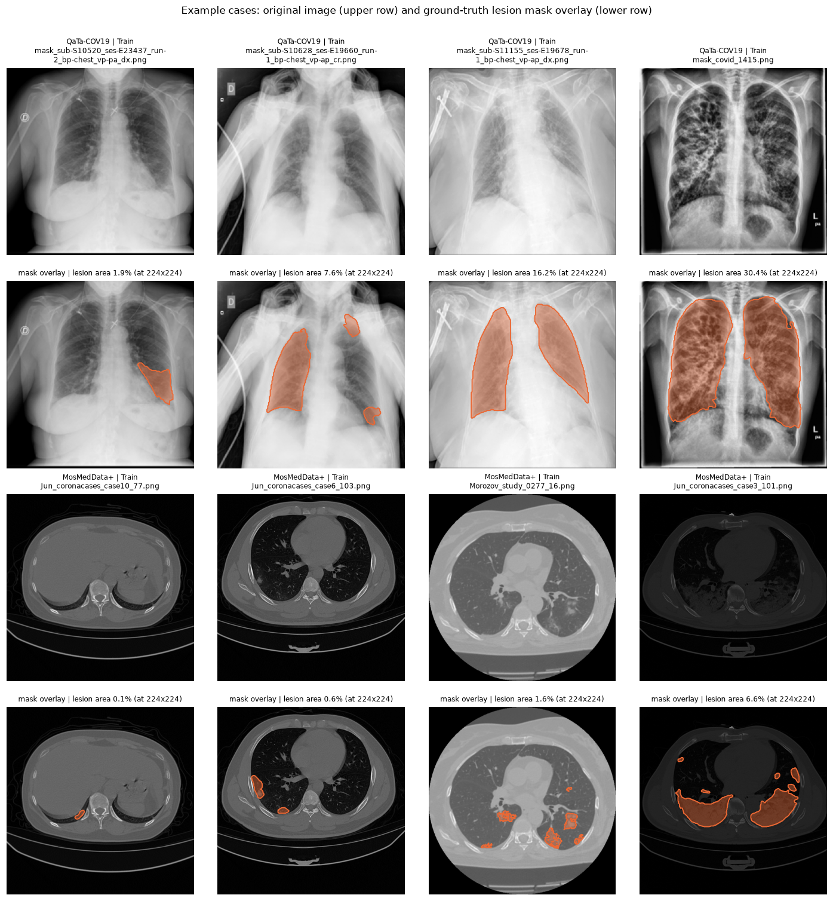

# Phase 0 — Data Summary (Task 0.1)

Both datasets use the **LViT benchmark split** unchanged. The split counts match the plan exactly.

| Dataset | Train | Validation | Test |
|---|---:|---:|---:|
| QaTa-COV19 | 5716 | 1429 | 2113 |
| MosMedData+ | 2183 | 273 | 273 |



*Four training cases per dataset, chosen deterministically (the non-empty masks at the 10th, 40th, 70th and
95th percentile of lesion area, so small and large lesions are both shown — not hand-picked). Upper row:
original image; lower row: ground-truth lesion mask overlaid in orange, with the lesion area after the
LViT 224×224 mask construction.*

## Sources

| Item | Source |
|---|---|
| Split lists (which file belongs to Train / Val / Test) | LViT Google Drive folder linked from the LViT README (https://drive.google.com/drive/folders/1BjkeVIYwiV4d94AMDZfBtIk_7MNIb2AH), LViT code at commit `ba90775ead37d6f445f65ce83d1a0be64157f76f` |
| QaTa-COV19 images and masks | Kaggle `aysendegerli/qatacov19-dataset` (https://www.kaggle.com/datasets/aysendegerli/qatacov19-dataset), subfolder `QaTa-COV19/QaTa-COV19-v2/` |
| MosMedData+ images and masks | Kaggle `maedemaftouni/covid19-ct-scan-lesion-segmentation-dataset` (https://www.kaggle.com/datasets/maedemaftouni/covid19-ct-scan-lesion-segmentation-dataset), subfolders `frames/` and `masks/` |

The LViT Google Drive folder contains only the seven split / text-annotation spreadsheets
(`Train_ID_for_Covid19.xlsx`, `Val_ID_for_Covid19.xlsx`, `Train_Val_text_for_Covid19.xlsx`,
`Test_text_for_Covid19.xlsx`, `Train_text_MosMedData.xlsx`, `Val_text_MosMedData.xlsx`,
`Test_text_MosMedData+.xlsx`), not the images; as stated in the LViT README, the images and masks come
from the original public datasets above.

## How the local copy was built

`src/prepare_lvit_datasets.py` copies every file listed in the LViT spreadsheets, unchanged, from the two
Kaggle archives into the folder layout used by LViT (`<Split>_Folder/img/`, `<Split>_Folder/labelcol/`,
`<Split>_Folder/<Split>_text.xlsx`) under `~/datasets/QaTa-COV19/` and `~/datasets/MosMedData+/`. No
split is created: a listed file that is missing from an archive stops the script.

- **QaTa-COV19**: LViT Train + Val (7145 images) = Kaggle v2 `Train Set` (7145 images); LViT Test (2113)
  = Kaggle v2 `Test Set` (2113). Every listed mask exists; no file of the v2 folders is left over.
  Mask names are `mask_<image name>`; the image name is obtained by removing the `mask_` prefix, as in
  LViT `Load_Dataset.py` (`ImageToImage2D.__getitem__`, the lines commented "Covid19").
- **MosMedData+**: all 2729 archive files are used (2183 + 273 + 273 = 2729); image and mask share the
  same filename. The MosMed text column is renamed `text` → `Description` in the per-folder sheets
  because LViT's `read_text()` reads `Description`.

## Image and mask format

All numbers are from `src/inspect_datasets.py` (`results/phase0_data_check.json`), checked on every file
of every split.

| | QaTa-COV19 | MosMedData+ |
|---|---|---|
| Modality | chest X-ray | chest CT (axial 2D slices) |
| Image channels | 1 (grayscale) | 3, but **all three channels identical** in every image (grayscale stored as RGB) |
| Image size | 224×224 for all 9258 images | 512×512 for all 2729 images |
| Image dtype | uint8 | uint8 |
| Mask channels | 1 | 3, identical channels |
| Mask values | {0, 255} | {0, 255}, plus 12 / 17 / 21 in 99 masks (see below) |
| Mask size = image size | yes, all | yes, all |
| Image ↔ mask pairing | one-to-one, no unpaired file | one-to-one, no unpaired file |
| Empty masks | 0 | 1 (Train, `bjorke_49.png`) |
| Mean lesion area at 224×224 (Train / Val / Test) | 12.2% / 11.9% / 11.9% | 1.7% / 1.3% / 1.8% |
| Median lesion area at 224×224 (Train / Val / Test) | 10.0% / 9.9% / 10.7% | 0.87% / 0.76% / 0.60% |

Notes:

- **MosMed non-binary mask values.** 99 masks (Train 79, Val 10, Test 10), all from the `bjorke_*`
  source, contain pixels with values 12, 17 or 21 (226,502 pixels in total). Every one of these pixels lies
  within 2 pixels of a 255-valued lesion pixel, i.e. they are anti-aliased lesion borders. The LViT target
  construction (resize, then `mask > 0 → 1`, `Load_Dataset.py` lines 177–180) counts them as lesion; Task
  0.2 follows that rule as required by the plan.
- **One empty MosMed mask** (`bjorke_49.png`, Train). It stays in the training set because the LViT split
  includes it; it does not affect evaluation (there are no empty masks in Val or Test).
- **QaTa is already at the benchmark resolution.** The Kaggle v2 images and masks are 224×224, so the LViT
  224×224 resize is the identity for QaTa; after binarisation (`> 0`) no QaTa mask is empty.
- **MosMed lesions are small.** The median lesion covers under 1% of the slice at 224×224 (in Val the
  smallest covers 0.01%), so boundary metrics (HD95, ASSD) and empty predictions will matter much more on
  MosMed than on QaTa.

## Observation about the benchmark split (not changed)

The LViT split is used as given, but two properties are worth knowing when reading the results:

- **MosMedData+ is split by slice, not by CT volume.** The 2729 slices come from 71 source volumes
  (filename prefix). Six prefixes appear in more than one split, four of them in both Train and Test —
  e.g. `Jun_coronacases_case8` has 57 / 24 / 135 slices in Train / Val / Test, and
  `Jun_radiopaedia_40_86625_0_case18` has 40 / 0 / 32. (`bjorke` is a pooled source whose filenames carry
  no volume id, so its 80 / 10 / 10 split cannot be checked.) Neighbouring slices of the same scan are
  similar, so MosMed test scores may be somewhat optimistic in absolute terms; this affects all three
  methods equally and therefore does not bias the comparison between them.
- **QaTa-COV19 test subjects are disjoint from training.** Of the 2130 subject ids that can be read from
  the filenames (`sub-S…`), none of the 474 test subjects appears in Train or Val. Train and Val share
  434 subjects (Val is carved out of the Kaggle training set).

## Reproduce

```bash
# 1. split lists (LViT Google Drive) -> ~/datasets/raw/lvit_split_lists/
gdown --folder https://drive.google.com/drive/folders/1BjkeVIYwiV4d94AMDZfBtIk_7MNIb2AH -O ~/datasets/raw/lvit_split_lists
# 2. public Kaggle archives -> ~/datasets/raw/
curl -L -o ~/datasets/raw/qatacov19-dataset.zip \
  https://www.kaggle.com/api/v1/datasets/download/aysendegerli/qatacov19-dataset
curl -L -o ~/datasets/raw/covid19-ct-scan-lesion-segmentation-dataset.zip \
  https://www.kaggle.com/api/v1/datasets/download/maedemaftouni/covid19-ct-scan-lesion-segmentation-dataset
# 3. LViT folder layout, then the format check and the example figure
python src/prepare_lvit_datasets.py --raw ~/datasets/raw --out ~/datasets
python src/inspect_datasets.py --data ~/datasets
```
