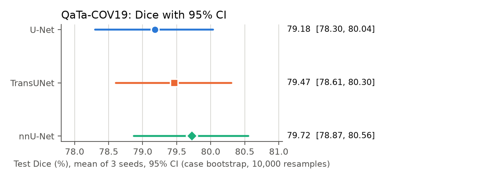
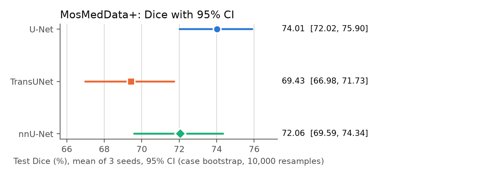
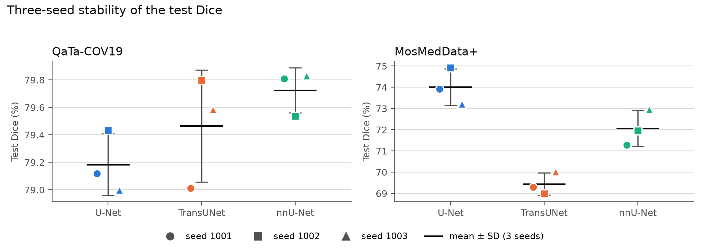
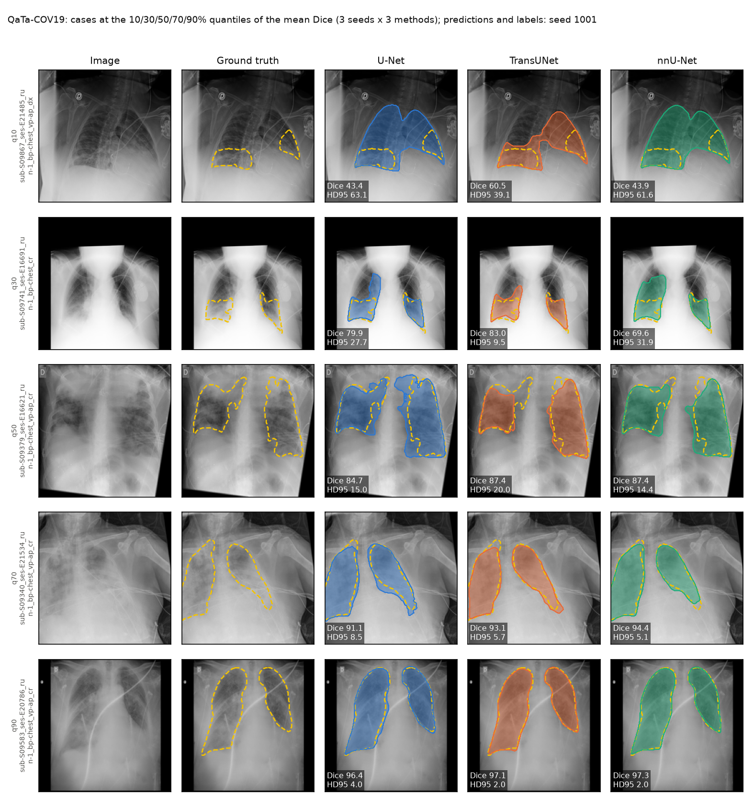
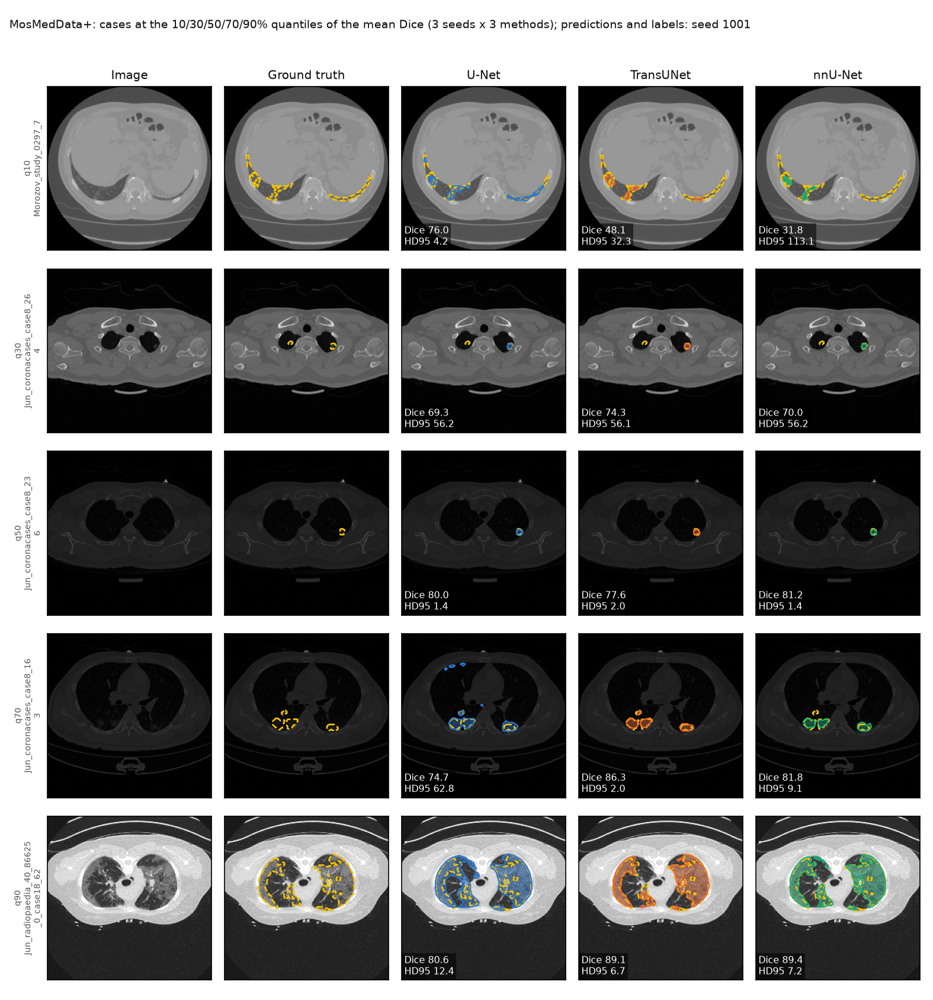

# Phase 0 — Summary for the supervisor

Image-only baselines (U-Net, TransUNet, nnU-Net 2d) on QaTa-COV19 and MosMedData+ (LViT split), seeds
1001 / 1002 / 1003. All numbers below are the final values of
[PHASE0_RESULTS.md](PHASE0_RESULTS.md), which also holds the full methods, all tables and the run
records. This summary adds no analysis.

## 1. Summary

1. **All 18 runs are complete** (3 methods × 2 datasets × 3 seeds), each scored by the same evaluator
   (224×224, probability > 0.5).
2. **QaTa-COV19: the three models are almost identical.** Mean test Dice 79.18–79.72; every pairwise
   difference is below 1 Dice point.
3. **MosMedData+: U-Net 74.01 > nnU-Net 72.06 > TransUNet 69.43**, and each of the three seeds gives this
   same order.
4. **Against LViT Table II, 5 of the 6 results are within 2 Dice points.** U-Net on MosMedData+ is 9.4
   points higher, in all three seeds; the cause is not confirmed.
5. **The statistical methods were fixed before the results were seen** (commit 6ed8aa7) and run once,
   unchanged. All results were re-computed independently from the per-case files with separate code
   (not `src/analyze_phase0.py`), and matched exactly.

## 2. Main results

Test set. Mean ± sample SD over the 3 seeds; 95% CI = case bootstrap of the seed-averaged per-case Dice.
Dice and mIoU in %, HD95 and ASSD in pixels.

| Dataset | Method | Dice | Dice 95% CI | mIoU | HD95 | ASSD |
|---|---|---|---|---:|---:|---:|
| QaTa-COV19 | U-Net | 79.18 ± 0.22 | [78.30, 80.04] | 69.73 ± 0.15 | 31.36 ± 0.70 | 9.95 ± 0.51 |
| QaTa-COV19 | TransUNet | 79.47 ± 0.41 | [78.61, 80.30] | 70.07 ± 0.64 | 29.81 ± 0.56 | 9.46 ± 0.76 |
| QaTa-COV19 | nnU-Net | 79.72 ± 0.16 | [78.87, 80.56] | 70.39 ± 0.17 | 29.23 ± 1.35 | 8.73 ± 0.79 |
| MosMedData+ | U-Net | 74.01 ± 0.86 | [72.02, 75.90] | 60.98 ± 0.84 | 23.02 ± 2.10 | 8.43 ± 1.46 |
| MosMedData+ | TransUNet | 69.43 ± 0.53 | [66.98, 71.73] | 56.32 ± 0.51 | 24.02 ± 0.62 | 10.91 ± 0.73 |
| MosMedData+ | nnU-Net | 72.06 ± 0.84 | [69.59, 74.34] | 59.61 ± 0.86 | 22.54 ± 2.96 | 8.90 ± 2.54 |

QaTa-COV19: the three mean Dice values lie within 0.54 points, and their 95% CIs overlap widely.

MosMedData+: U-Net is highest and TransUNet lowest, and their 95% CIs do not overlap ([72.02, 75.90] vs.
[66.98, 71.73]); nnU-Net lies between them.

The seeds of each method lie within 0.79 Dice points on QaTa-COV19 and within 1.70 points on MosMedData+;
on MosMedData+ every seed gives the order U-Net > nnU-Net > TransUNet, on QaTa-COV19 the order changes
from seed to seed.

## 3. Pairwise comparisons

Primary analysis: paired t-test on the seed-averaged per-case Dice, Holm correction across the 3
comparisons of each dataset, **two-sided 5% level**. ΔDice = Dice(A) − Dice(B) in Dice points.

| Dataset | A vs. B | ΔDice | 95% CI | Holm p |
|---|---|---:|---|---:|
| QaTa-COV19 | U-Net vs. TransUNet | −0.28 | [−0.66, +0.10] | 0.285 |
| QaTa-COV19 | U-Net vs. nnU-Net | −0.54 | [−0.97, −0.11] | **0.043** |
| QaTa-COV19 | TransUNet vs. nnU-Net | −0.26 | [−0.66, +0.15] | 0.285 |
| MosMedData+ | U-Net vs. TransUNet | +4.58 | [+3.33, +5.83] | **1.93e-11** |
| MosMedData+ | U-Net vs. nnU-Net | +1.95 | [+0.76, +3.14] | **0.001** |
| MosMedData+ | TransUNet vs. nnU-Net | −2.63 | [−3.71, −1.55] | **5.13e-06** |

The supplementary Wilcoxon signed-rank test (not used for the conclusions) disagrees with the primary
analysis on two pairs, whose result therefore depends on the choice of test:
- QaTa-COV19 TransUNet vs. nnU-Net: Wilcoxon Holm p = 3.07e-05 (significant), t-test Holm p = 0.285;
- MosMedData+ U-Net vs. nnU-Net: Wilcoxon Holm p = 0.079 (not significant), t-test Holm p = 0.001.

## 4. Real cases

Selection rule: each test case's Dice is averaged over the 3 seeds and the 3 methods, and the cases at
the 10/30/50/70/90% quantiles of this score are shown. The drawn predictions and the Dice / HD95 labels
are those of **seed 1001**. Ground truth: yellow dashed contour.

On QaTa-COV19, the three models are very close from q50 to q90 (Dice 84.7–97.3 for every model). At q10
all three draw far more than the annotation, U-Net and nnU-Net covering almost the whole lung field
(Dice 43.4 and 43.9; TransUNet 60.5). At q30 nnU-Net (69.6) is below U-Net (79.9) and TransUNet (83.0).

In the q10 and q30 rows, the drawn nnU-Net mask misses 2 and 1 pixels of the scored prediction (job 214,
section 6); the labels are the scored values.

On MosMedData+, at q10 U-Net (76.0) finds the lesions on both sides, while TransUNet (48.1) and nnU-Net
(31.8) find only part of them. At q70 U-Net adds small regions far from the lesions (HD95 62.8). Most
lesions in these cases are small.

## 5. Comparison with LViT (Table II)

LViT values are single numbers from the paper; ours are means over 3 seeds. Dice / mIoU in %.

| Dataset | Method | Ours Dice | LViT Dice | Δ | Ours mIoU | LViT mIoU | Δ |
|---|---|---:|---:|---:|---:|---:|---:|
| QaTa-COV19 | U-Net | 79.18 | 79.02 | +0.16 | 69.73 | 69.46 | +0.27 |
| QaTa-COV19 | TransUNet | 79.47 | 78.63 | +0.84 | 70.07 | 69.13 | +0.94 |
| QaTa-COV19 | nnU-Net | 79.72 | 80.42 | −0.70 | 70.39 | 70.81 | −0.42 |
| MosMedData+ | U-Net | 74.01 | 64.60 | +9.41 | 60.98 | 50.73 | +10.25 |
| MosMedData+ | TransUNet | 69.43 | 71.24 | −1.81 | 56.32 | 58.44 | −2.12 |
| MosMedData+ | nnU-Net | 72.06 | 72.59 | −0.53 | 59.61 | 60.36 | −0.75 |

**Confirmed facts**
- On QaTa-COV19 all three models are within 0.84 Dice points of the paper; on MosMedData+ TransUNet and
  nnU-Net are within 2 points.
- U-Net on MosMedData+ is above the paper in every seed (73.92 / 74.91 / 73.21; 8.61–10.31 points above
  64.60).
- Our scoring reproduces the LViT evaluation code exactly, and we use the same MosMedData+ data and split.
- The paper does not describe how its comparison models were trained, and the released LViT code has no
  MosMedData+ path.
- In the paper, U-Net is not the only comparison model that is low on MosMedData+ (Swin-Unet 63.29,
  UCTransNet 65.90, AttUNet 66.34).

**Not confirmed:** the cause of the U-Net MosMedData+ gap. The paper's setting for this model is not
published, so it cannot be compared with ours.

**Consequence for Phase 1:** the language-guided models will be compared with the baselines trained here
(same data, split, evaluator and seeds), not with the values copied from LViT Table II.

## 6. Issues found and how they were handled

- **LViT code and paper disagree on the training settings.** `Config.py` sets batch size 2 (its comment
  refers to LViT-T); the paper gives batch size 24 and learning rates 3e-4 (QaTa) / 1e-3 (MosMed). U-Net
  uses the paper's values. The released code has no MosMedData+ path.
- **MosMedData+ is split by slice, not by CT volume** (LViT split, used as given). Some volumes have
  slices in both Train and Test (e.g. `Jun_coronacases_case8`: 57 / 24 / 135 slices in Train / Val / Test).
  All three methods use the same split.
- **nnU-Net was trained in segments** because each cluster job is limited to 12 h (one run needs about
  23 h). Each segment resumes from nnU-Net's own checkpoint; at every first resume the epoch numbers,
  learning-rate schedule, training loss and snapshots were checked for continuity, and all passed.
- **GPU inference is not bit-identical between two runs.** A second prediction with the same checkpoint
  and settings (nnU-Net QaTa seed 1001) differed in 389 of 1217 cases, by at most 10 pixels; the lowest
  Dice between the two predictions is 0.9935. All scores come from the stored first evaluation
  (`per_case.csv`). In two case-figure panels the drawn mask, regenerated from the float16 probability
  archive, misses 1–2 scored pixels (section 4).

## 7. Limitations

- **MosMedData+ p-values may be too small and the CIs too narrow:** the tests treat every slice as an
  independent sample, but neighbouring slices of one CT volume are correlated.
- **MosMedData+ scores may be optimistic overall**, because of the slice-level split (slices of the same
  volume in Train and Test).
- **Segmented nnU-Net runs are not bit-reproducible:** the data-augmentation workers restart their random
  stream at each resume, so a segmented run is not identical to an uninterrupted run with the same seed.
- **U-Net uses the LViT paper's general settings** (batch 24, the paper's learning rates). The paper gives
  no separate settings for its U-Net comparison model; applying the general ones is our judgment.
