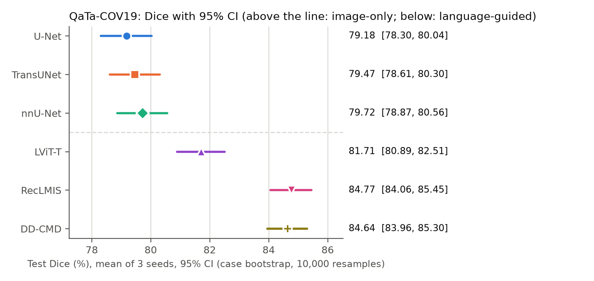
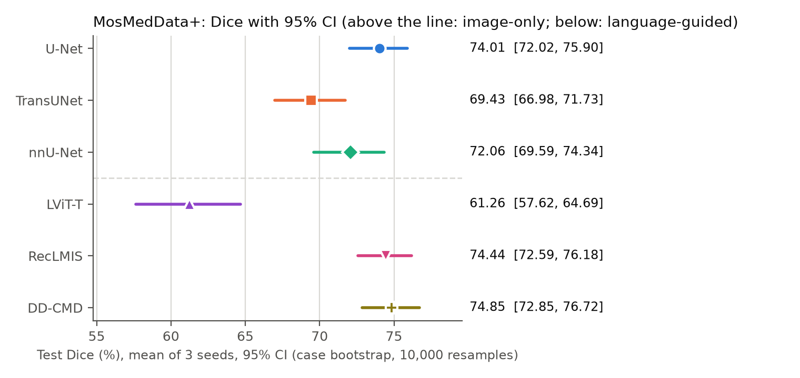
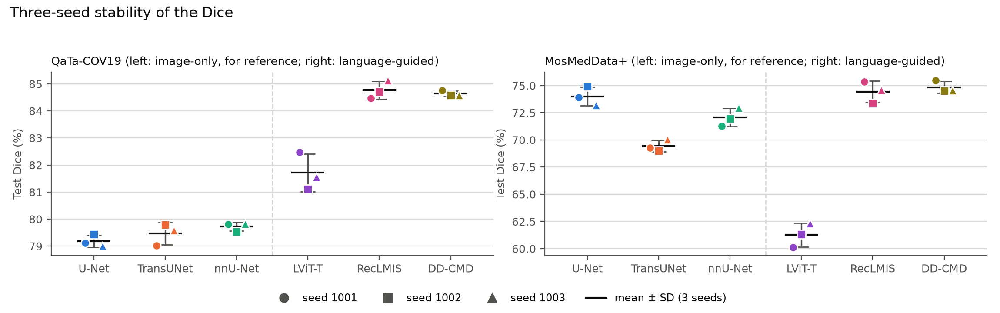
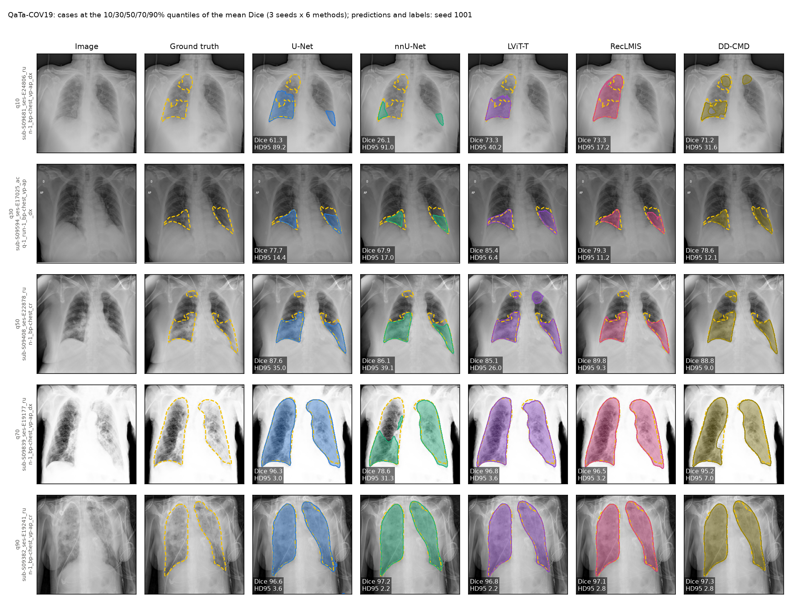
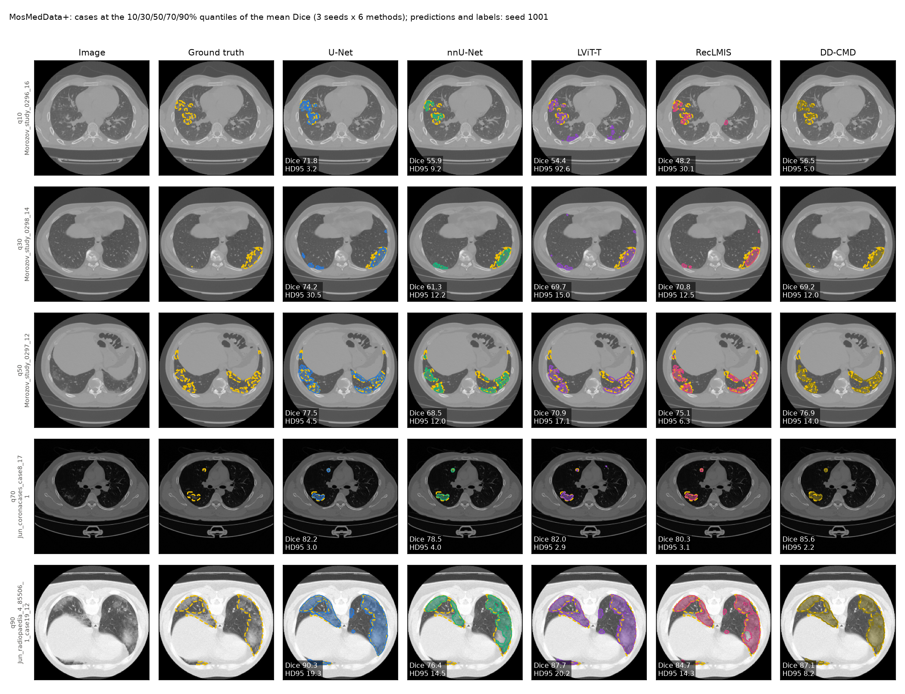

# Phase 1 — Results (Tasks 1.7–1.11)

> **Final (2026-10-26).** The conclusions were reviewed by the project lead. All results were re-computed
> from the per-case files (`runs/<method>/<dataset>/seed<k>/eval_test/per_case.csv`) with separate code,
> independent of `src/analyze_phase1.py`, and matched exactly. The tables and figures are outputs of the fixed
> analysis, except the RecLMIS published values in section 4, entered by hand. The hand-written text is the
> notes in sections 2 and 4 and sections 5–8. Main conclusions rest only on the paired t-test with Holm
> correction across the 15 pairs of a dataset (α = 0.05); the Wilcoxon test is supplementary. Comparing
> different architectures does not show that the text causes any difference; that is tested in Phase 2.

Generated by `src/analyze_phase1.py` (repository commit `b777d346f8da3c5d741894b8602c22347131ad6e`; analysis fixed in commit `ba53ba5c01d645fbf1b511b6df2f1b9c74a26309`) on 2026-10-26 02:54, split: `test`. The tables and figures are generated; the hand-written text (see the note above) was written after reviewing the results.

## Methods (fixed analysis plan)

This section is fixed together with `src/analyze_phase1.py`. Both are protected by the program lock
(`src/phase1/analysis_lock.py`): the test split becomes readable, and the analysis can be run on it, only
after both are committed and pushed and their sha256 are recorded. The plan is `reports/PHASE1_PLAN.md`,
Tasks 1.7–1.11.

- **Methods (6), in this fixed order:** U-Net, TransUNet, nnU-Net (image-only, Phase 0, unchanged) and
  LViT-T, RecLMIS, DD-CMD (language-guided, Phase 1). Each method has 3 seeds (1001, 1002, 1003). The
  checkpoint is selected on validation Dice only.
- **Common evaluation:** 224 × 224, binary threshold 0.5, the same test cases and the same target masks
  for every method (`src/evaluate.py`). Metrics: Dice, mIoU (%), HD95 and ASSD (pixels of the 224 × 224
  image). An empty prediction gets HD95 = ASSD = 316.78 px, the image diagonal.
- **Main tables** (`results/phase1_main_results.csv`: the 3 language-guided methods;
  `results/final_six_method_results.csv`: all 6, with "Text at Train / Test"):
  - Mean ± SD: the mean and the sample SD (ddof = 1) of the 3 per-seed test means, for every metric.
  - Dice 95% CI: case bootstrap of the seed-averaged per-case Dice. Each case's Dice is averaged over the
    3 seeds; the cases are resampled 10,000 times with numpy `default_rng(0)`, created anew for every
    dataset × method; the CI is the 2.5% / 97.5% percentile interval.
- **Pairwise comparisons** (`results/final_six_method_pairwise.csv`):
  - The 15 pairs of the 6 methods, within each dataset. Δ = A − B, where A comes earlier in the fixed
    order above.
  - Steps:
    1. Average every test case over the 3 seeds within each method.
    2. Align the cases by sample id.
    3. Compute the per-case paired differences d.
  - **Dice (primary):**
    - ΔDice = mean(d), in Dice points.
    - 95% CI = mean(d) ± t(0.975, n − 1) · SD(d) / √n.
    - Two-sided paired t-test.
    - **Holm correction across the 15 comparisons of the dataset.**
    - **Significance level: two-sided α = 0.05 after Holm, fixed before any Phase 1 test result
      existed.**
  - **Supplementary sensitivity analysis, specified in advance:** two-sided Wilcoxon signed-rank test on
    the same differences, with its own Holm correction across the same 15 comparisons. It is not used for
    the main conclusions.
  - **mIoU, HD95 and ASSD:** paired mean difference with the same t-based 95% CI, and no p-values. Because
    HD95 and ASSD are heavy-tailed, a case-bootstrap percentile CI of the mean difference (10,000
    resamples, `default_rng(0)`) is reported next to the t-CI.
  - Significance is never tested on the three seed means alone.
- **Limitation:** the case bootstrap and the paired tests treat every image as an independent sample.
  Neighbouring MosMedData+ slices of one CT volume are correlated, so the MosMed CIs may be too narrow and
  the p-values too small.
- **Causality:** comparing different architectures cannot show that the text itself causes a difference.
  Text dependence within one frozen model is tested in Phase 2.
- **Figures** (`reports/figures/`):
  - `phase1_dice_ci_<dataset>.png`: mean Dice with its 95% CI, 6 methods (required figures 1 and 2).
  - `phase1_seed_stability.png`: the 3 per-seed test Dice values with mean ± SD, for the 3
    language-guided methods, with the 3 image-only methods for reference (required figure 3).
  - `phase1_cases_<dataset>.png`: real cases, selected by rule.
    - Selection score of a case = its Dice averaged over the 3 seeds and the 6 methods.
    - Cases are sorted by this score (ascending; ties broken by sample id).
    - The cases at the 10/30/50/70/90% quantiles are shown (position round(q × (n − 1))).
    - Each row shows: image, ground truth (yellow dashed contour), and the seed-1001 prediction of U-Net,
      nnU-Net, LViT-T, RecLMIS and DD-CMD. Every panel is labelled with that method's seed-1001 Dice and
      HD95 for the case.

## 1. Six-method results (Tasks 1.8 and 1.9)

Test set, 224×224 common evaluation. Mean ± sample SD over the 3 seeds of the per-seed means. Dice and mIoU in %, HD95 and ASSD in pixels. The Dice 95% CI is the case bootstrap of the seed-averaged per-case Dice.

| Dataset | Method | Text at Train | Text at Test | Dice Mean ± SD | Dice 95% CI | mIoU | HD95 | ASSD |
|---|---|---|---|---|---|---:|---:|---:|
| QaTa-COV19 | U-Net | No | No | 79.18 ± 0.22 | [78.30, 80.04] | 69.73 ± 0.15 | 31.36 ± 0.70 | 9.95 ± 0.51 |
| QaTa-COV19 | TransUNet | No | No | 79.47 ± 0.41 | [78.61, 80.30] | 70.07 ± 0.64 | 29.81 ± 0.56 | 9.46 ± 0.76 |
| QaTa-COV19 | nnU-Net | No | No | 79.72 ± 0.16 | [78.87, 80.56] | 70.39 ± 0.17 | 29.23 ± 1.35 | 8.73 ± 0.79 |
| QaTa-COV19 | LViT-T | Yes | Yes | 81.71 ± 0.69 | [80.89, 82.51] | 72.90 ± 0.79 | 20.96 ± 1.48 | 8.61 ± 1.24 |
| QaTa-COV19 | RecLMIS | Yes | Yes | 84.77 ± 0.33 | [84.06, 85.45] | 76.46 ± 0.42 | 13.96 ± 0.65 | 4.31 ± 0.38 |
| QaTa-COV19 | DD-CMD | Yes | Yes | 84.64 ± 0.10 | [83.96, 85.30] | 76.16 ± 0.10 | 13.73 ± 0.30 | 3.99 ± 0.27 |
| MosMedData+ | U-Net | No | No | 74.01 ± 0.86 | [72.02, 75.90] | 60.98 ± 0.84 | 23.02 ± 2.10 | 8.43 ± 1.46 |
| MosMedData+ | TransUNet | No | No | 69.43 ± 0.53 | [66.98, 71.73] | 56.32 ± 0.51 | 24.02 ± 0.62 | 10.91 ± 0.73 |
| MosMedData+ | nnU-Net | No | No | 72.06 ± 0.84 | [69.59, 74.34] | 59.61 ± 0.86 | 22.54 ± 2.96 | 8.90 ± 2.54 |
| MosMedData+ | LViT-T | Yes | Yes | 61.26 ± 1.10 | [57.62, 64.69] | 49.91 ± 1.24 | 62.04 ± 3.60 | 50.29 ± 2.01 |
| MosMedData+ | RecLMIS | Yes | Yes | 74.44 ± 1.00 | [72.59, 76.18] | 61.35 ± 0.96 | 16.01 ± 1.79 | 3.79 ± 0.58 |
| MosMedData+ | DD-CMD | Yes | Yes | 74.85 ± 0.53 | [72.85, 76.72] | 62.12 ± 0.59 | 16.86 ± 0.50 | 5.46 ± 0.83 |

Per-seed Dice (%):

| Dataset | Method | seed 1001 | seed 1002 | seed 1003 |
|---|---|---:|---:|---:|
| QaTa-COV19 | U-Net | 79.12 | 79.43 | 79.00 |
| QaTa-COV19 | TransUNet | 79.01 | 79.80 | 79.59 |
| QaTa-COV19 | nnU-Net | 79.81 | 79.54 | 79.83 |
| QaTa-COV19 | LViT-T | 82.47 | 81.11 | 81.55 |
| QaTa-COV19 | RecLMIS | 84.47 | 84.71 | 85.12 |
| QaTa-COV19 | DD-CMD | 84.76 | 84.58 | 84.58 |
| MosMedData+ | U-Net | 73.92 | 74.91 | 73.21 |
| MosMedData+ | TransUNet | 69.29 | 68.99 | 70.02 |
| MosMedData+ | nnU-Net | 71.28 | 71.96 | 72.95 |
| MosMedData+ | LViT-T | 60.13 | 61.32 | 62.33 |
| MosMedData+ | RecLMIS | 75.35 | 73.37 | 74.61 |
| MosMedData+ | DD-CMD | 75.47 | 74.53 | 74.56 |

## 2. Pairwise comparisons, Dice (Task 1.10)

ΔDice = Dice(A) − Dice(B) in Dice points; paired t-test on the seed-averaged per-case Dice; Holm across the 15 comparisons of each dataset; significant = Holm p < 0.05 (fixed in advance).

| Dataset | Method A | Method B | ΔDice | 95% CI | Raw p | Holm p | Significant |
|---|---|---|---:|---|---:|---:|---|
| QaTa-COV19 | U-Net | TransUNet | -0.28 | [-0.66, +0.10] | 0.143 | 0.428 | no |
| QaTa-COV19 | U-Net | nnU-Net | -0.54 | [-0.97, -0.11] | 0.014 | 0.057 | no |
| QaTa-COV19 | U-Net | LViT-T | -2.53 | [-3.03, -2.03] | 1.62e-22 | 1.13e-21 | yes |
| QaTa-COV19 | U-Net | RecLMIS | -5.59 | [-6.09, -5.08] | 7.58e-96 | 1.06e-94 | yes |
| QaTa-COV19 | U-Net | DD-CMD | -5.46 | [-5.95, -4.96] | 9.81e-94 | 1.28e-92 | yes |
| QaTa-COV19 | TransUNet | nnU-Net | -0.26 | [-0.66, +0.15] | 0.210 | 0.428 | no |
| QaTa-COV19 | TransUNet | LViT-T | -2.25 | [-2.77, -1.73] | 3.85e-17 | 2.31e-16 | yes |
| QaTa-COV19 | TransUNet | RecLMIS | -5.30 | [-5.79, -4.82] | 9.36e-92 | 1.12e-90 | yes |
| QaTa-COV19 | TransUNet | DD-CMD | -5.17 | [-5.64, -4.71] | 1.55e-96 | 2.33e-95 | yes |
| QaTa-COV19 | nnU-Net | LViT-T | -1.99 | [-2.52, -1.46] | 3.16e-13 | 1.58e-12 | yes |
| QaTa-COV19 | nnU-Net | RecLMIS | -5.04 | [-5.55, -4.54] | 1.45e-77 | 1.45e-76 | yes |
| QaTa-COV19 | nnU-Net | DD-CMD | -4.92 | [-5.39, -4.44] | 6.68e-83 | 7.35e-82 | yes |
| QaTa-COV19 | LViT-T | RecLMIS | -3.06 | [-3.42, -2.69] | 1.22e-56 | 1.10e-55 | yes |
| QaTa-COV19 | LViT-T | DD-CMD | -2.93 | [-3.31, -2.54] | 2.38e-47 | 1.91e-46 | yes |
| QaTa-COV19 | RecLMIS | DD-CMD | +0.13 | [-0.13, +0.38] | 0.325 | 0.428 | no |
| MosMedData+ | U-Net | TransUNet | +4.58 | [+3.33, +5.83] | 6.43e-12 | 7.07e-11 | yes |
| MosMedData+ | U-Net | nnU-Net | +1.95 | [+0.76, +3.14] | 0.001 | 0.006 | yes |
| MosMedData+ | U-Net | LViT-T | +12.75 | [+9.40, +16.11] | 9.75e-13 | 1.17e-11 | yes |
| MosMedData+ | U-Net | RecLMIS | -0.43 | [-1.60, +0.74] | 0.470 | 0.637 | no |
| MosMedData+ | U-Net | DD-CMD | -0.84 | [-2.04, +0.37] | 0.172 | 0.517 | no |
| MosMedData+ | TransUNet | nnU-Net | -2.63 | [-3.71, -1.55] | 2.56e-06 | 1.79e-05 | yes |
| MosMedData+ | TransUNet | LViT-T | +8.17 | [+4.47, +11.88] | 2.00e-05 | 1.20e-04 | yes |
| MosMedData+ | TransUNet | RecLMIS | -5.01 | [-6.45, -3.56] | 5.65e-11 | 5.65e-10 | yes |
| MosMedData+ | TransUNet | DD-CMD | -5.42 | [-6.74, -4.10] | 2.39e-14 | 3.59e-13 | yes |
| MosMedData+ | nnU-Net | LViT-T | +10.80 | [+7.21, +14.40] | 9.72e-09 | 8.75e-08 | yes |
| MosMedData+ | nnU-Net | RecLMIS | -2.38 | [-3.59, -1.17] | 1.32e-04 | 6.58e-04 | yes |
| MosMedData+ | nnU-Net | DD-CMD | -2.79 | [-3.85, -1.73] | 4.36e-07 | 3.49e-06 | yes |
| MosMedData+ | LViT-T | RecLMIS | -13.18 | [-16.61, -9.75] | 6.18e-13 | 8.03e-12 | yes |
| MosMedData+ | LViT-T | DD-CMD | -13.59 | [-17.03, -10.16] | 1.40e-13 | 1.96e-12 | yes |
| MosMedData+ | RecLMIS | DD-CMD | -0.41 | [-1.22, +0.40] | 0.318 | 0.637 | no |

Supplementary sensitivity analysis (specified in advance, **not used for the main conclusions**): Wilcoxon signed-rank test with its own Holm correction across the 15 comparisons.

Pairs in which the Wilcoxon test and the main analysis (paired t-test, Holm) disagree at α = 0.05 (values from
the tables in this section; the main analysis decides):

| Dataset | Method A | Method B | t-test Holm p | Significant (main) | Wilcoxon Holm p | Significant (Wilcoxon) |
|---|---|---|---:|---|---:|---|
| QaTa-COV19 | U-Net | nnU-Net | 0.057 | no | 9.08e-06 | yes |
| QaTa-COV19 | TransUNet | nnU-Net | 0.428 | no | 4.61e-05 | yes |
| QaTa-COV19 | RecLMIS | DD-CMD | 0.428 | no | 5.28e-04 | yes |
| MosMedData+ | U-Net | nnU-Net | 0.006 | yes | 0.376 | no |
| MosMedData+ | TransUNet | LViT-T | 1.20e-04 | yes | 1.000 | no |
| MosMedData+ | nnU-Net | RecLMIS | 6.58e-04 | yes | 0.376 | no |
| MosMedData+ | RecLMIS | DD-CMD | 0.637 | no | 0.003 | yes |

The two tests answer different questions (the t-test the mean difference, the Wilcoxon test a shift of the
distribution of the differences), so they can disagree when the differences are skewed.

All Wilcoxon results:

| Dataset | Method A | Method B | Wilcoxon raw p | Wilcoxon Holm p |
|---|---|---|---:|---:|
| QaTa-COV19 | U-Net | TransUNet | 0.158 | 0.158 |
| QaTa-COV19 | U-Net | nnU-Net | 1.82e-06 | 9.08e-06 |
| QaTa-COV19 | U-Net | LViT-T | 2.07e-25 | 1.45e-24 |
| QaTa-COV19 | U-Net | RecLMIS | 2.59e-156 | 3.89e-155 |
| QaTa-COV19 | U-Net | DD-CMD | 5.77e-127 | 7.50e-126 |
| QaTa-COV19 | TransUNet | nnU-Net | 1.54e-05 | 4.61e-05 |
| QaTa-COV19 | TransUNet | LViT-T | 3.41e-17 | 2.05e-16 |
| QaTa-COV19 | TransUNet | RecLMIS | 3.17e-136 | 4.44e-135 |
| QaTa-COV19 | TransUNet | DD-CMD | 4.44e-126 | 5.33e-125 |
| QaTa-COV19 | nnU-Net | LViT-T | 5.64e-06 | 2.26e-05 |
| QaTa-COV19 | nnU-Net | RecLMIS | 1.14e-81 | 1.02e-80 |
| QaTa-COV19 | nnU-Net | DD-CMD | 1.89e-75 | 1.51e-74 |
| QaTa-COV19 | LViT-T | RecLMIS | 5.12e-122 | 5.63e-121 |
| QaTa-COV19 | LViT-T | DD-CMD | 6.02e-83 | 6.02e-82 |
| QaTa-COV19 | RecLMIS | DD-CMD | 2.64e-04 | 5.28e-04 |
| MosMedData+ | U-Net | TransUNet | 3.86e-12 | 5.01e-11 |
| MosMedData+ | U-Net | nnU-Net | 0.079 | 0.376 |
| MosMedData+ | U-Net | LViT-T | 1.93e-12 | 2.70e-11 |
| MosMedData+ | U-Net | RecLMIS | 0.764 | 1.000 |
| MosMedData+ | U-Net | DD-CMD | 0.169 | 0.508 |
| MosMedData+ | TransUNet | nnU-Net | 5.92e-10 | 5.92e-09 |
| MosMedData+ | TransUNet | LViT-T | 0.925 | 1.000 |
| MosMedData+ | TransUNet | RecLMIS | 9.27e-12 | 1.02e-10 |
| MosMedData+ | TransUNet | DD-CMD | 4.66e-23 | 6.99e-22 |
| MosMedData+ | nnU-Net | LViT-T | 6.95e-04 | 0.004 |
| MosMedData+ | nnU-Net | RecLMIS | 0.075 | 0.376 |
| MosMedData+ | nnU-Net | DD-CMD | 5.65e-05 | 4.52e-04 |
| MosMedData+ | LViT-T | RecLMIS | 1.47e-07 | 1.32e-06 |
| MosMedData+ | LViT-T | DD-CMD | 5.01e-12 | 6.01e-11 |
| MosMedData+ | RecLMIS | DD-CMD | 4.09e-04 | 0.003 |

## 3. Pairwise differences, mIoU / HD95 / ASSD

Mean paired difference A − B with the t-based 95% CI and the case-bootstrap 95% CI (no p-values). mIoU in points (%), HD95 / ASSD in pixels (lower is better).

| Dataset | Method A | Method B | ΔmIoU [t-CI] | ΔHD95 [t-CI] [bootstrap CI] | ΔASSD [t-CI] [bootstrap CI] |
|---|---|---|---|---|---|
| QaTa-COV19 | U-Net | TransUNet | -0.34 [-0.74, +0.06] | +1.55 [+0.46, +2.63] [+0.44, +2.63] | +0.49 [-0.33, +1.30] [-0.33, +1.30] |
| QaTa-COV19 | U-Net | nnU-Net | -0.67 [-1.14, -0.19] | +2.13 [+1.00, +3.25] [+1.00, +3.28] | +1.21 [+0.40, +2.03] [+0.40, +2.03] |
| QaTa-COV19 | U-Net | LViT-T | -3.17 [-3.69, -2.65] | +10.40 [+8.96, +11.83] [+8.96, +11.82] | +1.34 [+0.23, +2.46] [+0.21, +2.44] |
| QaTa-COV19 | U-Net | RecLMIS | -6.74 [-7.26, -6.22] | +17.40 [+15.96, +18.83] [+16.00, +18.83] | +5.64 [+4.66, +6.62] [+4.69, +6.64] |
| QaTa-COV19 | U-Net | DD-CMD | -6.44 [-6.97, -5.91] | +17.63 [+16.19, +19.07] [+16.21, +19.06] | +5.96 [+5.01, +6.90] [+5.04, +6.93] |
| QaTa-COV19 | TransUNet | nnU-Net | -0.33 [-0.78, +0.13] | +0.58 [-0.44, +1.60] [-0.45, +1.60] | +0.72 [-0.03, +1.48] [-0.02, +1.49] |
| QaTa-COV19 | TransUNet | LViT-T | -2.83 [-3.37, -2.30] | +8.85 [+7.41, +10.29] [+7.41, +10.28] | +0.85 [-0.25, +1.96] [-0.26, +1.95] |
| QaTa-COV19 | TransUNet | RecLMIS | -6.40 [-6.92, -5.88] | +15.85 [+14.50, +17.20] [+14.57, +17.22] | +5.15 [+4.27, +6.03] [+4.31, +6.05] |
| QaTa-COV19 | TransUNet | DD-CMD | -6.10 [-6.60, -5.60] | +16.08 [+14.70, +17.47] [+14.74, +17.46] | +5.47 [+4.54, +6.39] [+4.59, +6.41] |
| QaTa-COV19 | nnU-Net | LViT-T | -2.51 [-3.08, -1.93] | +8.27 [+6.82, +9.72] [+6.81, +9.73] | +0.13 [-0.98, +1.24] [-0.99, +1.24] |
| QaTa-COV19 | nnU-Net | RecLMIS | -6.07 [-6.63, -5.51] | +15.27 [+13.95, +16.59] [+13.99, +16.57] | +4.42 [+3.68, +5.16] [+3.71, +5.18] |
| QaTa-COV19 | nnU-Net | DD-CMD | -5.77 [-6.31, -5.23] | +15.50 [+14.22, +16.78] [+14.25, +16.76] | +4.74 [+4.05, +5.43] [+4.09, +5.44] |
| QaTa-COV19 | LViT-T | RecLMIS | -3.57 [-3.93, -3.20] | +7.00 [+5.87, +8.14] [+5.88, +8.16] | +4.29 [+3.23, +5.35] [+3.27, +5.39] |
| QaTa-COV19 | LViT-T | DD-CMD | -3.27 [-3.65, -2.88] | +7.23 [+6.07, +8.39] [+6.10, +8.41] | +4.61 [+3.53, +5.70] [+3.57, +5.72] |
| QaTa-COV19 | RecLMIS | DD-CMD | +0.30 [+0.01, +0.59] | +0.23 [-0.36, +0.82] [-0.36, +0.83] | +0.32 [-0.12, +0.76] [-0.12, +0.77] |
| MosMedData+ | U-Net | TransUNet | +4.67 [+3.32, +6.01] | -1.00 [-4.46, +2.46] [-4.75, +2.30] | -2.47 [-5.37, +0.42] [-5.71, +0.16] |
| MosMedData+ | U-Net | nnU-Net | +1.37 [+0.08, +2.66] | +0.49 [-2.53, +3.50] [-2.60, +3.40] | -0.46 [-2.49, +1.56] [-2.64, +1.43] |
| MosMedData+ | U-Net | LViT-T | +11.07 [+8.20, +13.95] | -39.02 [-51.51, -26.53] [-52.05, -27.17] | -41.85 [-54.88, -28.82] [-55.46, -29.56] |
| MosMedData+ | U-Net | RecLMIS | -0.36 [-1.53, +0.80] | +7.01 [+3.35, +10.67] [+3.72, +10.95] | +4.65 [+1.13, +8.16] [+1.61, +8.55] |
| MosMedData+ | U-Net | DD-CMD | -1.14 [-2.42, +0.14] | +6.17 [+3.29, +9.05] [+3.48, +9.16] | +2.97 [+0.66, +5.28] [+1.00, +5.52] |
| MosMedData+ | TransUNet | nnU-Net | -3.30 [-4.38, -2.21] | +1.48 [-1.64, +4.61] [-1.42, +4.84] | +2.01 [-0.59, +4.61] [-0.29, +4.92] |
| MosMedData+ | TransUNet | LViT-T | +6.41 [+3.17, +9.64] | -38.02 [-51.30, -24.74] [-51.88, -25.33] | -39.38 [-52.94, -25.82] [-53.46, -26.42] |
| MosMedData+ | TransUNet | RecLMIS | -5.03 [-6.40, -3.65] | +8.01 [+3.13, +12.89] [+3.55, +13.41] | +7.12 [+2.37, +11.87] [+2.90, +12.47] |
| MosMedData+ | TransUNet | DD-CMD | -5.80 [-7.02, -4.58] | +7.17 [+2.81, +11.52] [+3.19, +11.88] | +5.44 [+1.25, +9.64] [+1.66, +10.08] |
| MosMedData+ | nnU-Net | LViT-T | +9.70 [+6.57, +12.83] | -39.50 [-52.37, -26.63] [-52.84, -27.26] | -41.39 [-54.65, -28.13] [-55.20, -28.70] |
| MosMedData+ | nnU-Net | RecLMIS | -1.73 [-2.92, -0.55] | +6.53 [+2.41, +10.64] [+2.74, +11.00] | +5.11 [+1.36, +8.86] [+1.88, +9.25] |
| MosMedData+ | nnU-Net | DD-CMD | -2.51 [-3.54, -1.48] | +5.68 [+2.30, +9.07] [+2.54, +9.30] | +3.43 [+0.45, +6.42] [+0.84, +6.74] |
| MosMedData+ | LViT-T | RecLMIS | -11.44 [-14.40, -8.47] | +46.03 [+33.26, +58.80] [+33.90, +59.45] | +46.50 [+33.44, +59.56] [+34.05, +60.28] |
| MosMedData+ | LViT-T | DD-CMD | -12.21 [-15.19, -9.23] | +45.18 [+32.59, +57.77] [+33.22, +58.44] | +44.82 [+32.01, +57.63] [+32.69, +58.47] |
| MosMedData+ | RecLMIS | DD-CMD | -0.77 [-1.59, +0.04] | -0.84 [-3.84, +2.15] [-4.20, +1.72] | -1.68 [-4.40, +1.05] [-4.83, +0.38] |

## 4. Published reference values (Dice / mIoU, %)

Each paper's own setting and metric definition; for orientation only, never used for any selection.

| Dataset | Method | Ours Dice | Ours mIoU | Published |
|---|---|---:|---:|---|
| QaTa-COV19 | LViT-T | 81.71 | 72.90 | 83.66 / 75.11 (LViT README / paper Table II) |
| QaTa-COV19 | RecLMIS | 84.77 | 76.46 | 85.22 / 77.00 (RecLMIS paper, arXiv 2404.02845, Table I) |
| QaTa-COV19 | DD-CMD | 84.64 | 76.16 | 91.46 / 84.26 (DD-CMD paper, arXiv 2608.11335; pixel-pooled Dice) |
| MosMedData+ | LViT-T | 61.26 | 49.91 | 74.57 / 61.33 (LViT README / paper Table II) |
| MosMedData+ | RecLMIS | 74.44 | 61.35 | 77.48 / 65.07 (RecLMIS paper, arXiv 2404.02845, Table I) |
| MosMedData+ | DD-CMD | 74.85 | 62.12 | 81.95 / 69.42 (DD-CMD paper, arXiv 2608.11335; pixel-pooled Dice) |

The RecLMIS values were entered by hand after the analysis run (the generated table had a placeholder). The RecLMIS paper does not state whether they come from a single run or from several runs, and its metric definitions have not been checked against ours.

## 5. Figures

On QaTa-COV19 the 95% CIs of RecLMIS ([84.06, 85.45]) and DD-CMD ([83.96, 85.30]) overlap each other and lie above that of LViT-T ([80.89, 82.51]), which in turn lies above the three image-only methods (upper CI bounds 80.04–80.56).

On MosMedData+ the CIs of U-Net ([72.02, 75.90]), RecLMIS ([72.59, 76.18]) and DD-CMD ([72.85, 76.72]) overlap; LViT-T ([57.62, 64.69]) lies below every other method.

LViT-T has the widest spread of the three per-seed Dice values on both datasets (QaTa-COV19 81.11–82.47, MosMedData+ 60.13–62.33); DD-CMD has the narrowest among the language-guided methods (84.58–84.76 and 74.53–75.47). Three seeds give only a rough estimate of the SD.

In the QaTa-COV19 cases the methods differ most on the harder cases: at q10 nnU-Net reaches Dice 26.1 (HD95 91.0) while LViT-T and RecLMIS reach 73.3 (HD95 40.2 and 17.2), and at q70 nnU-Net covers only part of one lung region (Dice 78.6, HD95 31.3) while the other four reach 95.2–96.8; at q90 all five reach 96.6–97.3.

Case selection rule: Dice averaged over the 3 seeds and the 6 methods; the cases at the 10/30/50/70/90% quantiles are shown (q10 = `sub-S09681_ses-E24806_run-1_bp-chest_vp-ap_dx` (58.3), q30 = `sub-S09594_ses-E17025_acq-1_run-1_bp-chest_vp-ap_dx` (78.2), q50 = `sub-S09408_ses-E22878_run-1_bp-chest_cr` (87.4), q70 = `sub-S09839_ses-E19177_run-1_bp-chest_vp-ap_dx` (93.2), q90 = `sub-S09382_ses-E19241_run-1_bp-chest_vp-ap_cr` (96.9)). **The drawn predictions and the Dice / HD95 in every panel are those of seed 1001.** The ground truth is the yellow dashed contour.

In the MosMedData+ cases no method is best in every row: at q10 U-Net has the highest Dice (71.8, HD95 3.2) and LViT-T predicts additional regions away from the lesion (HD95 92.6), while at q70 DD-CMD has the highest Dice (85.6, HD95 2.2).

Case selection rule: Dice averaged over the 3 seeds and the 6 methods; the cases at the 10/30/50/70/90% quantiles are shown (q10 = `Morozov_study_0296_16` (55.4), q30 = `Morozov_study_0298_14` (67.4), q50 = `Morozov_study_0297_12` (74.2), q70 = `Jun_coronacases_case8_171` (81.0), q90 = `Jun_radiopaedia_4_85506_1_case19_12` (86.0)). **The drawn predictions and the Dice / HD95 in every panel are those of seed 1001.** The ground truth is the yellow dashed contour.

## 6. Non-finite losses and end of training, per run

Rule (fixed 2026-10-19, `PHASE1_MODEL_SETUP.md` section 3.4): a NaN or infinite loss ends training before that
step is applied, and the best validation checkpoint is evaluated. How each run was checked:
- **RecLMIS:** the driver checks every loss term at every step (`non_finite_steps` in
  `training_summary.json`), and counts the steps in which the official code would silently replace a NaN
  reconstruction loss by 0 (`rec_loss_zero_steps`).
- **LViT-T and DD-CMD:** no per-step check in the driver. Checked afterwards: the training loss of every
  epoch (the mean over all steps, so a single non-finite step would make it non-finite) and the validation
  Dice of every epoch in `epochs.csv`, and for DD-CMD also every value in the Lightning `metrics.csv` (logged
  every 10 steps). No non-finite value was found.

Test empty predictions = number of the test cases (QaTa-COV19 2113, MosMedData+ 273) with an empty predicted
mask (`eval_test/summary.json`).

| Method | Dataset | Seed | Training ended by | Last epoch | Best epoch (val. Dice) | Non-finite loss events | Official NaN → 0 replacements | Segments | Test empty predictions |
|---|---|---|---|---:|---|---|---:|---:|---:|
| LViT-T | QaTa-COV19 | 1001 | early stopping | 161 | 110 (0.810) | 0 | – | 1 | 16 |
| LViT-T | QaTa-COV19 | 1002 | early stopping | 162 | 111 (0.797) | 0 | – | 2 | 29 |
| LViT-T | QaTa-COV19 | 1003 | early stopping | 137 | 86 (0.806) | 0 | – | 1 | 31 |
| LViT-T | MosMedData+ | 1001 | early stopping | 88 | 37 (0.642) | 0 | – | 1 | 40 |
| LViT-T | MosMedData+ | 1002 | early stopping | 105 | 54 (0.662) | 0 | – | 1 | 41 |
| LViT-T | MosMedData+ | 1003 | early stopping | 208 | 157 (0.667) | 0 | – | 1 | 38 |
| RecLMIS | QaTa-COV19 | 1001 | **non-finite loss rule** | 151 | 129 (0.831) | **1**: epoch 152, step 136, `loss_ccl` = NaN; recurred at the same step after resuming from epoch 151 | 0 | 2 | 7 |
| RecLMIS | QaTa-COV19 | 1002 | early stopping | 169 | 68 (0.831) | 0 (30,251 steps) | 0 | 1 | 3 |
| RecLMIS | QaTa-COV19 | 1003 | early stopping | 181 | 80 (0.832) | 0 (32,399 steps) | 0 | 1 | 3 |
| RecLMIS | MosMedData+ | 1001 | early stopping | 86 | 55 (0.723) | 0 (9,460 steps) | 0 | 1 | 0 |
| RecLMIS | MosMedData+ | 1002 | early stopping | 84 | 53 (0.710) | 0 (9,240 steps) | 0 | 1 | 0 |
| RecLMIS | MosMedData+ | 1003 | early stopping | 62 | 31 (0.708) | 0 (6,820 steps) | 0 | 1 | 0 |
| DD-CMD | QaTa-COV19 | 1001 | max. epochs (160) | 160 | 128 (0.831) | 0 | – | 1 | 1 |
| DD-CMD | QaTa-COV19 | 1002 | early stopping | 150 | 100 (0.829) | 0 | – | 1 | 5 |
| DD-CMD | QaTa-COV19 | 1003 | early stopping | 158 | 108 (0.828) | 0 | – | 1 | 0 |
| DD-CMD | MosMedData+ | 1001 | early stopping | 103 | 53 (0.716) | 0 | – | 1 | 1 |
| DD-CMD | MosMedData+ | 1002 | early stopping | 134 | 84 (0.714) | 0 | – | 1 | 2 |
| DD-CMD | MosMedData+ | 1003 | early stopping | 68 | 18 (0.711) | 0 | – | 1 | 2 |

One of the 18 runs (RecLMIS, QaTa-COV19, seed 1001) met a non-finite loss; it is reported as observed, without
interpretation. "Segments" > 1 means that the run was resumed from its last state in a second Slurm job.
For comparison, the image-only Phase 0 runs have 4–18 (QaTa-COV19) and 2–6 (MosMedData+) empty test
predictions per seed.

## 7. Answers to the Phase 1 questions (Task 1.11)

No claim that the text itself causes a difference is made from comparing different architectures; this is tested in Phase 2.

1. **Which method performs best on QaTa-COV19?** RecLMIS (84.77 ± 0.33) and DD-CMD (84.64 ± 0.10) have the highest mean Dice. Their difference (RecLMIS −
   DD-CMD = +0.13 [−0.13, +0.38], Holm p = 0.428) is not significant, so neither can be named the single best
   method. Both are significantly better than each of the other four methods (Holm p ≤ 1.9e-46).

2. **Which method performs best on MosMedData+?** DD-CMD (74.85 ± 0.53), RecLMIS (74.44 ± 1.00) and U-Net (74.01 ± 0.86) have the highest mean Dice. None
   of the three differences among them is significant (U-Net − RecLMIS −0.43, Holm p = 0.637; U-Net − DD-CMD
   −0.84, Holm p = 0.517; RecLMIS − DD-CMD −0.41, Holm p = 0.637). Each of the three is significantly better
   than nnU-Net, TransUNet and LViT-T.

3. **How strong are the image-only baselines?** On QaTa-COV19 the three image-only methods lie within 0.54 Dice points of each other (79.18–79.72) with no
   significant difference among them (Holm p 0.057–0.428); all three are significantly below each
   language-guided method, by 1.99 (nnU-Net vs. LViT-T) to 5.59 (U-Net vs. RecLMIS) Dice points. On
   MosMedData+ U-Net (74.01) is level with the two best language-guided methods (see question 2), and is
   significantly above nnU-Net (+1.95) and TransUNet (+4.58); all three image-only methods are significantly
   above LViT-T (by 8.17 to 12.75 points).

4. **Do language-guided methods consistently outperform image-only methods?** No. On QaTa-COV19 all 9 language-guided vs. image-only pairs are significant in favour of the
   language-guided method. On MosMedData+ only 4 of the 9 are (RecLMIS and DD-CMD vs. TransUNet and nnU-Net);
   2 are not significant (RecLMIS and DD-CMD vs. U-Net), and 3 are significant in favour of the image-only
   method (U-Net, TransUNet and nnU-Net vs. LViT-T). These are comparisons of different architectures and
   training recipes; they do not show whether the text causes any difference (Phase 2).

5. **Does the recent DD-CMD model change the conclusion compared with LViT-T and RecLMIS?** No. DD-CMD is significantly better than LViT-T on both datasets (+2.93 Dice points on QaTa-COV19, +13.59
   on MosMedData+) and is not significantly different from RecLMIS on either (Holm p = 0.428 and 0.637). The
   ranking at the top therefore stays as with RecLMIS alone: on QaTa-COV19 the two methods are level and above
   all others; on MosMedData+ they are level with U-Net. Our DD-CMD Dice (84.64 / 74.85) is below the
   published values (91.46 / 81.95), which use a pixel-pooled Dice and the authors' own setting (section 4),
   so the two are not directly comparable.

6. **Which methods are most stable across seeds?** By the SD of the three per-seed Dice values, DD-CMD is the most stable method on both datasets (0.10 on
   QaTa-COV19; 0.53 on MosMedData+, equal to TransUNet's 0.53), and LViT-T the least stable (0.69 and 1.10).
   The SDs of the other methods are 0.16–0.41 on QaTa-COV19 and 0.84–1.00 on MosMedData+. An SD from three
   values is imprecise and was not tested.

7. **Do boundary metrics agree with Dice?** Mostly, but not everywhere.
   - QaTa-COV19: the order by HD95 and ASSD agrees with Dice for the top group: RecLMIS and DD-CMD have the
     lowest HD95 (13.96, 13.73) and ASSD (4.31, 3.99). LViT-T has a lower HD95 than the image-only methods
     (20.96 vs. 29.23–31.36), but its ASSD (8.61) is close to theirs: the ASSD CIs vs. nnU-Net (+0.13
     [−0.98, +1.24]) and TransUNet (+0.85 [−0.25, +1.96]) include 0. Between RecLMIS and DD-CMD the mIoU
     t-CI just excludes 0 (+0.30 [+0.01, +0.59] in favour of RecLMIS), while the HD95 and ASSD CIs include 0.
   - MosMedData+: Dice does not separate U-Net from RecLMIS and DD-CMD, but the boundary metrics do: U-Net's
     HD95 is higher by 7.01 [3.35, 10.67] and 6.17 [3.29, 9.05] px, and its ASSD by 4.65 [1.13, 8.16] and
     2.97 [0.66, 5.28] px (both CIs, t and bootstrap, exclude 0). LViT-T has by far the highest HD95 (62.04) and
     ASSD (50.29); it also has the most empty test predictions (38–41 of 273 per seed, vs. 0–6 for every other
     method, section 6), and an empty prediction is scored HD95 = ASSD = 316.78 px.

8. **Which differences remain significant after Holm correction?** With the paired t-test and Holm across the 15 pairs (α = 0.05), 11 of 15 pairs are significant on
   QaTa-COV19 and 12 of 15 on MosMedData+.
   - Not significant on QaTa-COV19: U-Net vs. TransUNet, U-Net vs. nnU-Net (raw p = 0.014, Holm p = 0.057),
     TransUNet vs. nnU-Net, and RecLMIS vs. DD-CMD.
   - U-Net vs. nnU-Net on QaTa-COV19 was significant in Phase 0 (Holm across 3 pairs: p = 0.043,
     `results/phase0_pairwise_comparisons.csv`) and is not significant here (Holm across 15 pairs: p = 0.057).
     The raw p-value is the same (0.014, same per-case data); only the correction is stricter because there
     are more comparisons. The two results do not contradict each other.
   - Not significant on MosMedData+: U-Net vs. RecLMIS, U-Net vs. DD-CMD, and RecLMIS vs. DD-CMD.
   - Supplementary Wilcoxon (with its own Holm), not used for the conclusions: it differs from the t-test for
     3 pairs on QaTa-COV19 (U-Net vs. nnU-Net, TransUNet vs. nnU-Net and RecLMIS vs. DD-CMD are significant only
     by Wilcoxon) and for 4 pairs on MosMedData+ (RecLMIS vs. DD-CMD is significant only by Wilcoxon; U-Net vs.
     nnU-Net, TransUNet vs. LViT-T and nnU-Net vs. RecLMIS only by the t-test).
   - Limitation (section "Methods"): neighbouring MosMedData+ slices of one CT volume are correlated, so the
     MosMedData+ p-values may be too small.

## 8. Limitations and open points

- **LViT-T settings.** The batch size 2 comes from the official code (`Config.py`, a comment specific to
  LViT-T), and the MosMedData+ learning rate 1e-3 from the paper. Neither the paper nor the code explicitly
  uses this combination. On MosMedData+ our LViT-T is about 13 Dice points below the paper (61.26 vs. 74.57),
  and every seed has 38–41 empty test predictions out of 273 (section 6). Whether this combination causes the
  gap has not been tested. No setting was changed because of it.
- **Correlated MosMedData+ slices** (section "Methods"): neighbouring slices of one CT volume are correlated,
  so the MosMedData+ CIs may be too narrow and the p-values too small.
- **Published values** (section 4) come from each paper's own setting and metric definition; they are for
  orientation only.

## 9. Changes to the analysis after it was fixed

No change to the analysis: `src/analyze_phase1.py` is unchanged since the fixing commit ba53ba5, and it was run
once (2026-10-26 02:54). (Any bug fix to it would be listed here: what changed, why, and the results before and
after.)

Changes to this report after the run, all by hand and none of them changing a number produced by the analysis:
- 2026-10-26, commit d0d6462: draft text added (figure sentences, non-finite-loss table, answers to the eight
  questions).
- 2026-10-26, commit 55163f0: RecLMIS published values (section 4), limitations (section 8), the Phase 0 vs.
  Phase 1 Holm note (answer 8), and the table of Wilcoxon disagreements (section 2).
- 2026-10-26, finalisation: the conclusions were reviewed by the project lead and the results re-computed
  independently from the per-case files, with an exact match; the DRAFT marks were removed. No number was
  changed.
