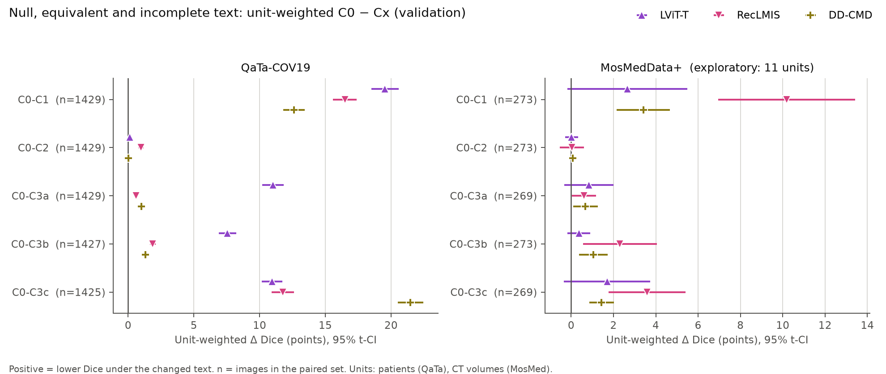
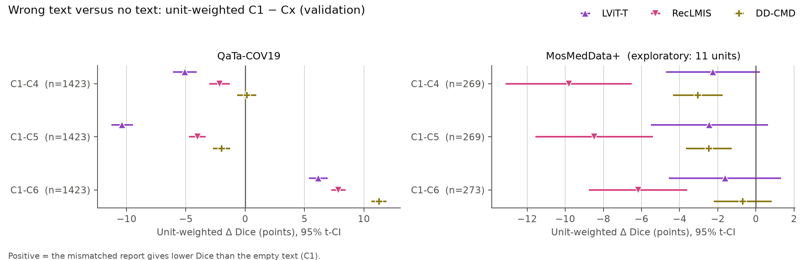
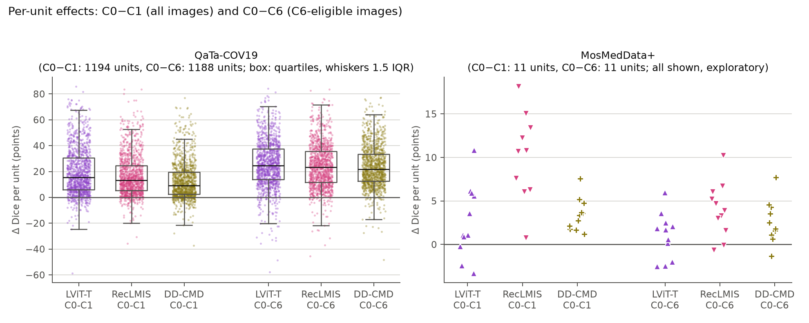
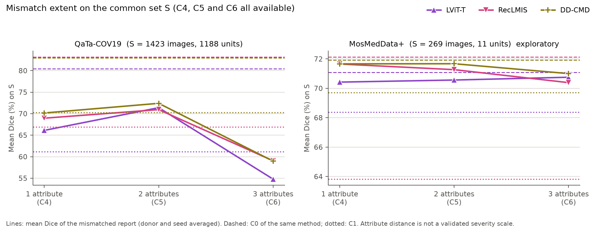
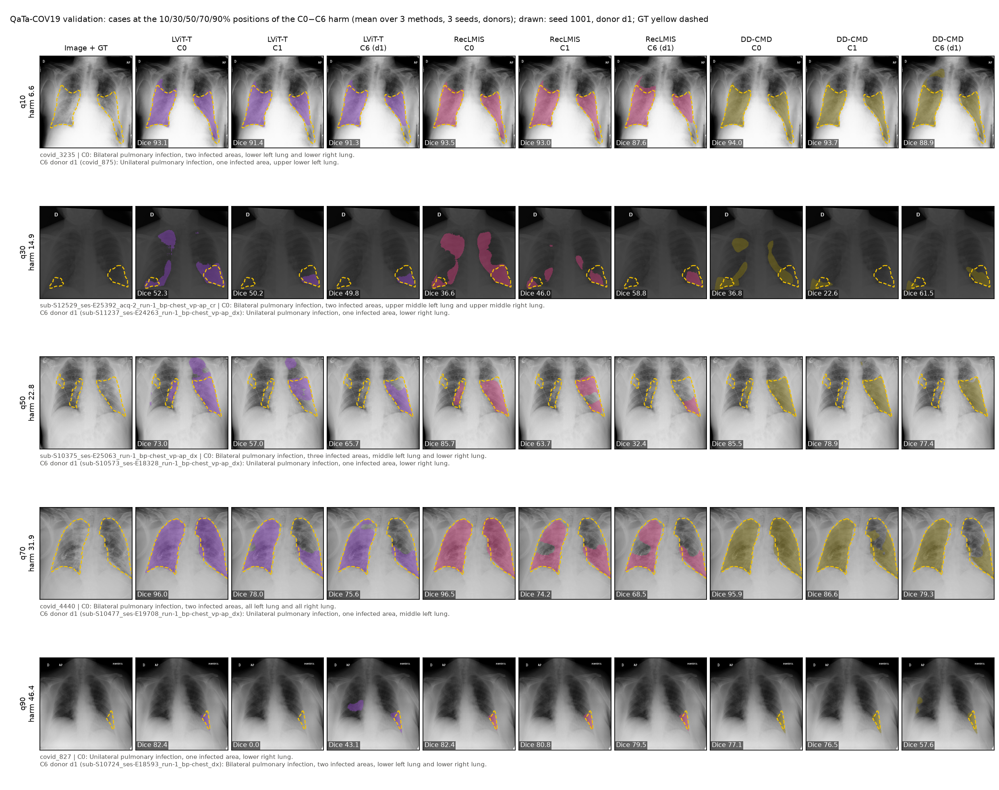
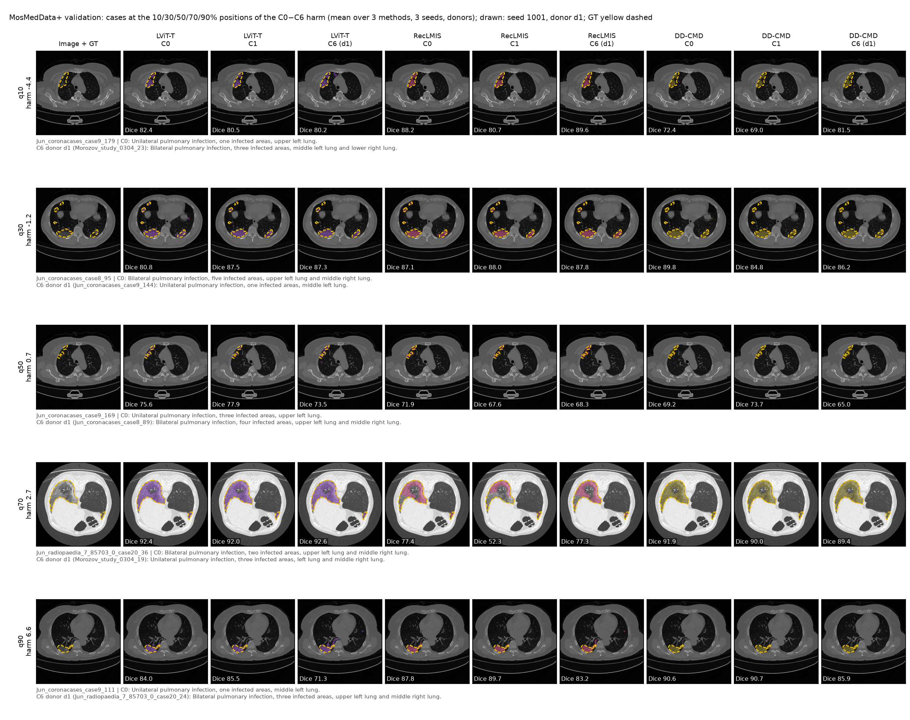

# Phase 2 — Validation summary for the supervisor

> **All results in this summary come from the validation split.**
> - The test split has not been evaluated in Phase 2. The Phase 2 lock is closed, and no test text or test
>   result was read.
> - Following [PHASE2_PLAN.md](PHASE2_PLAN.md) (validation-first order, Milestones 2.2 and 2.3), the test
>   split is evaluated only after the Phase 3 plan (or its cancellation) and the Phase 2 rules and analysis are
>   frozen.
> - The Phase 2 protocol ([PHASE2_PROTOCOL.md](PHASE2_PROTOCOL.md)) is still a **draft and not frozen**.
>
> Tables and quoted numbers are generated from the results files by `src/phase2/make_phase2_tables.py`.
> Dice is given in points (×100); a Δ is the difference A − B in points. MosMedData+ has 11 validation units
> (CT volumes + pooled `bjorke`), so **every MosMedData+ interval and p-value is exploratory**. Items decided
> after results had been seen are marked **post-hoc**.

## 1. Summary

1. **The benchmark ran as specified.** All three methods (LViT-T, RecLMIS, DD-CMD), both datasets, three
   seeds and nine text conditions ran on the validation split: 18 frozen checkpoints and 252 condition
   passes.
   - C0 reproduced the archived Phase 1 validation evaluation (LViT-T and RecLMIS identical; DD-CMD within 1–4
     pixels; section 10).
   - In the effective-input audit, 0 of 76,263 condition rows had a changed
     text but an unchanged model input.
2. **QaTa-COV19: the empty text (C1) and a three-attribute mismatch (C6) give lower Dice than the original
   text, for all three methods.**
   - Unit-weighted C0−C1 is +12.61 to +19.54 points across the methods, and C0−C6 is +23.90 to +25.75.
   - 30 of 33 comparisons have Holm p < 0.05.
3. **QaTa-COV19: a three-attribute mismatch gives lower Dice than an empty text.** C1−C6 is +6.16 to +11.28
   points. For one- and two-attribute mismatches the sign differs: C1−C4 is -5.10 to +0.13 and C1−C5 is
   -10.38 to -1.98 points.
4. **MosMedData+ (all exploratory, 11 units).**
   - The mismatched text has a small effect: C0−C4 and C0−C5 are +0.32 to +1.95 points, C0−C6 is
     +1.04 to +4.01 points (unit-weighted).
   - The empty text has a large effect for RecLMIS: C0−C1 +10.18 [+6.96, +13.41].
   - For the other two methods: DD-CMD +3.41 [+2.15, +4.67], and LViT-T +2.66 [-0.17, +5.48] (CI
     includes 0).
   - C1−C6 is negative for 3 of 3 methods: the empty text gives lower Dice than the mismatched
     report.
5. **Equivalent wording (C2) changes almost every mask.**
   - The scored masks change in 99.3–99.9% of the QaTa images.
   - The mean Dice change C0−C2 (unit-weighted [95% t-CI]) is +0.99 [+0.78, +1.19] for RecLMIS on QaTa-COV19
     (Holm p < 0.05).
   - For the other five method × dataset cells it is +0.02 to +0.11 points unit-weighted
     (-0.10 to +0.11 image-weighted).
   - The mean |D(C0) − D(C2)| is 0.15 to 2.07 points.
6. **Incomplete text (C3), QaTa-COV19.**
   - Deleting the location (C0−C3c) lowers Dice for all three methods by +10.95 to +21.48 points.
   - Deleting the scope or the count lowers LViT-T by +11.01 / +7.56 points, and RecLMIS
     and DD-CMD by +0.59 to +1.87.
7. **The Phase 3 rule of the protocol (section 5.1, validation only) gives: basis for Phase 3.**
   9 of 24 method × dataset × comparison cells have a repeated signal: C0−C5, C0−C6 and C1−C6 for each of the three methods, all on QaTa-COV19.
   Whether Phase 3 is started is for the supervisor and the project lead to decide.
8. **None of these comparisons shows that the models "use" the text in a clinical sense.** They measure how
   the frozen models' Dice responds to the benchmark texts given to them.

## 2. Setup

**Checkpoints.** The Phase 1 checkpoints (seeds 1001 / 1002 / 1003, selected on validation Dice), except one:
- **MosMedData+ LViT-T uses the batch-24 runs** of the post-hoc Phase 1 sensitivity study
  ([PHASE1_SENSITIVITY_LVIT.md](PHASE1_SENSITIVITY_LVIT.md)): training batch 24 instead of 2, everything else
  unchanged.
- sha256 values: `results/phase2_checkpoint_sha256.tsv`.
- Inference settings are unchanged from Phase 1 (eval mode, batch 32, no TTA, probability > 0.5, common
  evaluator).
- Validation C0 Dice: QaTa LViT-T 80.42, RecLMIS 83.14, DD-CMD 82.96; MosMed LViT-T 70.42, RecLMIS 71.35, DD-CMD 71.36.

**Units.**
- QaTa: patient = BIDS subject `sub-S…`. `covid_*` images, which have no patient id, are their own unit.
- MosMed: CT volume = file name without the slice number. `bjorke` slices form one pooled unit.
- The unit-weighted Δ is the mean over units of the per-unit mean image difference, with a 95% t-CI over
  units.

**Aggregation.** Metrics are averaged over the donors (up to 3) within image and seed, then over the 3 seeds.

**The nine conditions.** The example is the QaTa validation target `covid_1560`, chosen by a fixed rule: the
smallest hash among the targets with all nine conditions.

| Condition | Definition | Example (validation) |
|---|---|---|
| C0 | original paired report | Bilateral pulmonary infection, two infected areas, lower left lung and lower right lung. |
| C1 | empty string, through each method's normal text pathway | (empty string) |
| C2 | the original with `pulmonary` → `lung` and `infected area(s)` → `infected region(s)` only (P2-1) | Bilateral lung infection, two infected regions, lower left lung and lower right lung. |
| C3a | scope word deleted | Pulmonary infection, two infected areas, lower left lung and lower right lung. |
| C3b | count clause deleted | Bilateral pulmonary infection, lower left lung and lower right lung. |
| C3c | location clause deleted | Bilateral pulmonary infection, two infected areas. |
| C4 | real report of another case, exactly 1 of (scope, count, location) different | Bilateral pulmonary infection, two infected areas, all left lung and all right lung. (donor `sub-S11226_ses-E21312_run-1_bp-chest_vp-ap_cr`; changed: location) |
| C5 | real report, exactly 2 different | Bilateral pulmonary infection, three infected areas, upper lower left lung and upper lower right lung. (donor `covid_1408`; changed: count+location) |
| C6 | real report, all 3 different | Unilateral pulmonary infection, one infected area, lower right lung. (donor `sub-S10859_ses-E18894_run-1_bp-chest_vp-ap_cr`; changed: scope+count+location) |

**Donors.**
- C4–C6 donors come from the same split, never from the same patient or volume.
- Up to 3 distinct donor texts per target, chosen by a fixed hash before any model output existed.
- The same donors are used for all methods and seeds (`results/phase2_donor_manifest_val.csv`).

**Coverage on validation** (images and units per condition; identical for the three methods):

| Condition | QaTa-COV19 images | MosMedData+ images | QaTa-COV19 units | MosMedData+ units |
|---|---|---|---|---|
| C0 | 1429 | 273 | 1194 | 11 |
| C1 | 1429 | 273 | 1194 | 11 |
| C2 | 1429 | 273 | 1194 | 11 |
| C3a | 1429 | 269 | 1194 | 11 |
| C3b | 1427 | 273 | 1192 | 11 |
| C3c | 1425 | 269 | 1190 | 11 |
| C4 | 1423 | 269 | 1188 | 11 |
| C5 | 1423 | 269 | 1188 | 11 |
| C6 | 1423 | 273 | 1188 | 11 |

**Effective-input audit.** Text changed but model input unchanged, counted over all validation condition
rows:

| Dataset | Method | Condition rows | Text changed | Text changed, model input unchanged |
|---|---|---|---|---|
| MosMedData+ | DD-CMD | 4047 | 3774 | 0 |
| MosMedData+ | LViT-T | 4047 | 3774 | 0 |
| MosMedData+ | RecLMIS | 4047 | 3774 | 0 |
| QaTa-COV19 | DD-CMD | 21374 | 19945 | 0 |
| QaTa-COV19 | LViT-T | 21374 | 19945 | 0 |
| QaTa-COV19 | RecLMIS | 21374 | 19945 | 0 |

## 3. Main table (Task 2.4)

Dice, mean ± sample SD over the 3 per-seed image means (donor-averaged); image-weighted. Columns are on
different image sets where coverage differs (section 2), so column differences are not paired effects.

| Dataset | Method | C0 | C1 | C2 | C3a | C3b | C3c | C4 | C5 | C6 |
|---|---|---|---|---|---|---|---|---|---|---|
| QaTa-COV19 | LViT-T | 80.42 ± 0.65 | 61.18 ± 1.55 | 80.31 ± 0.71 | 69.46 ± 3.42 | 73.03 ± 2.33 | 69.69 ± 0.54 | 66.11 ± 0.91 | 71.39 ± 0.17 | 54.78 ± 2.15 |
| QaTa-COV19 | RecLMIS | 83.14 ± 0.06 | 66.93 ± 3.53 | 82.20 ± 0.67 | 82.60 ± 0.27 | 81.34 ± 1.24 | 71.62 ± 2.77 | 68.95 ± 0.81 | 70.94 ± 0.42 | 59.05 ± 1.10 |
| QaTa-COV19 | DD-CMD | 82.96 ± 0.14 | 70.31 ± 2.81 | 82.95 ± 0.14 | 81.98 ± 0.37 | 81.72 ± 0.38 | 61.47 ± 10.70 | 70.16 ± 0.52 | 72.41 ± 0.54 | 58.96 ± 3.46 |
| MosMedData+ | LViT-T (batch-24 training) | 70.42 ± 0.35 | 67.77 ± 2.10 | 70.34 ± 0.47 | 70.40 ± 1.69 | 70.13 ± 1.06 | 69.45 ± 1.67 | 70.42 ± 0.82 | 70.56 ± 0.90 | 70.07 ± 0.95 |
| MosMedData+ | RecLMIS | 71.35 ± 0.80 | 63.18 ± 2.58 | 71.45 ± 0.72 | 71.60 ± 0.82 | 69.47 ± 0.81 | 69.42 ± 0.74 | 71.65 ± 0.74 | 71.27 ± 0.78 | 69.62 ± 0.85 |
| MosMedData+ | DD-CMD | 71.36 ± 0.25 | 69.10 ± 1.68 | 71.28 ± 0.23 | 71.44 ± 0.45 | 70.75 ± 0.55 | 70.74 ± 0.20 | 71.66 ± 0.35 | 71.67 ± 0.36 | 70.33 ± 0.32 |

Per-seed values, mIoU, HD95, ASSD and empty-prediction rates are in Appendix A.

## 4. Paired comparisons (Task 2.5)

**Method.** 11 comparisons per method × dataset, each on the common eligible images of its two conditions.
- Unit-weighted Δ with 95% t-CI and the one-sample t-test over units.
- Holm correction across the 11 comparisons of each method × dataset, α = 0.05.
- The image-weighted Δ is shown for reference only, without inference.
- Positive = lower Dice under the second condition.

**QaTa-COV19** (30 of 33 comparisons with Holm p < 0.05):

| Method | Comparison | Images | Units | Unit-weighted Δ [95% t-CI] | Holm p | Holm < 0.05 | Image-weighted Δ |
|---|---|---|---|---|---|---|---|
| LViT-T | C0-C1 | 1429 | 1194 | +19.54 [+18.51, +20.57] | 2.18e-201 | yes | +19.24 |
| LViT-T | C0-C2 | 1429 | 1194 | +0.11 [-0.00, +0.22] | 0.057 | no | +0.11 |
| LViT-T | C0-C3a | 1429 | 1194 | +11.01 [+10.20, +11.83] | 4.19e-121 | yes | +10.96 |
| LViT-T | C0-C3b | 1427 | 1192 | +7.56 [+6.90, +8.23] | 8.11e-92 | yes | +7.38 |
| LViT-T | C0-C3c | 1425 | 1190 | +10.95 [+10.16, +11.74] | 6.17e-126 | yes | +10.75 |
| LViT-T | C0-C4 | 1423 | 1188 | +14.49 [+13.67, +15.31] | 2.83e-181 | yes | +14.32 |
| LViT-T | C0-C5 | 1423 | 1188 | +9.22 [+8.44, +9.99] | 2.39e-98 | yes | +9.04 |
| LViT-T | C0-C6 | 1423 | 1188 | +25.75 [+24.71, +26.78] | 4.75e-285 | yes | +25.65 |
| LViT-T | C1-C4 | 1423 | 1188 | -5.10 [-6.10, -4.10] | 1.75e-22 | yes | -4.97 |
| LViT-T | C1-C5 | 1423 | 1188 | -10.38 [-11.29, -9.46] | 1.74e-91 | yes | -10.25 |
| LViT-T | C1-C6 | 1423 | 1188 | +6.16 [+5.36, +6.95] | 2.42e-47 | yes | +6.36 |
| RecLMIS | C0-C1 | 1429 | 1194 | +16.48 [+15.59, +17.37] | 3.14e-194 | yes | +16.21 |
| RecLMIS | C0-C2 | 1429 | 1194 | +0.99 [+0.78, +1.19] | 1.75e-20 | yes | +0.94 |
| RecLMIS | C0-C3a | 1429 | 1194 | +0.59 [+0.42, +0.76] | 3.18e-11 | yes | +0.54 |
| RecLMIS | C0-C3b | 1427 | 1192 | +1.87 [+1.64, +2.11] | 1.54e-50 | yes | +1.79 |
| RecLMIS | C0-C3c | 1425 | 1190 | +11.78 [+10.92, +12.63] | 2.40e-125 | yes | +11.53 |
| RecLMIS | C0-C4 | 1423 | 1188 | +14.37 [+13.52, +15.21] | 2.24e-171 | yes | +14.19 |
| RecLMIS | C0-C5 | 1423 | 1188 | +12.49 [+11.74, +13.23] | 1.34e-167 | yes | +12.20 |
| RecLMIS | C0-C6 | 1423 | 1188 | +24.37 [+23.40, +25.35] | 3.69e-285 | yes | +24.09 |
| RecLMIS | C1-C4 | 1423 | 1188 | -2.16 [-3.01, -1.30] | 7.80e-07 | yes | -2.05 |
| RecLMIS | C1-C5 | 1423 | 1188 | -4.03 [-4.74, -3.32] | 7.27e-27 | yes | -4.04 |
| RecLMIS | C1-C6 | 1423 | 1188 | +7.85 [+7.25, +8.46] | 8.89e-114 | yes | +7.85 |
| DD-CMD | C0-C1 | 1429 | 1194 | +12.61 [+11.79, +13.43] | 2.15e-148 | yes | +12.65 |
| DD-CMD | C0-C2 | 1429 | 1194 | +0.02 [+0.00, +0.03] | 0.058 | no | +0.02 |
| DD-CMD | C0-C3a | 1429 | 1194 | +1.02 [+0.80, +1.24] | 5.29e-19 | yes | +0.98 |
| DD-CMD | C0-C3b | 1427 | 1192 | +1.32 [+1.08, +1.55] | 7.68e-26 | yes | +1.23 |
| DD-CMD | C0-C3c | 1425 | 1190 | +21.48 [+20.51, +22.45] | 1.15e-246 | yes | +21.50 |
| DD-CMD | C0-C4 | 1423 | 1188 | +12.76 [+12.07, +13.44] | 1.70e-196 | yes | +12.80 |
| DD-CMD | C0-C5 | 1423 | 1188 | +10.64 [+10.02, +11.27] | 3.51e-173 | yes | +10.55 |
| DD-CMD | C0-C6 | 1423 | 1188 | +23.90 [+23.00, +24.81] | 9.23e-306 | yes | +24.00 |
| DD-CMD | C1-C4 | 1423 | 1188 | +0.13 [-0.67, +0.93] | 0.747 | no | +0.14 |
| DD-CMD | C1-C5 | 1423 | 1188 | -1.98 [-2.71, -1.26] | 2.84e-07 | yes | -2.11 |
| DD-CMD | C1-C6 | 1423 | 1188 | +11.28 [+10.64, +11.91] | 1.23e-181 | yes | +11.33 |

**MosMedData+ — exploratory, 11 units** (13 of 33 with Holm p < 0.05; the p-values rest on 11 units):

| Method | Comparison | Images | Units | Unit-weighted Δ [95% t-CI] | Holm p | Holm < 0.05 | Image-weighted Δ |
|---|---|---|---|---|---|---|---|
| LViT-T | C0-C1 | 273 | 11 | +2.66 [-0.17, +5.48] | 0.689 | no | +2.65 |
| LViT-T | C0-C2 | 273 | 11 | +0.02 [-0.29, +0.33] | 0.995 | no | +0.08 |
| LViT-T | C0-C3a | 269 | 11 | +0.84 [-0.32, +2.00] | 0.961 | no | +0.68 |
| LViT-T | C0-C3b | 273 | 11 | +0.36 [-0.18, +0.90] | 0.961 | no | +0.29 |
| LViT-T | C0-C3c | 269 | 11 | +1.69 [-0.34, +3.73] | 0.845 | no | +1.63 |
| LViT-T | C0-C4 | 269 | 11 | +0.51 [-0.20, +1.21] | 0.961 | no | +0.66 |
| LViT-T | C0-C5 | 269 | 11 | +0.32 [-0.70, +1.34] | 0.995 | no | +0.52 |
| LViT-T | C0-C6 | 273 | 11 | +1.04 [-0.75, +2.82] | 0.961 | no | +0.35 |
| LViT-T | C1-C4 | 269 | 11 | -2.25 [-4.71, +0.20] | 0.689 | no | -2.04 |
| LViT-T | C1-C5 | 269 | 11 | -2.44 [-5.51, +0.63] | 0.856 | no | -2.18 |
| LViT-T | C1-C6 | 273 | 11 | -1.62 [-4.56, +1.32] | 0.961 | no | -2.30 |
| RecLMIS | C0-C1 | 273 | 11 | +10.18 [+6.96, +13.41] | 3.93e-04 | yes | +8.17 |
| RecLMIS | C0-C2 | 273 | 11 | +0.04 [-0.54, +0.61] | 0.891 | no | -0.10 |
| RecLMIS | C0-C3a | 269 | 11 | +0.60 [+0.03, +1.17] | 0.120 | no | +0.52 |
| RecLMIS | C0-C3b | 273 | 11 | +2.30 [+0.55, +4.05] | 0.060 | no | +1.88 |
| RecLMIS | C0-C3c | 269 | 11 | +3.59 [+1.78, +5.41] | 0.009 | yes | +2.70 |
| RecLMIS | C0-C4 | 269 | 11 | +0.62 [+0.01, +1.23] | 0.120 | no | +0.47 |
| RecLMIS | C0-C5 | 269 | 11 | +1.95 [+0.63, +3.27] | 0.041 | yes | +0.85 |
| RecLMIS | C0-C6 | 273 | 11 | +4.01 [+1.92, +6.11] | 0.010 | yes | +1.73 |
| RecLMIS | C1-C4 | 269 | 11 | -9.82 [-13.12, -6.51] | 5.95e-04 | yes | -7.83 |
| RecLMIS | C1-C5 | 269 | 11 | -8.49 [-11.58, -5.41] | 9.98e-04 | yes | -7.45 |
| RecLMIS | C1-C6 | 273 | 11 | -6.17 [-8.75, -3.59] | 0.003 | yes | -6.44 |
| DD-CMD | C0-C1 | 273 | 11 | +3.41 [+2.15, +4.67] | 0.001 | yes | +2.26 |
| DD-CMD | C0-C2 | 273 | 11 | +0.08 [-0.11, +0.28] | 0.670 | no | +0.08 |
| DD-CMD | C0-C3a | 269 | 11 | +0.67 [+0.10, +1.25] | 0.132 | no | +0.48 |
| DD-CMD | C0-C3b | 273 | 11 | +1.05 [+0.37, +1.73] | 0.039 | yes | +0.61 |
| DD-CMD | C0-C3c | 269 | 11 | +1.43 [+0.86, +2.01] | 0.002 | yes | +1.18 |
| DD-CMD | C0-C4 | 269 | 11 | +0.33 [+0.01, +0.65] | 0.139 | no | +0.26 |
| DD-CMD | C0-C5 | 269 | 11 | +0.91 [+0.09, +1.74] | 0.132 | no | +0.25 |
| DD-CMD | C0-C6 | 273 | 11 | +2.72 [+1.10, +4.34] | 0.027 | yes | +1.03 |
| DD-CMD | C1-C4 | 269 | 11 | -3.05 [-4.35, -1.75] | 0.004 | yes | -1.96 |
| DD-CMD | C1-C5 | 269 | 11 | -2.47 [-3.66, -1.27] | 0.008 | yes | -1.97 |
| DD-CMD | C1-C6 | 273 | 11 | -0.69 [-2.21, +0.83] | 0.670 | no | -1.23 |

**Null, equivalent and incomplete text** (C0 − C1, C2, C3a, C3b, C3c):

**Wrong text versus no text** (C1 − C4, C5, C6; positive = the mismatched report gives lower Dice than the
empty text):

**Per-unit effects.** The distribution over units of C0−C1 and C0−C6. For MosMed all 11 units are shown.

## 5. Equivalent wording (C2)

C2 differs from C0 only in two words (section 2). Values are per seed, then mean ± SD over the 3 seeds:

| Dataset | Method | Images | Mean |D(C0) − D(C2)| (points) | Mean D(C0) − D(C2) (points) | Images with a changed mask (%) | Changed by > 4 px (%) (DD-CMD) | Empty ↔ non-empty flips (seeds 1001/1002/1003) |
|---|---|---|---|---|---|---|---|
| QaTa-COV19 | LViT-T | 1429 | 1.11 ± 0.55 | +0.11 ± 0.28 | 99.3 ± 0.2 | NA | 6 (1/0/5) |
| QaTa-COV19 | RecLMIS | 1429 | 2.07 ± 1.17 | +0.94 ± 0.72 | 99.9 ± 0.1 | NA | 10 (2/2/6) |
| QaTa-COV19 | DD-CMD | 1429 | 0.15 ± 0.01 | +0.02 ± 0.02 | 99.3 ± 0.4 | 88.2 ± 1.4 | 0 (0/0/0) |
| MosMedData+ | LViT-T | 273 | 0.98 ± 0.27 | +0.08 ± 0.14 | 86.1 ± 7.4 | NA | 1 (0/0/1) |
| MosMedData+ | RecLMIS | 273 | 1.26 ± 0.68 | -0.10 ± 0.13 | 95.2 ± 4.5 | NA | 1 (0/0/1) |
| MosMedData+ | DD-CMD | 273 | 0.37 ± 0.11 | +0.08 ± 0.06 | 84.5 ± 3.9 | 22.1 ± 1.7 | 3 (2/1/0) |

- **Masks change, Dice hardly.** The scored mask changes in 99.3–99.9% of the QaTa images and
  84.5–95.2% of the MosMed images. The mean absolute Dice change is 0.15 to 2.07 points.
- **Empty ↔ non-empty flips.** 21 in total over all methods, datasets and seeds.
- **DD-CMD.** Its C0 comes from a different process (job 369) than its C2 (job 370). Cross-process noise
  alone changes 1–4 pixels (protocol 4.8). The share of images changed by more than 4 pixels is
  88.2% (QaTa) and 22.1% (MosMed). The 4-pixel cut-off was chosen **post-hoc**, from
  the reconciliation result.
- **Review.** The manual review of the C2 rewrites is recorded in protocol section 4.3.1.

## 6. Mismatch extent (Task 2.6)

**S** = the target images with C4, C5 and C6 donors:
- QaTa: 1423 of 1429 images (99.6%), 1188 units;
- MosMed: 269 of 273 images (98.5%), 11 units.

S is identical for the three methods (yes). Mean Dice on S (donor and seed averaged), and the paired
harms C0 − Cx (image-weighted / unit-weighted [95% t-CI]). Descriptive, no test:

| Dataset | Method | S images | S units | S coverage (%) | C0 | C1 | C4 | C5 | C6 | C0−C4 image / unit [95% t-CI] | C0−C5 image / unit [95% t-CI] | C0−C6 image / unit [95% t-CI] |
|---|---|---|---|---|---|---|---|---|---|---|---|---|
| QaTa-COV19 | LViT-T | 1423 | 1188 | 99.6 | 80.43 | 61.14 | 66.11 | 71.39 | 54.78 | +14.32 / +14.49 [+13.67, +15.31] | +9.04 / +9.22 [+8.44, +9.99] | +25.65 / +25.75 [+24.71, +26.78] |
| QaTa-COV19 | RecLMIS | 1423 | 1188 | 99.6 | 83.14 | 66.90 | 68.95 | 70.94 | 59.05 | +14.19 / +14.37 [+13.52, +15.21] | +12.20 / +12.49 [+11.74, +13.23] | +24.09 / +24.37 [+23.40, +25.35] |
| QaTa-COV19 | DD-CMD | 1423 | 1188 | 99.6 | 82.96 | 70.29 | 70.16 | 72.41 | 58.96 | +12.80 / +12.76 [+12.07, +13.44] | +10.55 / +10.64 [+10.02, +11.27] | +24.00 / +23.90 [+23.00, +24.81] |
| MosMedData+ | LViT-T | 269 | 11 | 98.5 | 71.08 | 68.39 | 70.42 | 70.56 | 70.75 | +0.66 / +0.51 [-0.20, +1.21] | +0.52 / +0.32 [-0.70, +1.34] | +0.33 / +0.98 [-0.90, +2.85] |
| MosMedData+ | RecLMIS | 269 | 11 | 98.5 | 72.12 | 63.82 | 71.65 | 71.27 | 70.39 | +0.47 / +0.62 [+0.01, +1.23] | +0.85 / +1.95 [+0.63, +3.27] | +1.73 / +4.07 [+1.96, +6.18] |
| MosMedData+ | DD-CMD | 269 | 11 | 98.5 | 71.92 | 69.70 | 71.66 | 71.67 | 71.00 | +0.26 / +0.33 [+0.01, +0.65] | +0.25 / +0.91 [+0.09, +1.74] | +0.92 / +2.61 [+0.92, +4.30] |

- **The attribute distance is not a validated severity scale.** On QaTa the mean Dice under C5 is higher than
  under C4 for 3 of 3 methods.
- **Which attributes differ, QaTa.**
  - C4 is almost entirely location-only: 4194 of 4268 donor pairs, harm +12.94 to +14.47
    points.
  - C5 is mostly count + location: 3748 of 4269 pairs, harm +8.40 to +11.12 points.
  - So the higher mean Dice under C5 than under C4 goes with *which* attributes differ, not only with *how
    many*.
- **What `changed_attributes` records.** Only whether an attribute differs, not how far apart two locations
  are (for example, whether they share a lung zone). This is a description, not an inference.

**By changed attributes.** On S, per (target, donor) pair, seed-averaged. The mean harm averages the donors of
a target within its group first. Descriptive:

| Dataset | Method | Condition | Changed attributes | Donor pairs | Target images | Mean harm D(C0) − D(Cx) (points) |
|---|---|---|---|---|---|---|
| QaTa-COV19 | LViT-T | C4 | count | 71 | 64 | +0.24 |
| QaTa-COV19 | LViT-T | C4 | location | 4194 | 1421 | +14.47 |
| QaTa-COV19 | LViT-T | C4 | scope | 3 | 3 | +3.05 |
| QaTa-COV19 | LViT-T | C5 | count+location | 3748 | 1417 | +8.40 |
| QaTa-COV19 | LViT-T | C5 | scope+count | 33 | 31 | +0.84 |
| QaTa-COV19 | LViT-T | C5 | scope+location | 488 | 424 | +11.68 |
| QaTa-COV19 | LViT-T | C6 | scope+count+location | 4269 | 1423 | +25.65 |
| QaTa-COV19 | RecLMIS | C4 | count | 71 | 64 | +1.38 |
| QaTa-COV19 | RecLMIS | C4 | location | 4194 | 1421 | +14.38 |
| QaTa-COV19 | RecLMIS | C4 | scope | 3 | 3 | -0.09 |
| QaTa-COV19 | RecLMIS | C5 | count+location | 3748 | 1417 | +11.12 |
| QaTa-COV19 | RecLMIS | C5 | scope+count | 33 | 31 | +0.42 |
| QaTa-COV19 | RecLMIS | C5 | scope+location | 488 | 424 | +18.74 |
| QaTa-COV19 | RecLMIS | C6 | scope+count+location | 4269 | 1423 | +24.09 |
| QaTa-COV19 | DD-CMD | C4 | count | 71 | 64 | +1.71 |
| QaTa-COV19 | DD-CMD | C4 | location | 4194 | 1421 | +12.94 |
| QaTa-COV19 | DD-CMD | C4 | scope | 3 | 3 | -0.16 |
| QaTa-COV19 | DD-CMD | C5 | count+location | 3748 | 1417 | +10.01 |
| QaTa-COV19 | DD-CMD | C5 | scope+count | 33 | 31 | +0.08 |
| QaTa-COV19 | DD-CMD | C5 | scope+location | 488 | 424 | +14.07 |
| QaTa-COV19 | DD-CMD | C6 | scope+count+location | 4269 | 1423 | +24.00 |
| MosMedData+ | LViT-T | C4 | count | 278 | 213 | +0.19 |
| MosMedData+ | LViT-T | C4 | location | 513 | 250 | +0.85 |
| MosMedData+ | LViT-T | C5 | count+location | 656 | 268 | +0.77 |
| MosMedData+ | LViT-T | C5 | scope+location | 151 | 125 | +0.17 |
| MosMedData+ | LViT-T | C6 | scope+count+location | 807 | 269 | +0.33 |
| MosMedData+ | RecLMIS | C4 | count | 278 | 213 | +0.35 |
| MosMedData+ | RecLMIS | C4 | location | 513 | 250 | +0.32 |
| MosMedData+ | RecLMIS | C5 | count+location | 656 | 268 | +1.02 |
| MosMedData+ | RecLMIS | C5 | scope+location | 151 | 125 | +0.30 |
| MosMedData+ | RecLMIS | C6 | scope+count+location | 807 | 269 | +1.73 |
| MosMedData+ | DD-CMD | C4 | count | 278 | 213 | -0.01 |
| MosMedData+ | DD-CMD | C4 | location | 513 | 250 | +0.30 |
| MosMedData+ | DD-CMD | C5 | count+location | 656 | 268 | +0.37 |
| MosMedData+ | DD-CMD | C5 | scope+location | 151 | 125 | -0.48 |
| MosMedData+ | DD-CMD | C6 | scope+count+location | 807 | 269 | +0.92 |

## 7. Model susceptibility (Task 2.7)

On the C6-eligible images. All values in points, donor and seed averaged; descriptive.

| Dataset | Method | Images | Units | C0 | C0−C1 | C1−C6 | H = C0−C6 |
|---|---|---|---|---|---|---|---|
| QaTa-COV19 | LViT-T | 1423 | 1188 | 80.43 | +19.29 | +6.36 | +25.65 |
| QaTa-COV19 | RecLMIS | 1423 | 1188 | 83.14 | +16.24 | +7.85 | +24.09 |
| QaTa-COV19 | DD-CMD | 1423 | 1188 | 82.96 | +12.66 | +11.33 | +24.00 |
| MosMedData+ | LViT-T | 273 | 11 | 70.42 | +2.65 | -2.30 | +0.35 |
| MosMedData+ | RecLMIS | 273 | 11 | 71.35 | +8.17 | -6.44 | +1.73 |
| MosMedData+ | DD-CMD | 273 | 11 | 71.36 | +2.26 | -1.23 | +1.03 |

Paired differences of H between methods (same images, same donors):

| Dataset | H_A − H_B | Images | Units | Image-weighted | Unit-weighted [95% t-CI] |
|---|---|---|---|---|---|
| QaTa-COV19 | LViT-T − RecLMIS | 1423 | 1188 | +1.56 | +1.37 [+0.66, +2.09] |
| QaTa-COV19 | LViT-T − DD-CMD | 1423 | 1188 | +1.66 | +1.85 [+1.13, +2.56] |
| QaTa-COV19 | RecLMIS − DD-CMD | 1423 | 1188 | +0.10 | +0.47 [-0.12, +1.07] |
| MosMedData+ | LViT-T − RecLMIS | 273 | 11 | -1.38 | -2.97 [-4.73, -1.22] |
| MosMedData+ | LViT-T − DD-CMD | 273 | 11 | -0.68 | -1.68 [-3.84, +0.47] |
| MosMedData+ | RecLMIS − DD-CMD | 273 | 11 | +0.71 | +1.29 [-0.20, +2.79] |

On QaTa:
- LViT-T − RecLMIS: +1.37 [+0.66, +2.09];
- LViT-T − DD-CMD: +1.85 [+1.13, +2.56];
- RecLMIS − DD-CMD: +0.47 [-0.12, +1.07].

These are different architectures and training recipes; a difference in H does not isolate the effect of any
one module.

## 8. Real cases

**Selection rule** (written before the figures were drawn; **post-hoc** with respect to the aggregate
validation results, which were known by then):
- Take the C6-eligible validation images.
- Sort them by the C0−C6 harm, averaged over the 3 methods, 3 seeds and the donors.
- Take the image at position round(q × (n − 1)) for q = 10/30/50/70/90%; ties are broken by sample id.
- Each row shows the image with the ground truth (yellow dashed contour) and, for each method, C0 | C1 | C6
  with donor d1, seed 1001. The masks are the scored masks of the benchmark; nothing was re-inferred.
- Below each row: the original text and the d1 donor's text.

| Dataset | Position | Sample id | Harm C0−C6 (points, mean of 3 methods × 3 seeds × donors) |
|---|---|---|---|
| QaTa-COV19 | q10 | `covid_3235` | +6.61 |
| QaTa-COV19 | q30 | `sub-S12529_ses-E25392_acq-2_run-1_bp-chest_vp-ap_cr` | +14.87 |
| QaTa-COV19 | q50 | `sub-S10375_ses-E25063_run-1_bp-chest_vp-ap_dx` | +22.82 |
| QaTa-COV19 | q70 | `covid_4440` | +31.87 |
| QaTa-COV19 | q90 | `covid_827` | +46.39 |
| MosMedData+ | q10 | `Jun_coronacases_case9_179` | -4.39 |
| MosMedData+ | q30 | `Jun_coronacases_case8_95` | -1.22 |
| MosMedData+ | q50 | `Jun_coronacases_case9_169` | +0.68 |
| MosMedData+ | q70 | `Jun_radiopaedia_7_85703_0_case20_36` | +2.67 |
| MosMedData+ | q90 | `Jun_coronacases_case9_111` | +6.58 |

QaTa-COV19 (seed 1001, donor d1; what the figure shows):
- **q30 (`sub-S12529_ses-E25392_acq-2_run-1_bp-chest_vp-ap_cr`).**
  - The original text names "Bilateral pulmonary infection, two infected areas, upper middle left lung and upper middle right lung.", but the ground truth lies in the lower lung fields.
  - In this row RecLMIS and DD-CMD reach a higher Dice under C6 than under C0: RecLMIS 58.82 vs.
    36.61; DD-CMD 61.48 vs. 36.79.
  - The d1 donor text is "Unilateral pulmonary infection, one infected area, lower right lung.".
- **q90 (`covid_827`).**
  - LViT-T predicts an empty mask under C1 (Dice 0.00; C0 82.38).
  - Under C6 (donor: "Bilateral pulmonary infection, two infected areas, lower left lung and lower right lung.") it predicts an additional region on the other side of the image
    (Dice 43.15).

MosMedData+:
- 3 of 5 of the selected cases come from the same CT volume (`Jun_coronacases_case9`).
- The harm of the five rows ranges from -4.39 to +6.58 points, so this figure reflects only a few volumes
  (exploratory).

## 9. Phase 3 rule (protocol section 5.1)

**When the rule was fixed.** On 2026-10-27, after the 64-case subset C1 / C6 numbers had been seen and before
any full-validation C1–C6 result.

**The rule.** For each method × dataset × comparison:
- per seed, the image-weighted Δ ("img") and the unit-weighted Δ ("unit");
- **repeated signal** = at least 2 of 3 seeds with img ≥ threshold **and** unit > 0 in the same seed;
- **unstable** = the image-weighted threshold is met in ≥ 2 seeds, but not both conditions;
- otherwise **no signal**.

**Results.** Repeated: 9; unstable: 0; no signal: 15.

| Dataset | Method | Comparison | Threshold (points) | Seed 1001 img / unit | Seed 1002 img / unit | Seed 1003 img / unit | Classification |
|---|---|---|---|---|---|---|---|
| QaTa-COV19 | LViT-T | C0-C5 | 2 | +9.70 / +9.93 | +8.46 / +8.66 | +8.96 / +9.07 | repeated signal |
| QaTa-COV19 | LViT-T | C0-C6 | 2 | +23.91 / +24.17 | +26.83 / +26.79 | +26.22 / +26.29 | repeated signal |
| QaTa-COV19 | LViT-T | C1-C5 | 1 | -11.87 / -12.16 | -8.70 / -8.67 | -10.18 / -10.30 | no signal |
| QaTa-COV19 | LViT-T | C1-C6 | 1 | +2.34 / +2.09 | +9.67 / +9.46 | +7.08 / +6.92 | repeated signal |
| QaTa-COV19 | RecLMIS | C0-C5 | 2 | +12.38 / +12.77 | +11.70 / +11.96 | +12.51 / +12.73 | repeated signal |
| QaTa-COV19 | RecLMIS | C0-C6 | 2 | +24.07 / +24.49 | +22.96 / +23.08 | +25.25 / +25.56 | repeated signal |
| QaTa-COV19 | RecLMIS | C1-C5 | 1 | -0.30 / -0.32 | -8.08 / -8.03 | -3.76 / -3.76 | no signal |
| QaTa-COV19 | RecLMIS | C1-C6 | 1 | +11.38 / +11.41 | +3.18 / +3.08 | +8.99 / +9.07 | repeated signal |
| QaTa-COV19 | DD-CMD | C0-C5 | 2 | +10.22 / +10.32 | +11.07 / +11.18 | +10.38 / +10.43 | repeated signal |
| QaTa-COV19 | DD-CMD | C0-C6 | 2 | +21.65 / +21.65 | +27.90 / +27.71 | +22.44 / +22.35 | repeated signal |
| QaTa-COV19 | DD-CMD | C1-C5 | 1 | +0.57 / +0.64 | -3.74 / -3.52 | -3.16 / -3.06 | no signal |
| QaTa-COV19 | DD-CMD | C1-C6 | 1 | +12.00 / +11.96 | +13.10 / +13.00 | +8.90 / +8.86 | repeated signal |
| MosMedData+ | LViT-T | C0-C5 | 2 | +0.31 / +0.17 | +1.26 / +0.88 | -0.01 / -0.07 | no signal |
| MosMedData+ | LViT-T | C0-C6 | 2 | +0.38 / +1.42 | +1.20 / +1.58 | -0.53 / +0.11 | no signal |
| MosMedData+ | LViT-T | C1-C5 | 1 | -0.89 / -0.44 | -3.52 / -4.62 | -2.12 / -2.25 | no signal |
| MosMedData+ | LViT-T | C1-C6 | 1 | -0.80 / +0.85 | -3.48 / -3.76 | -2.61 / -1.95 | no signal |
| MosMedData+ | RecLMIS | C0-C5 | 2 | +0.82 / +1.66 | +0.59 / +1.14 | +1.15 / +3.04 | no signal |
| MosMedData+ | RecLMIS | C0-C6 | 2 | +1.78 / +3.82 | +1.42 / +3.01 | +2.01 / +5.20 | no signal |
| MosMedData+ | RecLMIS | C1-C5 | 1 | -8.35 / -10.46 | -4.77 / -5.97 | -9.23 / -9.04 | no signal |
| MosMedData+ | RecLMIS | C1-C6 | 1 | -7.24 / -8.03 | -3.85 / -3.95 | -8.22 / -6.54 | no signal |
| MosMedData+ | DD-CMD | C0-C5 | 2 | +0.03 / +0.98 | +0.44 / +0.81 | +0.28 / +0.95 | no signal |
| MosMedData+ | DD-CMD | C0-C6 | 2 | +1.05 / +2.87 | +1.44 / +3.10 | +0.60 / +2.19 | no signal |
| MosMedData+ | DD-CMD | C1-C5 | 1 | -2.40 / -2.79 | -3.59 / -4.56 | +0.09 / -0.05 | no signal |
| MosMedData+ | DD-CMD | C1-C6 | 1 | -1.37 / -0.86 | -2.57 / -2.21 | +0.25 / +0.99 | no signal |

**Outcome by the rule: basis for Phase 3.** Repeated-signal cells: C0−C5, C0−C6 and C1−C6 for each of the three methods, all on QaTa-COV19.

**Per-donor check** (descriptive). Is a signal carried by one donor? For the repeated-signal cells the smallest
per-donor image-weighted Δ is +1.15 points, and 81 of 81 seed × donor cells meet the
threshold.

| Dataset | Method | Comparison | Classification | Per-donor image-weighted Δ (range over 3 seeds × 3 donors) | Seed × donor cells at or above threshold |
|---|---|---|---|---|---|
| QaTa-COV19 | LViT-T | C0-C5 | repeated signal | +8.34 to +9.95 | 9 of 9 |
| QaTa-COV19 | LViT-T | C0-C6 | repeated signal | +22.72 to +28.40 | 9 of 9 |
| QaTa-COV19 | LViT-T | C1-C5 | no signal | -12.06 to -8.63 | 0 of 9 |
| QaTa-COV19 | LViT-T | C1-C6 | repeated signal | +1.15 to +11.25 | 9 of 9 |
| QaTa-COV19 | RecLMIS | C0-C5 | repeated signal | +11.48 to +12.67 | 9 of 9 |
| QaTa-COV19 | RecLMIS | C0-C6 | repeated signal | +22.32 to +25.67 | 9 of 9 |
| QaTa-COV19 | RecLMIS | C1-C5 | no signal | -8.30 to -0.15 | 0 of 9 |
| QaTa-COV19 | RecLMIS | C1-C6 | repeated signal | +2.54 to +11.49 | 9 of 9 |
| QaTa-COV19 | DD-CMD | C0-C5 | repeated signal | +9.99 to +11.28 | 9 of 9 |
| QaTa-COV19 | DD-CMD | C0-C6 | repeated signal | +21.01 to +28.63 | 9 of 9 |
| QaTa-COV19 | DD-CMD | C1-C5 | no signal | -4.03 to +0.69 | 0 of 9 |
| QaTa-COV19 | DD-CMD | C1-C6 | repeated signal | +8.21 to +13.82 | 9 of 9 |
| MosMedData+ | LViT-T | C0-C5 | no signal | -0.26 to +1.62 | 0 of 9 |
| MosMedData+ | LViT-T | C0-C6 | no signal | -0.57 to +1.49 | 0 of 9 |
| MosMedData+ | LViT-T | C1-C5 | no signal | -3.99 to -0.72 | 0 of 9 |
| MosMedData+ | LViT-T | C1-C6 | no signal | -3.86 to -0.53 | 0 of 9 |
| MosMedData+ | RecLMIS | C0-C5 | no signal | +0.48 to +1.31 | 0 of 9 |
| MosMedData+ | RecLMIS | C0-C6 | no signal | +1.18 to +2.17 | 2 of 9 |
| MosMedData+ | RecLMIS | C1-C5 | no signal | -9.34 to -4.57 | 0 of 9 |
| MosMedData+ | RecLMIS | C1-C6 | no signal | -8.43 to -3.42 | 0 of 9 |
| MosMedData+ | DD-CMD | C0-C5 | no signal | -0.03 to +0.57 | 0 of 9 |
| MosMedData+ | DD-CMD | C0-C6 | no signal | +0.52 to +1.68 | 0 of 9 |
| MosMedData+ | DD-CMD | C1-C5 | no signal | -3.72 to +0.27 | 0 of 9 |
| MosMedData+ | DD-CMD | C1-C6 | no signal | -2.99 to +0.33 | 0 of 9 |

**D6 sensitivity check** (pre-specified).
- 14 MosMed validation images are excluded: their text says "Unilateral" but names both sides.
- The unit-weighted Δs of the 11 comparisons then change by at most 1.59 points (all three
  methods; exploratory).

| Method | Comparison | Images (all) | Images (without D6) | Image Δ all | Image Δ without D6 | Unit Δ all | Unit Δ without D6 |
|---|---|---|---|---|---|---|---|
| LViT-T | C0-C1 | 273 | 259 | +2.65 | +2.70 | +2.66 | +3.17 |
| LViT-T | C0-C2 | 273 | 259 | +0.08 | +0.08 | +0.02 | +0.02 |
| LViT-T | C0-C3a | 269 | 255 | +0.68 | +0.78 | +0.84 | +1.24 |
| LViT-T | C0-C3b | 273 | 259 | +0.29 | +0.37 | +0.36 | +0.36 |
| LViT-T | C0-C3c | 269 | 255 | +1.63 | +1.67 | +1.69 | +2.02 |
| LViT-T | C0-C4 | 269 | 255 | +0.66 | +0.71 | +0.51 | +0.55 |
| LViT-T | C0-C5 | 269 | 255 | +0.52 | +0.61 | +0.32 | +0.38 |
| LViT-T | C0-C6 | 273 | 259 | +0.35 | +0.36 | +1.04 | +1.01 |
| LViT-T | C1-C4 | 269 | 255 | -2.04 | -2.04 | -2.25 | -2.76 |
| LViT-T | C1-C5 | 269 | 255 | -2.18 | -2.14 | -2.44 | -2.93 |
| LViT-T | C1-C6 | 273 | 259 | -2.30 | -2.33 | -1.62 | -2.16 |
| RecLMIS | C0-C1 | 273 | 259 | +8.17 | +8.33 | +10.18 | +11.42 |
| RecLMIS | C0-C2 | 273 | 259 | -0.10 | -0.14 | +0.04 | -0.16 |
| RecLMIS | C0-C3a | 269 | 255 | +0.52 | +0.52 | +0.60 | +0.65 |
| RecLMIS | C0-C3b | 273 | 259 | +1.88 | +1.88 | +2.30 | +2.30 |
| RecLMIS | C0-C3c | 269 | 255 | +2.70 | +2.75 | +3.59 | +4.33 |
| RecLMIS | C0-C4 | 269 | 255 | +0.47 | +0.41 | +0.62 | +0.48 |
| RecLMIS | C0-C5 | 269 | 255 | +0.85 | +0.65 | +1.95 | +1.68 |
| RecLMIS | C0-C6 | 273 | 259 | +1.73 | +1.50 | +4.01 | +4.13 |
| RecLMIS | C1-C4 | 269 | 255 | -7.83 | -8.06 | -9.82 | -11.28 |
| RecLMIS | C1-C5 | 269 | 255 | -7.45 | -7.83 | -8.49 | -10.08 |
| RecLMIS | C1-C6 | 273 | 259 | -6.44 | -6.83 | -6.17 | -7.29 |
| DD-CMD | C0-C1 | 273 | 259 | +2.26 | +2.18 | +3.41 | +3.57 |
| DD-CMD | C0-C2 | 273 | 259 | +0.08 | +0.10 | +0.08 | +0.15 |
| DD-CMD | C0-C3a | 269 | 255 | +0.48 | +0.40 | +0.67 | +0.66 |
| DD-CMD | C0-C3b | 273 | 259 | +0.61 | +0.52 | +1.05 | +1.03 |
| DD-CMD | C0-C3c | 269 | 255 | +1.18 | +1.22 | +1.43 | +1.69 |
| DD-CMD | C0-C4 | 269 | 255 | +0.26 | +0.23 | +0.33 | +0.27 |
| DD-CMD | C0-C5 | 269 | 255 | +0.25 | +0.05 | +0.91 | +0.53 |
| DD-CMD | C0-C6 | 273 | 259 | +1.03 | +0.70 | +2.72 | +2.43 |
| DD-CMD | C1-C4 | 269 | 255 | -1.96 | -1.91 | -3.05 | -3.27 |
| DD-CMD | C1-C5 | 269 | 255 | -1.97 | -2.09 | -2.47 | -3.00 |
| DD-CMD | C1-C6 | 273 | 259 | -1.23 | -1.49 | -0.69 | -1.14 |

## 10. Issues found and how they were handled

- **The first C2 template was truncated.** RecLMIS (CLIP, 16 tokens) and DD-CMD (22 word pieces) cut the end
  of the longer rewrite in most cases. Decision P2-1, taken before any C2 segmentation was run: C2 now changes
  only two words of the original. After P2-1, C2 cuts no more report content than C0 for any method.
- **DD-CMD is not bit-reproducible across processes** (official `deterministic: false`). Compared with
  Phase 1, its validation C0 differs by 1–4 pixels in up to 111 of 1429 cases; within one process it is
  identical. Tolerance rule P2-2 was fixed for the later test reconciliation.
- **C0 is reused.** The benchmark reuses the C0 pass of the text-path jobs. For DD-CMD this mixes processes;
  the measured bound is ≤ 4 pixels per case and ≤ 0.00002 mean Dice. Every pass is logged with its job id.
- **RecLMIS truncation of C0.** RecLMIS uses a CLIP context of 18 tokens including start and end (16 text
  tokens). In 101 of 1429 QaTa validation texts it cuts report words (81 the final "lung", 20 parts of the
  right-lung location), under C0 and the conditions that keep the original location (C2, C3a, C3b).
- **LViT-T uses only the first 10 word vectors.** The location clause is never fully inside them. In
  544 of 4268 QaTa C4 rows (69 of 791 MosMed), the ten window words are
  unchanged; the vectors still differ through BERT's context.
- **C1 looks like a "no infection" report for LViT-T and RecLMIS.** The official padding turns `""` into
  `EOF XXX` × 9. In MosMed training this padding occurs only with "No pulmonary infection, zero infected
  areas.".
- **"No pulmonary infection" MosMed images have lesions.** 46 of the 47 train/val images with this text have
  lesion pixels in their mask (median about 10 pixels). Counted only, never used to change a text.
- **D6.** 420 MosMed train/val texts say "Unilateral" but name both sides. They are kept as written, and a
  pre-specified sensitivity check is run (section 9).
- **Grouping.**
  - QaTa patient identity rests on the BIDS `sub-S` naming.
  - `covid_*` validation images cannot be grouped and are their own units.
  - MosMed `bjorke` slices are pooled into one unit.
- **A software error** (DD-CMD's own `evaluate.py` shadowed the common evaluator) stopped DD-CMD in the first
  text-path job. It was fixed and rerun (protocol 4.5).

## 11. Limitations

- **Validation only.** The test split is evaluated only after the freeze, so none of these numbers is a test
  result.
- **MosMedData+ is exploratory.** It has 11 units, and the benchmark split has a known volume overlap between
  train, validation and test (Phase 0).
- **What the texts are.** They are benchmark annotations, not independently verified reports. The three
  attributes are dependent (scope follows the sides named), and the attribute distance is not a clinical
  severity scale.
- **What the comparisons can show.** They describe the frozen models' response to text changes. They do not
  show the causal value of adding text during training, and different architectures do not isolate a module.
- **Seeds and donors are fixed.** Inference is conditional on the three trained seeds and the fixed donor
  assignments. The unit-level t-intervals treat units as independent.
- **Effective inputs differ by method.** LViT-T's 10-word window and RecLMIS's 18-token context limit what each
  method receives, so the same text change is not the same input change for every method.

## 12. Observations relevant to Phase 3 (facts only) and the order of the next steps

**Observations:**
- **The rule's repeated signals:** C0−C5, C0−C6 and C1−C6 for each of the three methods, all on QaTa-COV19. MosMedData+ has none (exploratory, 11 units).
- **QaTa, incomplete text.**
  - Deleting the location (C0−C3c) lowers Dice by +10.95 to +21.48 points for all three methods.
  - Deleting the scope or the count lowers LViT-T by +11.01 / +7.56 points, and RecLMIS
    and DD-CMD by +0.59 to +1.87.
- **QaTa, three-attribute mismatch.** C0−C6 is +23.90 to +25.75 points (unit-weighted) and C1−C6 is
  +6.16 to +11.28 points.
- **QaTa, one- and two-attribute mismatches versus the empty text.** C1−C4 is -5.10 to +0.13 and C1−C5 is
  -10.38 to -1.98 points: mostly negative, i.e. there the mismatched report gives higher Dice than the empty
  text.
- **QaTa, susceptibility.** LViT-T has a larger C0−C6 harm than RecLMIS (+1.37 [+0.66, +2.09]) and DD-CMD
  (+1.85 [+1.13, +2.56]). RecLMIS − DD-CMD is +0.47 [-0.12, +1.07].
- **C2 changes masks in most images**, but the mean |ΔDice| is 0.15 to 2.07 points.

**Order of the next steps.**
1. The supervisor writes the Phase 3 plan, or decides to cancel Phase 3.
2. The Phase 3 protocol (or the cancellation), the Phase 2 rules and the analysis are frozen and pushed; the
   Phase 2 lock opens.
3. Only then is the test split evaluated, with the frozen programs.

## Appendix A. Supplementary main table (Task 2.4)

mIoU in points, HD95 and ASSD in pixels: mean ± SD over the 3 per-seed means. Empty = the share of
predictions with no foreground (mean over seeds). Dice per seed, in points.

| Dataset | Method | Condition | mIoU (%) | HD95 (px) | ASSD (px) | Empty (%) | Dice s1001 | Dice s1002 | Dice s1003 |
|---|---|---|---|---|---|---|---|---|---|
| QaTa-COV19 | LViT-T | C0 | 70.61 ± 0.77 | 20.06 ± 0.68 | 7.03 ± 0.57 | 0.70 | 81.00 | 79.72 | 80.55 |
| QaTa-COV19 | LViT-T | C1 | 49.43 ± 1.25 | 56.20 ± 4.84 | 26.07 ± 6.18 | 3.71 | 59.53 | 62.59 | 61.42 |
| QaTa-COV19 | LViT-T | C2 | 70.46 ± 0.83 | 20.86 ± 1.16 | 7.12 ± 0.74 | 0.65 | 81.10 | 79.73 | 80.11 |
| QaTa-COV19 | LViT-T | C3a | 57.44 ± 4.16 | 46.75 ± 4.66 | 14.81 ± 2.35 | 0.72 | 73.16 | 68.83 | 66.39 |
| QaTa-COV19 | LViT-T | C3b | 61.67 ± 2.97 | 37.09 ± 3.67 | 11.81 ± 1.71 | 0.65 | 70.63 | 73.18 | 75.28 |
| QaTa-COV19 | LViT-T | C3c | 58.24 ± 0.45 | 38.39 ± 0.20 | 16.48 ± 0.18 | 1.96 | 70.11 | 69.89 | 69.08 |
| QaTa-COV19 | LViT-T | C4 | 55.06 ± 0.96 | 46.19 ± 1.58 | 21.17 ± 1.24 | 2.48 | 66.60 | 66.68 | 65.06 |
| QaTa-COV19 | LViT-T | C5 | 60.27 ± 0.13 | 40.75 ± 1.05 | 14.86 ± 0.71 | 1.37 | 71.32 | 71.26 | 71.58 |
| QaTa-COV19 | LViT-T | C6 | 41.84 ± 2.23 | 72.29 ± 4.24 | 26.14 ± 2.68 | 1.30 | 57.12 | 52.89 | 54.33 |
| QaTa-COV19 | RecLMIS | C0 | 73.76 ± 0.05 | 14.94 ± 0.33 | 4.17 ± 0.24 | 0.07 | 83.09 | 83.12 | 83.21 |
| QaTa-COV19 | RecLMIS | C1 | 53.98 ± 3.48 | 46.99 ± 6.32 | 14.50 ± 5.05 | 0.72 | 70.43 | 63.37 | 67.00 |
| QaTa-COV19 | RecLMIS | C2 | 72.66 ± 0.78 | 16.71 ± 0.64 | 5.06 ± 0.45 | 0.26 | 82.23 | 82.86 | 81.52 |
| QaTa-COV19 | RecLMIS | C3a | 73.03 ± 0.38 | 16.52 ± 0.64 | 4.44 ± 0.14 | 0.05 | 82.88 | 82.58 | 82.34 |
| QaTa-COV19 | RecLMIS | C3b | 71.38 ± 1.58 | 22.09 ± 4.20 | 5.72 ± 1.10 | 0.05 | 82.63 | 80.16 | 81.24 |
| QaTa-COV19 | RecLMIS | C3c | 59.89 ± 2.66 | 36.12 ± 4.20 | 14.11 ± 5.91 | 1.85 | 71.60 | 68.86 | 74.40 |
| QaTa-COV19 | RecLMIS | C4 | 57.62 ± 0.93 | 39.87 ± 0.84 | 14.68 ± 0.12 | 0.66 | 69.18 | 69.61 | 68.05 |
| QaTa-COV19 | RecLMIS | C5 | 59.30 ± 0.53 | 40.79 ± 0.67 | 12.77 ± 0.10 | 0.30 | 70.70 | 71.43 | 70.71 |
| QaTa-COV19 | RecLMIS | C6 | 45.88 ± 1.16 | 68.46 ± 3.35 | 21.57 ± 1.24 | 0.26 | 59.02 | 60.16 | 57.96 |
| QaTa-COV19 | DD-CMD | C0 | 73.50 ± 0.16 | 15.06 ± 0.14 | 4.12 ± 0.26 | 0.05 | 83.12 | 82.92 | 82.84 |
| QaTa-COV19 | DD-CMD | C1 | 57.50 ± 3.24 | 39.64 ± 3.68 | 10.86 ± 1.62 | 0.07 | 73.47 | 68.13 | 69.32 |
| QaTa-COV19 | DD-CMD | C2 | 73.49 ± 0.17 | 15.21 ± 0.19 | 4.15 ± 0.25 | 0.05 | 83.10 | 82.93 | 82.81 |
| QaTa-COV19 | DD-CMD | C3a | 72.21 ± 0.45 | 17.78 ± 1.65 | 4.77 ± 0.15 | 0.05 | 81.83 | 82.40 | 81.70 |
| QaTa-COV19 | DD-CMD | C3b | 71.91 ± 0.51 | 17.53 ± 0.22 | 4.81 ± 0.34 | 0.07 | 81.91 | 81.28 | 81.98 |
| QaTa-COV19 | DD-CMD | C3c | 48.78 ± 10.69 | 55.76 ± 22.10 | 22.50 ± 15.53 | 2.32 | 70.48 | 49.65 | 64.28 |
| QaTa-COV19 | DD-CMD | C4 | 58.22 ± 0.27 | 39.25 ± 0.10 | 12.34 ± 1.55 | 0.33 | 70.42 | 69.56 | 70.50 |
| QaTa-COV19 | DD-CMD | C5 | 60.31 ± 0.41 | 40.80 ± 0.47 | 11.00 ± 0.63 | 0.05 | 72.91 | 71.84 | 72.46 |
| QaTa-COV19 | DD-CMD | C6 | 45.44 ± 3.65 | 67.94 ± 7.07 | 20.75 ± 2.83 | 0.10 | 61.48 | 55.01 | 60.40 |
| MosMedData+ | LViT-T | C0 | 57.69 ± 0.32 | 21.69 ± 1.30 | 10.84 ± 1.69 | 1.95 | 70.82 | 70.18 | 70.25 |
| MosMedData+ | LViT-T | C1 | 55.24 ± 2.22 | 24.27 ± 1.97 | 13.06 ± 3.14 | 2.44 | 69.64 | 65.50 | 68.17 |
| MosMedData+ | LViT-T | C2 | 57.68 ± 0.52 | 21.94 ± 1.68 | 11.24 ± 2.30 | 2.08 | 70.86 | 69.95 | 70.21 |
| MosMedData+ | LViT-T | C3a | 57.63 ± 1.73 | 21.68 ± 1.00 | 10.60 ± 2.10 | 1.86 | 71.59 | 68.47 | 71.14 |
| MosMedData+ | LViT-T | C3b | 57.32 ± 1.08 | 21.97 ± 1.85 | 10.45 ± 2.18 | 1.83 | 71.11 | 69.00 | 70.26 |
| MosMedData+ | LViT-T | C3c | 56.77 ± 1.72 | 22.07 ± 2.31 | 11.46 ± 3.22 | 2.11 | 70.73 | 67.56 | 70.07 |
| MosMedData+ | LViT-T | C4 | 57.58 ± 0.83 | 21.76 ± 1.59 | 10.42 ± 2.09 | 1.78 | 71.00 | 69.48 | 70.79 |
| MosMedData+ | LViT-T | C5 | 57.60 ± 0.98 | 22.03 ± 1.25 | 8.87 ± 1.64 | 1.16 | 71.10 | 69.52 | 71.07 |
| MosMedData+ | LViT-T | C6 | 57.27 ± 1.16 | 23.32 ± 2.54 | 8.91 ± 0.45 | 0.98 | 70.43 | 68.98 | 70.78 |
| MosMedData+ | RecLMIS | C0 | 58.76 ± 0.82 | 18.33 ± 1.34 | 7.25 ± 1.21 | 0.61 | 72.26 | 70.99 | 70.79 |
| MosMedData+ | RecLMIS | C1 | 50.34 ± 2.29 | 31.77 ± 6.95 | 17.35 ± 5.22 | 3.17 | 63.25 | 65.72 | 60.57 |
| MosMedData+ | RecLMIS | C2 | 58.85 ± 0.74 | 18.37 ± 0.19 | 6.93 ± 0.62 | 0.49 | 72.25 | 71.24 | 70.86 |
| MosMedData+ | RecLMIS | C3a | 58.89 ± 0.81 | 17.32 ± 0.33 | 6.16 ± 0.10 | 0.25 | 72.54 | 71.24 | 71.03 |
| MosMedData+ | RecLMIS | C3b | 56.81 ± 0.83 | 20.81 ± 1.43 | 9.46 ± 0.69 | 1.22 | 70.41 | 68.96 | 69.06 |
| MosMedData+ | RecLMIS | C3c | 56.69 ± 0.65 | 21.88 ± 1.84 | 10.52 ± 1.08 | 1.61 | 69.91 | 69.79 | 68.57 |
| MosMedData+ | RecLMIS | C4 | 58.88 ± 0.81 | 17.25 ± 0.57 | 5.89 ± 0.08 | 0.17 | 72.51 | 71.15 | 71.30 |
| MosMedData+ | RecLMIS | C5 | 58.47 ± 0.83 | 19.72 ± 1.07 | 6.10 ± 0.57 | 0.00 | 72.16 | 70.95 | 70.70 |
| MosMedData+ | RecLMIS | C6 | 56.90 ± 0.77 | 24.55 ± 1.20 | 7.62 ± 0.92 | 0.04 | 70.49 | 69.57 | 68.79 |
| MosMedData+ | DD-CMD | C0 | 58.94 ± 0.43 | 18.84 ± 2.85 | 8.13 ± 3.20 | 1.10 | 71.59 | 71.40 | 71.09 |
| MosMedData+ | DD-CMD | C1 | 56.22 ± 1.68 | 19.72 ± 2.70 | 7.70 ± 2.45 | 0.73 | 69.17 | 67.39 | 70.75 |
| MosMedData+ | DD-CMD | C2 | 58.88 ± 0.43 | 19.28 ± 1.67 | 8.58 ± 1.68 | 1.22 | 71.45 | 71.38 | 71.01 |
| MosMedData+ | DD-CMD | C3a | 58.87 ± 0.41 | 19.15 ± 2.69 | 7.77 ± 2.42 | 0.87 | 71.93 | 71.03 | 71.38 |
| MosMedData+ | DD-CMD | C3b | 58.19 ± 0.47 | 20.17 ± 3.74 | 8.28 ± 3.14 | 0.98 | 71.25 | 70.15 | 70.85 |
| MosMedData+ | DD-CMD | C3c | 58.07 ± 0.14 | 19.42 ± 1.77 | 8.35 ± 1.23 | 1.12 | 70.93 | 70.53 | 70.77 |
| MosMedData+ | DD-CMD | C4 | 59.10 ± 0.49 | 18.15 ± 2.18 | 7.58 ± 2.33 | 0.91 | 71.99 | 71.71 | 71.29 |
| MosMedData+ | DD-CMD | C5 | 59.01 ± 0.47 | 19.35 ± 0.76 | 7.33 ± 1.66 | 0.70 | 72.05 | 71.66 | 71.32 |
| MosMedData+ | DD-CMD | C6 | 57.60 ± 0.16 | 22.72 ± 1.15 | 7.31 ± 1.07 | 0.33 | 70.55 | 69.96 | 70.49 |

## Appendix B. Supplementary paired differences (Task 2.5)

Unit-weighted Δ with a paired unit bootstrap 95% CI (10,000 resamples, `default_rng(0)`). Descriptive, no
test. HD95 and ASSD: positive = larger distance under the first condition.

| Dataset | Method | Comparison | ΔmIoU (points) [bootstrap CI] | ΔHD95 (px) [bootstrap CI] | ΔASSD (px) [bootstrap CI] |
|---|---|---|---|---|---|
| QaTa-COV19 | LViT-T | C0-C1 | +21.27 [+20.22, +22.32] | -36.65 [-39.16, -34.26] | -19.57 [-21.87, -17.42] |
| QaTa-COV19 | LViT-T | C0-C2 | +0.15 [+0.03, +0.26] | -0.80 [-1.27, -0.33] | -0.07 [-0.39, +0.28] |
| QaTa-COV19 | LViT-T | C0-C3a | +13.05 [+12.26, +13.85] | -26.83 [-28.99, -24.75] | -7.94 [-9.55, -6.32] |
| QaTa-COV19 | LViT-T | C0-C3b | +9.02 [+8.34, +9.75] | -17.31 [-19.05, -15.63] | -4.91 [-6.04, -3.83] |
| QaTa-COV19 | LViT-T | C0-C3c | +12.43 [+11.59, +13.29] | -18.58 [-20.41, -16.81] | -9.88 [-11.53, -8.30] |
| QaTa-COV19 | LViT-T | C0-C4 | +15.52 [+14.78, +16.28] | -26.43 [-28.52, -24.37] | -14.77 [-16.73, -12.85] |
| QaTa-COV19 | LViT-T | C0-C5 | +10.40 [+9.67, +11.14] | -20.96 [-22.87, -19.06] | -8.13 [-9.73, -6.65] |
| QaTa-COV19 | LViT-T | C0-C6 | +28.63 [+27.55, +29.69] | -52.71 [-54.97, -50.47] | -19.33 [-21.07, -17.59] |
| QaTa-COV19 | LViT-T | C1-C4 | -5.80 [-6.75, -4.86] | +10.32 [+8.00, +12.70] | +4.88 [+2.86, +6.92] |
| QaTa-COV19 | LViT-T | C1-C5 | -10.92 [-11.83, -10.04] | +15.78 [+13.75, +17.89] | +11.52 [+9.84, +13.31] |
| QaTa-COV19 | LViT-T | C1-C6 | +7.30 [+6.56, +8.03] | -15.96 [-17.97, -13.89] | +0.32 [-1.70, +2.45] |
| QaTa-COV19 | RecLMIS | C0-C1 | +19.85 [+18.86, +20.85] | -32.95 [-34.77, -31.21] | -10.78 [-11.87, -9.75] |
| QaTa-COV19 | RecLMIS | C0-C2 | +1.13 [+0.92, +1.35] | -1.86 [-2.64, -1.21] | -0.97 [-1.72, -0.40] |
| QaTa-COV19 | RecLMIS | C0-C3a | +0.79 [+0.59, +0.99] | -1.65 [-2.10, -1.22] | -0.29 [-0.47, -0.06] |
| QaTa-COV19 | RecLMIS | C0-C3b | +2.44 [+2.16, +2.72] | -7.43 [-8.29, -6.58] | -1.61 [-1.90, -1.30] |
| QaTa-COV19 | RecLMIS | C0-C3c | +14.00 [+13.09, +14.93] | -21.83 [-23.88, -19.84] | -10.41 [-12.19, -8.72] |
| QaTa-COV19 | RecLMIS | C0-C4 | +16.11 [+15.33, +16.91] | -25.18 [-26.77, -23.57] | -10.89 [-12.20, -9.64] |
| QaTa-COV19 | RecLMIS | C0-C5 | +14.60 [+13.84, +15.36] | -26.49 [-28.08, -24.94] | -9.05 [-10.12, -8.04] |
| QaTa-COV19 | RecLMIS | C0-C6 | +27.93 [+26.92, +28.96] | -54.62 [-56.64, -52.67] | -17.88 [-18.83, -16.96] |
| QaTa-COV19 | RecLMIS | C1-C4 | -3.79 [-4.61, -2.94] | +7.89 [+6.52, +9.32] | -0.07 [-1.21, +1.04] |
| QaTa-COV19 | RecLMIS | C1-C5 | -5.29 [-6.02, -4.56] | +6.57 [+5.17, +8.01] | +1.77 [+0.80, +2.74] |
| QaTa-COV19 | RecLMIS | C1-C6 | +8.04 [+7.44, +8.65] | -21.56 [-23.17, -19.96] | -7.06 [-8.09, -6.04] |
| QaTa-COV19 | DD-CMD | C0-C1 | +15.77 [+14.83, +16.70] | -24.71 [-26.31, -23.11] | -6.89 [-7.55, -6.26] |
| QaTa-COV19 | DD-CMD | C0-C2 | +0.02 [+0.00, +0.04] | -0.17 [-0.28, -0.08] | -0.03 [-0.05, -0.02] |
| QaTa-COV19 | DD-CMD | C0-C3a | +1.31 [+1.06, +1.57] | -2.76 [-3.32, -2.22] | -0.68 [-0.98, -0.39] |
| QaTa-COV19 | DD-CMD | C0-C3b | +1.67 [+1.39, +1.95] | -2.56 [-3.11, -2.02] | -0.75 [-1.01, -0.55] |
| QaTa-COV19 | DD-CMD | C0-C3c | +24.44 [+23.39, +25.48] | -41.23 [-43.30, -39.13] | -19.09 [-20.85, -17.41] |
| QaTa-COV19 | DD-CMD | C0-C4 | +15.00 [+14.31, +15.70] | -24.14 [-25.50, -22.76] | -8.47 [-9.35, -7.61] |
| QaTa-COV19 | DD-CMD | C0-C5 | +13.13 [+12.45, +13.83] | -26.11 [-27.56, -24.64] | -7.11 [-7.78, -6.46] |
| QaTa-COV19 | DD-CMD | C0-C6 | +27.71 [+26.72, +28.71] | -53.83 [-55.66, -52.00] | -17.01 [-17.82, -16.22] |
| QaTa-COV19 | DD-CMD | C1-C4 | -0.78 [-1.61, +0.05] | +0.64 [-0.87, +2.16] | -1.56 [-2.31, -0.82] |
| QaTa-COV19 | DD-CMD | C1-C5 | -2.65 [-3.43, -1.88] | -1.34 [-2.95, +0.28] | -0.20 [-0.80, +0.41] |
| QaTa-COV19 | DD-CMD | C1-C6 | +11.93 [+11.26, +12.58] | -29.05 [-30.74, -27.44] | -10.09 [-10.79, -9.42] |
| MosMedData+ | LViT-T | C0-C1 | +2.32 [-0.37, +5.13] | -1.52 [-5.12, +2.35] | -2.34 [-5.01, -0.26] |
| MosMedData+ | LViT-T | C0-C2 | -0.08 [-0.42, +0.23] | -0.17 [-1.30, +0.60] | -0.42 [-1.31, +0.09] |
| MosMedData+ | LViT-T | C0-C3a | +0.81 [-0.28, +1.85] | -1.19 [-3.63, +0.31] | -1.16 [-3.29, +0.04] |
| MosMedData+ | LViT-T | C0-C3b | +0.44 [-0.13, +0.98] | -1.00 [-2.93, +0.70] | +0.08 [-0.74, +1.13] |
| MosMedData+ | LViT-T | C0-C3c | +1.34 [-0.40, +3.30] | -1.19 [-4.38, +1.71] | -2.13 [-5.03, +0.00] |
| MosMedData+ | LViT-T | C0-C4 | +0.46 [-0.22, +1.09] | -1.09 [-2.89, +0.49] | -0.78 [-1.97, -0.02] |
| MosMedData+ | LViT-T | C0-C5 | +0.45 [-0.52, +1.45] | -0.12 [-2.69, +3.00] | +1.46 [-0.68, +4.72] |
| MosMedData+ | LViT-T | C0-C6 | +1.28 [-0.43, +2.99] | -0.52 [-4.93, +4.72] | +3.28 [-0.93, +9.44] |
| MosMedData+ | LViT-T | C1-C4 | -1.95 [-4.41, +0.38] | +0.59 [-2.25, +3.34] | +1.71 [+0.09, +3.87] |
| MosMedData+ | LViT-T | C1-C5 | -1.97 [-5.02, +0.79] | +1.56 [-2.32, +7.07] | +3.95 [+0.26, +9.43] |
| MosMedData+ | LViT-T | C1-C6 | -1.04 [-3.80, +1.56] | +1.00 [-4.53, +8.33] | +5.62 [+0.19, +13.33] |
| MosMedData+ | RecLMIS | C0-C1 | +10.08 [+7.22, +12.99] | -19.75 [-32.33, -10.49] | -17.07 [-30.36, -6.54] |
| MosMedData+ | RecLMIS | C0-C2 | +0.07 [-0.60, +0.65] | -0.09 [-0.63, +0.45] | +0.26 [-0.21, +1.00] |
| MosMedData+ | RecLMIS | C0-C3a | +0.53 [+0.12, +0.97] | -0.31 [-0.88, +0.16] | -0.49 [-1.35, +0.02] |
| MosMedData+ | RecLMIS | C0-C3b | +2.16 [+1.06, +3.34] | -5.16 [-12.02, -0.58] | -5.50 [-12.54, -0.30] |
| MosMedData+ | RecLMIS | C0-C3c | +3.31 [+1.98, +4.90] | -7.86 [-16.84, -0.93] | -8.21 [-16.91, -0.89] |
| MosMedData+ | RecLMIS | C0-C4 | +0.71 [+0.19, +1.28] | -0.69 [-1.94, +0.39] | -0.15 [-0.79, +0.51] |
| MosMedData+ | RecLMIS | C0-C5 | +2.19 [+1.06, +3.47] | -4.86 [-8.89, -2.05] | -0.76 [-2.31, +0.84] |
| MosMedData+ | RecLMIS | C0-C6 | +4.35 [+2.52, +6.18] | -8.32 [-11.88, -5.41] | -0.90 [-3.28, +1.86] |
| MosMedData+ | RecLMIS | C1-C4 | -9.61 [-12.71, -6.63] | +19.80 [+10.03, +32.45] | +17.74 [+6.75, +31.12] |
| MosMedData+ | RecLMIS | C1-C5 | -8.13 [-11.27, -5.21] | +15.63 [+4.52, +28.82] | +17.13 [+5.64, +30.84] |
| MosMedData+ | RecLMIS | C1-C6 | -5.73 [-8.33, -3.22] | +11.43 [+1.91, +23.22] | +16.18 [+5.21, +29.50] |
| MosMedData+ | DD-CMD | C0-C1 | +4.02 [+2.88, +5.40] | -2.26 [-3.74, -0.69] | -0.01 [-1.10, +1.56] |
| MosMedData+ | DD-CMD | C0-C2 | +0.06 [-0.07, +0.21] | -0.34 [-1.62, +0.59] | -0.51 [-1.61, +0.05] |
| MosMedData+ | DD-CMD | C0-C3a | +0.83 [+0.32, +1.46] | -0.98 [-1.81, -0.19] | -0.31 [-0.76, +0.02] |
| MosMedData+ | DD-CMD | C0-C3b | +1.25 [+0.58, +1.98] | -2.14 [-3.73, -0.71] | -0.58 [-1.09, -0.15] |
| MosMedData+ | DD-CMD | C0-C3c | +1.69 [+1.08, +2.35] | -1.42 [-3.80, +0.11] | -1.15 [-3.26, +0.08] |
| MosMedData+ | DD-CMD | C0-C4 | +0.44 [+0.09, +0.79] | -0.11 [-0.53, +0.37] | +0.11 [-0.10, +0.41] |
| MosMedData+ | DD-CMD | C0-C5 | +1.24 [+0.58, +2.07] | -2.85 [-5.22, -1.03] | -0.02 [-0.82, +1.08] |
| MosMedData+ | DD-CMD | C0-C6 | +3.36 [+1.92, +4.87] | -5.60 [-9.57, -1.50] | +1.04 [-1.90, +4.87] |
| MosMedData+ | DD-CMD | C1-C4 | -3.56 [-5.08, -2.41] | +2.45 [+1.41, +3.47] | +0.41 [-0.29, +1.04] |
| MosMedData+ | DD-CMD | C1-C5 | -2.76 [-4.16, -1.77] | -0.29 [-2.10, +1.04] | +0.28 [-0.02, +0.58] |
| MosMedData+ | DD-CMD | C1-C6 | -0.66 [-2.18, +0.73] | -3.34 [-6.32, -0.35] | +1.05 [-1.03, +3.77] |

## Files

**Results** (`results/`):
- `phase2_val_per_case.csv.gz` (per-case metrics, no text);
- `phase2_donor_manifest_val.csv`;
- `phase2_main_results_val.csv`;
- `phase2_pairwise_results_val.csv`;
- `phase2_severity_results_val.csv`;
- `phase2_severity_by_attribute_val.csv`;
- `phase2_susceptibility_val.csv`;
- `phase2_c2_change_val.csv` and `phase2_c2_mask_change_val.csv.gz`;
- `phase2_effective_input_val_audit.csv`;
- `phase2_phase3_rule_val.csv` and `phase2_phase3_per_donor_val.csv`;
- `phase2_d6_sensitivity_val.csv`;
- `phase2_val_case_selection.json`.

**Code** (`src/phase2/`):
- `analyze_phase2.py`, `analyze_phase2_extra.py` and `make_phase2_tables.py`;
- tests: `test_analyze_phase2.py` and `test_analyze_phase2_extra.py`.
