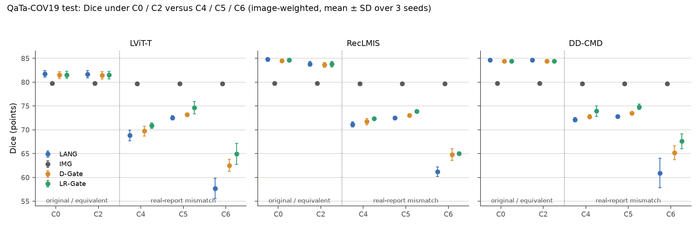
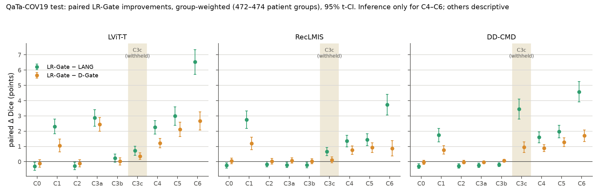
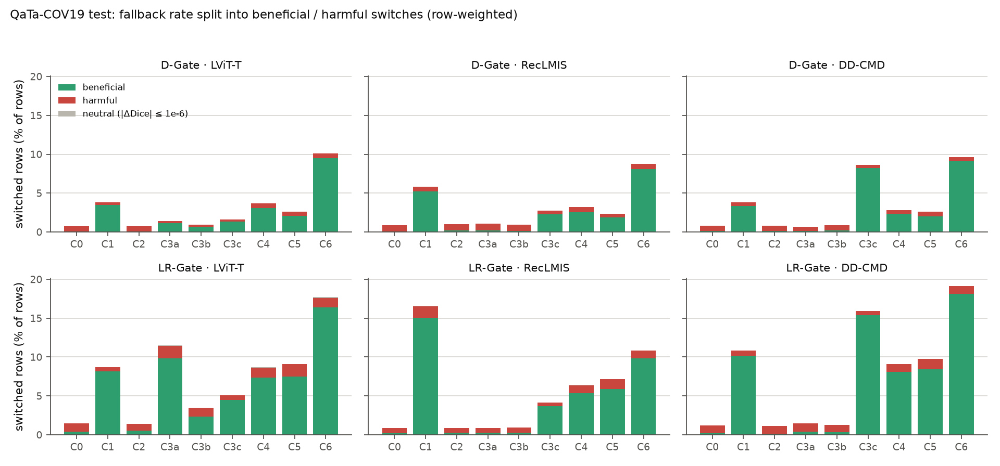
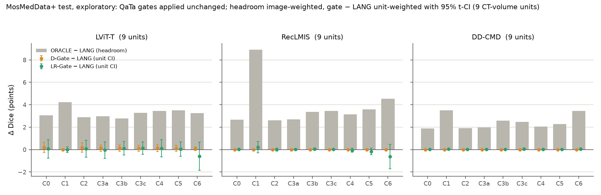
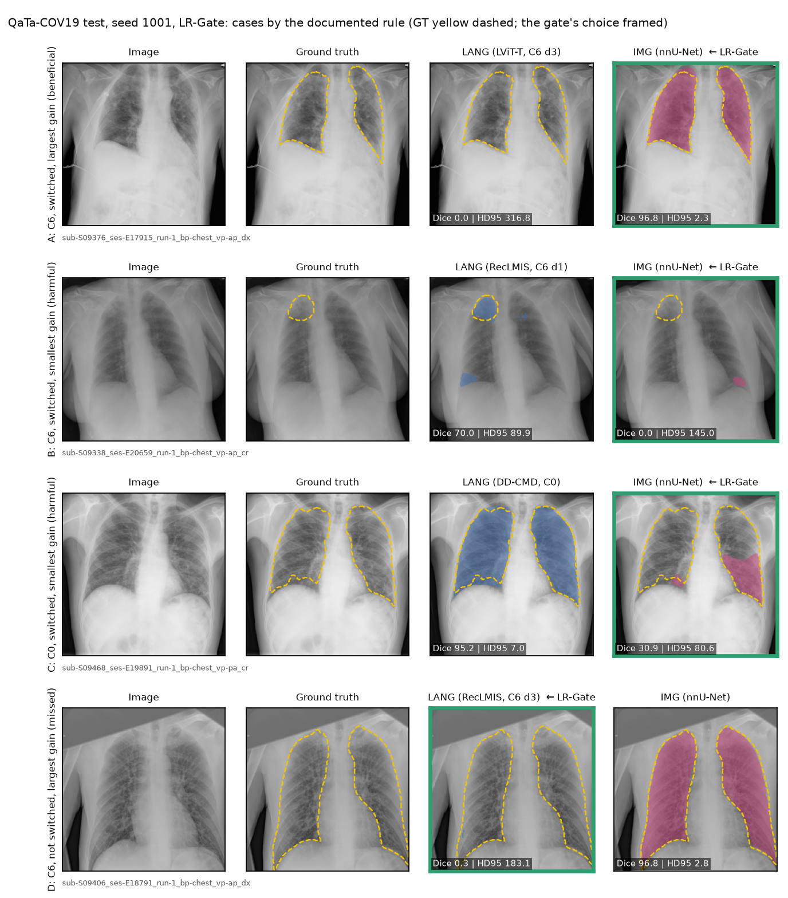

# Phase 3 — Test results (frozen protocol)

Status: 2026-10-30. Run record, checks, results (section 4) and conclusions (section 5) of the locked test evaluation.
Protocol: [PHASE3_PROTOCOL_FREEZE.md](PHASE3_PROTOCOL_FREEZE.md), frozen in commit b593d7f (record
`configs/phase2_frozen/phase2_lock.json`). This file is not part of the freeze record. Gates as fixed at
b58cdf6; nothing was fitted, calibrated or selected on test.

## 1. Test run record

- Job 394 (`slurm/phase3_test.slurm`), 2026-10-30 14:38–14:46 EDT, one run: lock check OPEN; nnU-Net test
  inference (2 datasets × 3 seeds); `export_per_case.py`, `features.py`, `evaluate_gates.py`, `stats_phase3.py`,
  all with `--split test`.
- `results/phase2_test_eval_log.tsv`: 6 start and 6 end entries of `phase3/infer_img.py`, job 394.
- **Fetch on the compute node.** The two rows of MosMedData+ seed 1002 (14:43:35 start, 14:43:50 end) have
  `fetch` = "failed: … Could not resolve host" (no DNS on the compute node at that moment). By design of
  `src/phase2/lock.py` (`require_open(fetch_required=False)` on compute nodes), the lock then uses the local
  `origin/main` ref, which was fb221cc, the same as in the other rows of job 394. The record, the 27 sha256 values
  and the content of the frozen commit were still checked, and the lock was open; the run is valid.
- Inputs: the Phase 2 test benchmark (job 392; [PHASE2_RESULTS.md](PHASE2_RESULTS.md)), P_lang of every
  condition and donor (amendment A1).

## 2. Checks

- **Rows.** 319,230 feature / label / decision rows (QaTa 282,375; MosMed 36,855), equal to the rows of
  `results/phase2_test_per_case.csv.gz`.
- **nnU-Net test inference vs the Phase 0 test archive** (reproducibility record only; Phase 3 uses the new
  scores; job 394 log, `runs/phase3/test/img/nnunet/<ds>/seed<k>/reconcile_phase0.csv`):

| Dataset | Seed | Mean Dice (new) | Mean Dice (Phase 0) | Max case \|ΔDice\| | Cases with a mask difference | Max pixels |
|---|---|---:|---:|---:|---:|---:|
| QaTa-COV19 | 1001 | 79.8076 | 79.8076 | 0.0060 | 636 / 2113 | 9 |
| QaTa-COV19 | 1002 | 79.5355 | 79.5358 | 0.0040 | 497 / 2113 | 4 |
| QaTa-COV19 | 1003 | 79.8293 | 79.8291 | 0.0033 | 702 / 2113 | 10 |
| MosMedData+ | 1001 | 71.2861 | 71.2850 | 0.0031 | 23 / 273 | 2 |
| MosMedData+ | 1002 | 71.9562 | 71.9574 | 0.0020 | 17 / 273 | 3 |
| MosMedData+ | 1003 | 72.9503 | 72.9516 | 0.0180 | 19 / 273 | 1 |

  The same kind of difference as on validation (PHASE3_SETUP.md section 6): the Phase 0 archive is float16.

## 3. Result files

- `phase3_test_results.csv` (Task 3.5, image-weighted), `phase3_test_per_case.csv.gz` (every row × strategy),
  `phase3_test_paired_differences.csv`, `phase3_test_fallback_rates.csv`, `phase3_test_routing_quality.csv`,
  `phase3_test_mosmed_exploratory.csv`
- `phase3_pairwise_results.csv` (Task 3.7)
- for independent checking: `phase3_test_gate_decisions.csv.gz` (keys, F1, LR score, both switches; full
  precision), `phase3_img_test_per_case.csv.gz` (IMG test per-case scores),
  `phase3_reliability_features_test.csv.gz`, `phase3_feature_labels_test.csv.gz`

## 4. Results (QaTa-COV19 test unless stated; Dice in points)

Image-weighted tables (Task 3.5) are the mean of the three per-seed means, donors averaged within image and
seed. Paired differences (Task 3.7) are group-weighted over 472–474 patient groups with 95% t-CIs. Tables are
generated by `src/phase3/make_phase3_results.py`; figures by `src/phase3/make_figures.py`
(`reports/figures/phase3/`).

### 4.1 All strategies by condition (Task 3.5, image-weighted)

ORACLE needs the ground truth and is a reference, not a method. IMG is the same prediction under every
condition (79.66 instead of 79.72 under C3c–C6, where 32 images are not eligible).

<!-- BEGIN QATA -->
| Method | Condition | Images | LANG | IMG | D-Gate | LR-Gate | NULL (C1) | ORACLE | D-Gate switch % | LR-Gate switch % | ORACLE switch % |
|---|---|---|---|---|---|---|---|---|---|---|---|
| LViT-T | C0 | 2113 | 81.71 | 79.72 | 81.48 | 81.54 | 63.05 | 84.98 | 0.7 | 1.5 | 53.5 |
| LViT-T | C1 | 2113 | 63.05 | 79.72 | 64.64 | 66.10 | 63.05 | 81.68 | 3.8 | 8.7 | 82.3 |
| LViT-T | C2 | 2113 | 81.65 | 79.72 | 81.43 | 81.51 | 63.05 | 84.91 | 0.7 | 1.4 | 53.9 |
| LViT-T | C3a | 2113 | 70.75 | 79.72 | 71.08 | 73.22 | 63.05 | 81.62 | 1.4 | 11.5 | 77.6 |
| LViT-T | C3b | 2113 | 74.45 | 79.72 | 74.66 | 74.85 | 63.05 | 82.66 | 0.9 | 3.5 | 69.1 |
| LViT-T | C3c | 2081 | 70.78 | 79.66 | 71.25 | 71.96 | 63.07 | 82.65 | 1.6 | 5.1 | 71.8 |
| LViT-T | C4 | 2081 | 68.81 | 79.66 | 69.73 | 70.89 | 63.07 | 82.08 | 3.7 | 8.7 | 75.9 |
| LViT-T | C5 | 2081 | 72.53 | 79.66 | 73.19 | 74.64 | 63.07 | 82.05 | 2.6 | 9.1 | 73.4 |
| LViT-T | C6 | 2081 | 57.70 | 79.66 | 62.54 | 64.95 | 63.07 | 80.96 | 10.1 | 17.7 | 86.6 |
| RecLMIS | C0 | 2113 | 84.77 | 79.72 | 84.48 | 84.63 | 68.03 | 86.38 | 0.9 | 0.9 | 37.4 |
| RecLMIS | C1 | 2113 | 68.03 | 79.72 | 70.03 | 72.02 | 68.03 | 82.08 | 5.8 | 16.6 | 77.6 |
| RecLMIS | C2 | 2113 | 83.84 | 79.72 | 83.62 | 83.77 | 68.03 | 85.96 | 1.0 | 0.8 | 40.3 |
| RecLMIS | C3a | 2113 | 84.32 | 79.72 | 84.08 | 84.21 | 68.03 | 86.12 | 1.0 | 0.9 | 39.3 |
| RecLMIS | C3b | 2113 | 83.28 | 79.72 | 83.05 | 83.16 | 68.03 | 85.64 | 0.9 | 0.9 | 45.1 |
| RecLMIS | C3c | 2081 | 72.66 | 79.66 | 73.37 | 73.60 | 68.08 | 82.77 | 2.7 | 4.1 | 69.0 |
| RecLMIS | C4 | 2081 | 71.13 | 79.66 | 71.72 | 72.39 | 68.08 | 82.44 | 3.2 | 6.4 | 71.2 |
| RecLMIS | C5 | 2081 | 72.48 | 79.66 | 73.01 | 73.88 | 68.08 | 82.44 | 2.3 | 7.2 | 71.1 |
| RecLMIS | C6 | 2081 | 61.20 | 79.66 | 64.79 | 65.04 | 68.08 | 81.14 | 8.8 | 10.9 | 85.2 |
| DD-CMD | C0 | 2113 | 84.64 | 79.72 | 84.41 | 84.39 | 71.30 | 86.17 | 0.8 | 1.2 | 39.6 |
| DD-CMD | C1 | 2113 | 71.30 | 79.72 | 72.61 | 74.11 | 71.30 | 82.72 | 3.8 | 10.8 | 72.5 |
| DD-CMD | C2 | 2113 | 84.63 | 79.72 | 84.40 | 84.38 | 71.30 | 86.16 | 0.8 | 1.2 | 39.8 |
| DD-CMD | C3a | 2113 | 83.57 | 79.72 | 83.42 | 83.37 | 71.30 | 85.54 | 0.7 | 1.5 | 44.8 |
| DD-CMD | C3b | 2113 | 83.41 | 79.72 | 83.20 | 83.22 | 71.30 | 85.56 | 0.9 | 1.2 | 43.7 |
| DD-CMD | C3c | 2081 | 62.53 | 79.66 | 66.57 | 68.46 | 71.32 | 82.06 | 8.6 | 15.9 | 79.8 |
| DD-CMD | C4 | 2081 | 72.12 | 79.66 | 72.75 | 73.93 | 71.32 | 82.58 | 2.8 | 9.1 | 71.3 |
| DD-CMD | C5 | 2081 | 72.85 | 79.66 | 73.46 | 74.82 | 71.32 | 82.28 | 2.6 | 9.8 | 72.1 |
| DD-CMD | C6 | 2081 | 60.92 | 79.66 | 65.16 | 67.60 | 71.32 | 81.16 | 9.6 | 19.1 | 84.7 |
<!-- END QATA -->

### 4.2 Task 3.7: primary and secondary families (QaTa, Holm within each family of 9)

<!-- BEGIN PRIMARY -->
| Family | Comparison | Method | Condition | Images | Groups | Δ [95% CI] | p raw | p Holm | Holm < 0.05 |
|---|---|---|---|---|---|---|---|---|---|
| primary | LR-Gate - LANG | LViT-T | C4 | 2081 | 472 | +2.26 [+1.82, +2.70] | 6.1e-22 | 3.6e-21 | True |
| primary | LR-Gate - LANG | RecLMIS | C4 | 2081 | 472 | +1.36 [+0.98, +1.74] | 6.5e-12 | 6.5e-12 | True |
| primary | LR-Gate - LANG | DD-CMD | C4 | 2081 | 472 | +1.60 [+1.25, +1.96] | 1.9e-17 | 5.7e-17 | True |
| primary | LR-Gate - LANG | LViT-T | C5 | 2081 | 472 | +2.99 [+2.39, +3.58] | 5.5e-21 | 2.7e-20 | True |
| primary | LR-Gate - LANG | RecLMIS | C5 | 2081 | 472 | +1.44 [+1.06, +1.83] | 1.2e-12 | 2.4e-12 | True |
| primary | LR-Gate - LANG | DD-CMD | C5 | 2081 | 472 | +1.98 [+1.57, +2.39] | 1.5e-19 | 5.9e-19 | True |
| primary | LR-Gate - LANG | LViT-T | C6 | 2081 | 472 | +6.53 [+5.71, +7.35] | 3.8e-45 | 3.4e-44 | True |
| primary | LR-Gate - LANG | RecLMIS | C6 | 2081 | 472 | +3.74 [+3.06, +4.41] | 7.7e-25 | 5.4e-24 | True |
| primary | LR-Gate - LANG | DD-CMD | C6 | 2081 | 472 | +4.58 [+3.91, +5.24] | 1.5e-35 | 1.2e-34 | True |
| secondary | LR-Gate - D-Gate | LViT-T | C4 | 2081 | 472 | +1.22 [+0.90, +1.53] | 1.6e-13 | 6.5e-13 | True |
| secondary | LR-Gate - D-Gate | RecLMIS | C4 | 2081 | 472 | +0.76 [+0.48, +1.04] | 1.3e-07 | 2.6e-07 | True |
| secondary | LR-Gate - D-Gate | DD-CMD | C4 | 2081 | 472 | +0.89 [+0.67, +1.11] | 1.5e-14 | 7.3e-14 | True |
| secondary | LR-Gate - D-Gate | LViT-T | C5 | 2081 | 472 | +2.12 [+1.64, +2.59] | 4.7e-17 | 2.8e-16 | True |
| secondary | LR-Gate - D-Gate | RecLMIS | C5 | 2081 | 472 | +0.93 [+0.61, +1.24] | 1.8e-08 | 5.3e-08 | True |
| secondary | LR-Gate - D-Gate | DD-CMD | C5 | 2081 | 472 | +1.28 [+0.99, +1.56] | 2.2e-17 | 1.7e-16 | True |
| secondary | LR-Gate - D-Gate | LViT-T | C6 | 2081 | 472 | +2.68 [+2.08, +3.27] | 1.9e-17 | 1.7e-16 | True |
| secondary | LR-Gate - D-Gate | RecLMIS | C6 | 2081 | 472 | +0.88 [+0.38, +1.38] | 0.00062 | 0.00062 | True |
| secondary | LR-Gate - D-Gate | DD-CMD | C6 | 2081 | 472 | +1.70 [+1.32, +2.08] | 2e-17 | 1.7e-16 | True |
<!-- END PRIMARY -->

### 4.3 How much of the ORACLE headroom the gates recover (C4–C6; descriptive)

(gate − LANG) / (ORACLE − LANG), from the image-weighted table of section 4.1; no new test.

<!-- BEGIN RECOVERY -->
| Method | Condition | ORACLE − LANG | D-Gate − LANG | LR-Gate − LANG | D-Gate recovered | LR-Gate recovered | IMG − LR-Gate |
|---|---|---|---|---|---|---|---|
| LViT-T | C4 | 13.27 | +0.91 | +2.08 | 6.9% | 15.7% | +8.77 |
| LViT-T | C5 | 9.52 | +0.66 | +2.11 | 7.0% | 22.2% | +5.02 |
| LViT-T | C6 | 23.26 | +4.84 | +7.25 | 20.8% | 31.2% | +14.72 |
| RecLMIS | C4 | 11.31 | +0.59 | +1.26 | 5.2% | 11.1% | +7.28 |
| RecLMIS | C5 | 9.96 | +0.53 | +1.39 | 5.3% | 14.0% | +5.79 |
| RecLMIS | C6 | 19.94 | +3.59 | +3.84 | 18.0% | 19.3% | +14.62 |
| DD-CMD | C4 | 10.45 | +0.63 | +1.80 | 6.0% | 17.3% | +5.73 |
| DD-CMD | C5 | 9.43 | +0.61 | +1.97 | 6.5% | 20.9% | +4.85 |
| DD-CMD | C6 | 20.24 | +4.24 | +6.68 | 20.9% | 33.0% | +12.06 |
<!-- END RECOVERY -->

### 4.4 IMG alone as the reference

<!-- BEGIN IMGREF -->
| Method | Condition | IMG | IMG − LANG | IMG − D-Gate | IMG − LR-Gate |
|---|---|---|---|---|---|
| LViT-T | C0 | 79.72 | -1.99 | -1.76 | -1.81 |
| LViT-T | C2 | 79.72 | -1.93 | -1.71 | -1.78 |
| LViT-T | C1 | 79.72 | +16.67 | +15.08 | +13.62 |
| LViT-T | C4 | 79.66 | +10.85 | +9.94 | +8.77 |
| LViT-T | C5 | 79.66 | +7.13 | +6.47 | +5.02 |
| LViT-T | C6 | 79.66 | +21.96 | +17.12 | +14.72 |
| RecLMIS | C0 | 79.72 | -5.04 | -4.76 | -4.91 |
| RecLMIS | C2 | 79.72 | -4.12 | -3.89 | -4.05 |
| RecLMIS | C1 | 79.72 | +11.69 | +9.69 | +7.71 |
| RecLMIS | C4 | 79.66 | +8.54 | +7.95 | +7.28 |
| RecLMIS | C5 | 79.66 | +7.18 | +6.65 | +5.79 |
| RecLMIS | C6 | 79.66 | +18.46 | +14.88 | +14.62 |
| DD-CMD | C0 | 79.72 | -4.92 | -4.68 | -4.67 |
| DD-CMD | C2 | 79.72 | -4.91 | -4.67 | -4.66 |
| DD-CMD | C1 | 79.72 | +8.43 | +7.11 | +5.61 |
| DD-CMD | C4 | 79.66 | +7.54 | +6.91 | +5.73 |
| DD-CMD | C5 | 79.66 | +6.81 | +6.20 | +4.85 |
| DD-CMD | C6 | 79.66 | +18.74 | +14.50 | +12.06 |
<!-- END IMGREF -->

### 4.5 C0 and C2: gate − LANG against the −0.005 development margin

Group-weighted Δ with 95% t-CI on test; "CI lower bound ≥ −0.50" means the CI does not reach the margin
(−0.005 on the [0, 1] scale). The validation columns are the same quantity on QaTa GATE_CAL and GATE_FIT
(`results/phase3_pairwise_results_val.csv`; development data).

<!-- BEGIN MARGIN -->
| Comparison | Method | Condition | Test Δ [95% CI] | CI lower bound ≥ −0.50 | GATE_CAL Δ | GATE_FIT Δ |
|---|---|---|---|---|---|---|
| D-Gate - LANG | LViT-T | C0 | -0.18 [-0.32, -0.04] | True | -0.44 | -0.74 |
| D-Gate - LANG | RecLMIS | C0 | -0.29 [-0.47, -0.11] | True | -0.49 | -0.94 |
| D-Gate - LANG | DD-CMD | C0 | -0.26 [-0.43, -0.08] | True | -0.41 | -0.79 |
| D-Gate - LANG | LViT-T | C2 | -0.17 [-0.30, -0.04] | True | -0.43 | -0.72 |
| D-Gate - LANG | RecLMIS | C2 | -0.20 [-0.39, -0.01] | True | -0.45 | -0.75 |
| D-Gate - LANG | DD-CMD | C2 | -0.26 [-0.43, -0.08] | True | -0.42 | -0.79 |
| LR-Gate - LANG | LViT-T | C0 | -0.30 [-0.56, -0.04] | False | -0.39 | -0.85 |
| LR-Gate - LANG | RecLMIS | C0 | -0.25 [-0.42, -0.07] | True | -0.48 | -0.68 |
| LR-Gate - LANG | DD-CMD | C0 | -0.30 [-0.45, -0.14] | True | -0.46 | -0.76 |
| LR-Gate - LANG | LViT-T | C2 | -0.28 [-0.52, -0.03] | False | -0.45 | -0.82 |
| LR-Gate - LANG | RecLMIS | C2 | -0.17 [-0.34, -0.00] | True | -0.44 | -0.66 |
| LR-Gate - LANG | DD-CMD | C2 | -0.28 [-0.42, -0.13] | True | -0.46 | -0.75 |
<!-- END MARGIN -->

### 4.6 C1 and C3 (withheld from fitting and calibration; descriptive)

<!-- BEGIN C3 -->
| Method | Condition | D-Gate − LANG | LR-Gate − LANG | LR-Gate − D-Gate |
|---|---|---|---|---|
| LViT-T | C1 | +1.25 [+0.79, +1.70] | +2.31 [+1.82, +2.79] | +1.06 [+0.64, +1.48] |
| LViT-T | C3a | +0.42 [+0.20, +0.65] | +2.87 [+2.33, +3.40] | +2.45 [+1.99, +2.90] |
| LViT-T | C3b | +0.21 [+0.04, +0.38] | +0.23 [-0.04, +0.51] | +0.02 [-0.22, +0.26] |
| LViT-T | C3c | +0.36 [+0.13, +0.59] | +0.72 [+0.42, +1.02] | +0.36 [+0.14, +0.58] |
| RecLMIS | C1 | +1.55 [+1.08, +2.02] | +2.75 [+2.18, +3.32] | +1.20 [+0.80, +1.61] |
| RecLMIS | C3a | -0.29 [-0.48, -0.10] | -0.21 [-0.39, -0.03] | +0.08 [-0.10, +0.25] |
| RecLMIS | C3b | -0.25 [-0.40, -0.09] | -0.22 [-0.40, -0.04] | +0.03 [-0.14, +0.20] |
| RecLMIS | C3c | +0.54 [+0.23, +0.84] | +0.66 [+0.39, +0.92] | +0.12 [-0.08, +0.32] |
| DD-CMD | C1 | +0.97 [+0.56, +1.37] | +1.74 [+1.29, +2.19] | +0.77 [+0.50, +1.04] |
| DD-CMD | C3a | -0.22 [-0.35, -0.08] | -0.24 [-0.39, -0.10] | -0.03 [-0.11, +0.06] |
| DD-CMD | C3b | -0.26 [-0.43, -0.10] | -0.20 [-0.32, -0.08] | +0.06 [-0.04, +0.16] |
| DD-CMD | C3c | +2.50 [+1.87, +3.14] | +3.45 [+2.80, +4.11] | +0.95 [+0.61, +1.29] |
<!-- END C3 -->

### 4.7 Routing quality (row counts; neutral = |ΔDice| ≤ 1e-6)

<!-- BEGIN ROUTING -->
| Gate | Method | Condition | Rows | Switched | Switch % (rows) | Beneficial | Harmful | Neutral | Beneficial % of switched | Harmful % of switched | Net gain (image-weighted) |
|---|---|---|---|---|---|---|---|---|---|---|---|
| D-Gate | LViT-T | C0 | 6339 | 46 | 0.73 | 6 | 40 | 0 | 13.0 | 87.0 | -0.23 |
| D-Gate | LViT-T | C1 | 6339 | 243 | 3.83 | 221 | 22 | 0 | 90.9 | 9.1 | +1.59 |
| D-Gate | LViT-T | C2 | 6339 | 45 | 0.71 | 5 | 40 | 0 | 11.1 | 88.9 | -0.22 |
| D-Gate | LViT-T | C3a | 6339 | 88 | 1.39 | 73 | 15 | 0 | 83.0 | 17.0 | +0.34 |
| D-Gate | LViT-T | C3b | 6339 | 58 | 0.91 | 43 | 15 | 0 | 74.1 | 25.9 | +0.20 |
| D-Gate | LViT-T | C3c | 6243 | 99 | 1.59 | 83 | 16 | 0 | 83.8 | 16.2 | +0.47 |
| D-Gate | LViT-T | C4 | 18729 | 695 | 3.71 | 580 | 115 | 0 | 83.5 | 16.5 | +0.91 |
| D-Gate | LViT-T | C5 | 18729 | 487 | 2.60 | 388 | 99 | 0 | 79.7 | 20.3 | +0.66 |
| D-Gate | LViT-T | C6 | 18729 | 1887 | 10.08 | 1773 | 114 | 0 | 94.0 | 6.0 | +4.84 |
| D-Gate | RecLMIS | C0 | 6339 | 56 | 0.88 | 5 | 51 | 0 | 8.9 | 91.1 | -0.29 |
| D-Gate | RecLMIS | C1 | 6339 | 367 | 5.79 | 330 | 37 | 0 | 89.9 | 10.1 | +2.00 |
| D-Gate | RecLMIS | C2 | 6339 | 64 | 1.01 | 13 | 51 | 0 | 20.3 | 79.7 | -0.23 |
| D-Gate | RecLMIS | C3a | 6339 | 66 | 1.04 | 11 | 55 | 0 | 16.7 | 83.3 | -0.24 |
| D-Gate | RecLMIS | C3b | 6339 | 60 | 0.95 | 9 | 51 | 0 | 15.0 | 85.0 | -0.23 |
| D-Gate | RecLMIS | C3c | 6243 | 170 | 2.72 | 140 | 30 | 0 | 82.4 | 17.6 | +0.71 |
| D-Gate | RecLMIS | C4 | 18729 | 602 | 3.21 | 470 | 132 | 0 | 78.1 | 21.9 | +0.59 |
| D-Gate | RecLMIS | C5 | 18729 | 439 | 2.34 | 347 | 91 | 1 | 79.0 | 20.7 | +0.53 |
| D-Gate | RecLMIS | C6 | 18729 | 1644 | 8.78 | 1518 | 126 | 0 | 92.3 | 7.7 | +3.59 |
| D-Gate | DD-CMD | C0 | 6339 | 49 | 0.77 | 8 | 41 | 0 | 16.3 | 83.7 | -0.23 |
| D-Gate | DD-CMD | C1 | 6339 | 241 | 3.80 | 212 | 29 | 0 | 88.0 | 12.0 | +1.32 |
| D-Gate | DD-CMD | C2 | 6339 | 49 | 0.77 | 8 | 41 | 0 | 16.3 | 83.7 | -0.23 |
| D-Gate | DD-CMD | C3a | 6339 | 42 | 0.66 | 10 | 32 | 0 | 23.8 | 76.2 | -0.15 |
| D-Gate | DD-CMD | C3b | 6339 | 57 | 0.90 | 12 | 45 | 0 | 21.1 | 78.9 | -0.21 |
| D-Gate | DD-CMD | C3c | 6243 | 540 | 8.65 | 514 | 26 | 0 | 95.2 | 4.8 | +4.04 |
| D-Gate | DD-CMD | C4 | 18729 | 530 | 2.83 | 436 | 94 | 0 | 82.3 | 17.7 | +0.63 |
| D-Gate | DD-CMD | C5 | 18729 | 487 | 2.60 | 377 | 110 | 0 | 77.4 | 22.6 | +0.61 |
| D-Gate | DD-CMD | C6 | 18729 | 1805 | 9.64 | 1699 | 106 | 0 | 94.1 | 5.9 | +4.24 |
| LR-Gate | LViT-T | C0 | 6339 | 92 | 1.45 | 27 | 64 | 1 | 29.3 | 69.6 | -0.17 |
| LR-Gate | LViT-T | C1 | 6339 | 553 | 8.72 | 516 | 34 | 3 | 93.3 | 6.1 | +3.05 |
| LR-Gate | LViT-T | C2 | 6339 | 90 | 1.42 | 33 | 55 | 2 | 36.7 | 61.1 | -0.15 |
| LR-Gate | LViT-T | C3a | 6339 | 731 | 11.53 | 625 | 98 | 8 | 85.5 | 13.4 | +2.48 |
| LR-Gate | LViT-T | C3b | 6339 | 222 | 3.50 | 149 | 70 | 3 | 67.1 | 31.5 | +0.39 |
| LR-Gate | LViT-T | C3c | 6243 | 317 | 5.08 | 280 | 36 | 1 | 88.3 | 11.4 | +1.18 |
| LR-Gate | LViT-T | C4 | 18729 | 1622 | 8.66 | 1376 | 243 | 3 | 84.8 | 15.0 | +2.08 |
| LR-Gate | LViT-T | C5 | 18729 | 1709 | 9.12 | 1405 | 293 | 11 | 82.2 | 17.1 | +2.11 |
| LR-Gate | LViT-T | C6 | 18729 | 3314 | 17.69 | 3073 | 226 | 15 | 92.7 | 6.8 | +7.25 |
| LR-Gate | RecLMIS | C0 | 6339 | 56 | 0.88 | 14 | 42 | 0 | 25.0 | 75.0 | -0.14 |
| LR-Gate | RecLMIS | C1 | 6339 | 1050 | 16.56 | 954 | 93 | 3 | 90.9 | 8.9 | +3.99 |
| LR-Gate | RecLMIS | C2 | 6339 | 53 | 0.84 | 18 | 35 | 0 | 34.0 | 66.0 | -0.07 |
| LR-Gate | RecLMIS | C3a | 6339 | 55 | 0.87 | 16 | 39 | 0 | 29.1 | 70.9 | -0.10 |
| LR-Gate | RecLMIS | C3b | 6339 | 58 | 0.91 | 15 | 42 | 1 | 25.9 | 72.4 | -0.12 |
| LR-Gate | RecLMIS | C3c | 6243 | 257 | 4.12 | 229 | 28 | 0 | 89.1 | 10.9 | +0.94 |
| LR-Gate | RecLMIS | C4 | 18729 | 1198 | 6.40 | 1001 | 187 | 10 | 83.6 | 15.6 | +1.26 |
| LR-Gate | RecLMIS | C5 | 18729 | 1340 | 7.15 | 1096 | 238 | 6 | 81.8 | 17.8 | +1.39 |
| LR-Gate | RecLMIS | C6 | 18729 | 2033 | 10.85 | 1843 | 181 | 9 | 90.7 | 8.9 | +3.84 |
| LR-Gate | DD-CMD | C0 | 6339 | 78 | 1.23 | 11 | 67 | 0 | 14.1 | 85.9 | -0.25 |
| LR-Gate | DD-CMD | C1 | 6339 | 686 | 10.82 | 643 | 43 | 0 | 93.7 | 6.3 | +2.81 |
| LR-Gate | DD-CMD | C2 | 6339 | 73 | 1.15 | 10 | 63 | 0 | 13.7 | 86.3 | -0.25 |
| LR-Gate | DD-CMD | C3a | 6339 | 95 | 1.50 | 26 | 69 | 0 | 27.4 | 72.6 | -0.20 |
| LR-Gate | DD-CMD | C3b | 6339 | 79 | 1.25 | 20 | 59 | 0 | 25.3 | 74.7 | -0.20 |
| LR-Gate | DD-CMD | C3c | 6243 | 995 | 15.94 | 962 | 33 | 0 | 96.7 | 3.3 | +5.92 |
| LR-Gate | DD-CMD | C4 | 18729 | 1706 | 9.11 | 1520 | 186 | 0 | 89.1 | 10.9 | +1.80 |
| LR-Gate | DD-CMD | C5 | 18729 | 1832 | 9.78 | 1584 | 247 | 1 | 86.5 | 13.5 | +1.97 |
| LR-Gate | DD-CMD | C6 | 18729 | 3586 | 19.15 | 3400 | 182 | 4 | 94.8 | 5.1 | +6.68 |
<!-- END ROUTING -->

### 4.8 MosMedData+ (exploratory; QaTa gates applied unchanged; 9 CT-volume units)

<!-- BEGIN MOSMED -->
| Method | Condition | Images | Units | LANG | IMG | D-Gate | LR-Gate | ORACLE − LANG | D switch % | LR switch % | LR-Gate − LANG (units) [95% CI] |
|---|---|---|---|---|---|---|---|---|---|---|---|
| LViT-T | C0 | 273 | 9 | 74.01 | 72.06 | 74.08 | 73.89 | 3.05 | 0.24 | 1.59 | +0.07 [-0.76, +0.89] |
| LViT-T | C1 | 273 | 9 | 70.98 | 72.06 | 70.98 | 70.92 | 4.24 | 0.00 | 0.61 | -0.01 [-0.25, +0.24] |
| LViT-T | C2 | 273 | 9 | 73.97 | 72.06 | 74.03 | 73.87 | 2.89 | 0.24 | 1.47 | +0.08 [-0.67, +0.83] |
| LViT-T | C3a | 273 | 9 | 73.55 | 72.06 | 73.59 | 73.42 | 2.97 | 0.12 | 1.47 | -0.05 [-0.77, +0.68] |
| LViT-T | C3b | 273 | 9 | 73.96 | 72.06 | 74.00 | 73.88 | 2.77 | 0.12 | 1.22 | +0.11 [-0.48, +0.70] |
| LViT-T | C3c | 273 | 9 | 73.00 | 72.06 | 73.03 | 72.98 | 3.28 | 0.12 | 1.10 | +0.13 [-0.42, +0.68] |
| LViT-T | C4 | 273 | 9 | 73.27 | 72.06 | 73.31 | 73.15 | 3.45 | 0.12 | 1.59 | +0.12 [-0.65, +0.88] |
| LViT-T | C5 | 273 | 9 | 73.54 | 72.06 | 73.58 | 73.41 | 3.51 | 0.12 | 1.47 | +0.05 [-0.58, +0.69] |
| LViT-T | C6 | 273 | 9 | 73.79 | 72.06 | 73.81 | 73.36 | 3.24 | 0.08 | 1.99 | -0.58 [-1.84, +0.67] |
| RecLMIS | C0 | 273 | 9 | 74.44 | 72.06 | 74.44 | 74.45 | 2.66 | 0.00 | 0.37 | +0.02 [-0.09, +0.12] |
| RecLMIS | C1 | 273 | 9 | 65.32 | 72.06 | 65.32 | 65.40 | 8.92 | 0.00 | 0.24 | +0.22 [-0.29, +0.73] |
| RecLMIS | C2 | 273 | 9 | 74.69 | 72.06 | 74.69 | 74.70 | 2.60 | 0.00 | 0.37 | -0.00 [-0.13, +0.12] |
| RecLMIS | C3a | 273 | 9 | 74.27 | 72.06 | 74.27 | 74.27 | 2.70 | 0.00 | 0.12 | +0.01 [-0.01, +0.02] |
| RecLMIS | C3b | 273 | 9 | 72.27 | 72.06 | 72.27 | 72.28 | 3.37 | 0.00 | 0.24 | +0.05 [-0.06, +0.15] |
| RecLMIS | C3c | 273 | 9 | 72.40 | 72.06 | 72.40 | 72.41 | 3.45 | 0.00 | 0.12 | +0.02 [-0.02, +0.05] |
| RecLMIS | C4 | 273 | 9 | 73.44 | 72.06 | 73.44 | 73.41 | 3.13 | 0.00 | 0.49 | -0.05 [-0.23, +0.12] |
| RecLMIS | C5 | 273 | 9 | 73.27 | 72.06 | 73.27 | 73.22 | 3.58 | 0.00 | 0.49 | -0.17 [-0.46, +0.13] |
| RecLMIS | C6 | 273 | 9 | 71.58 | 72.06 | 71.58 | 71.35 | 4.54 | 0.00 | 1.06 | -0.63 [-1.72, +0.46] |
| DD-CMD | C0 | 273 | 9 | 74.85 | 72.06 | 74.85 | 74.86 | 1.90 | 0.00 | 0.37 | +0.02 [-0.02, +0.05] |
| DD-CMD | C1 | 273 | 9 | 72.06 | 72.06 | 72.06 | 72.07 | 3.49 | 0.00 | 2.08 | +0.04 [-0.04, +0.12] |
| DD-CMD | C2 | 273 | 9 | 74.83 | 72.06 | 74.83 | 74.83 | 1.91 | 0.00 | 0.37 | +0.02 [-0.02, +0.05] |
| DD-CMD | C3a | 273 | 9 | 74.46 | 72.06 | 74.46 | 74.47 | 1.96 | 0.00 | 0.49 | +0.01 [-0.02, +0.04] |
| DD-CMD | C3b | 273 | 9 | 73.24 | 72.06 | 73.24 | 73.24 | 2.59 | 0.00 | 0.49 | +0.01 [-0.01, +0.03] |
| DD-CMD | C3c | 273 | 9 | 73.52 | 72.06 | 73.52 | 73.54 | 2.46 | 0.00 | 0.49 | +0.04 [-0.06, +0.15] |
| DD-CMD | C4 | 273 | 9 | 74.48 | 72.06 | 74.48 | 74.48 | 2.06 | 0.00 | 0.24 | +0.01 [-0.02, +0.04] |
| DD-CMD | C5 | 273 | 9 | 74.42 | 72.06 | 74.42 | 74.42 | 2.28 | 0.00 | 0.24 | +0.02 [-0.03, +0.07] |
| DD-CMD | C6 | 273 | 9 | 72.67 | 72.06 | 72.67 | 72.69 | 3.44 | 0.00 | 0.37 | +0.05 [-0.07, +0.17] |
<!-- END MOSMED -->

### 4.9 Cost (Task 3.8, job 391, validation subset of 64 QaTa images, NVIDIA GB10)

<!-- BEGIN COST -->
| Method | Mode | Mean ms | Median ms | p95 ms | Max allocated MB | Max reserved MB |
|---|---|---|---|---|---|---|
| nnU-Net | IMG only | 30.35 | 29.99 | 33.68 | 108 | 128 |
| LViT-T | LANG only | 50.15 | 46.89 | 70.41 | 314 | 342 |
| LViT-T | LANG + IMG + D-Gate | 83.26 | 81.22 | 100.40 | 395 | 438 |
| LViT-T | LANG + IMG + LR-Gate | 82.64 | 79.08 | 108.40 | 395 | 438 |
| RecLMIS | LANG only | 21.97 | 21.85 | 23.90 | 1006 | 1040 |
| RecLMIS | LANG + IMG + D-Gate | 61.49 | 61.64 | 63.54 | 1086 | 1120 |
| RecLMIS | LANG + IMG + LR-Gate | 60.58 | 60.58 | 62.79 | 1086 | 1120 |
| DD-CMD | LANG only | 19.81 | 19.71 | 22.59 | 721 | 780 |
| DD-CMD | LANG + IMG + D-Gate | 53.56 | 54.13 | 56.05 | 802 | 856 |
| DD-CMD | LANG + IMG + LR-Gate | 53.82 | 53.76 | 56.33 | 802 | 854 |
<!-- END COST -->

### 4.10 Real cases

**Selection rule** (fixed before drawing; `src/phase3/make_figures.py`, `reports/figures/phase3/case_selection.json`):
QaTa test, seed 1001, LR-Gate, rows of the three language models pooled; gain = Dice(IMG) − Dice(LANG) of the
row; ties by method order (LViT-T, RecLMIS, DD-CMD), sample id, donor variant.
- A: C6, switched to IMG, largest gain (beneficial switch)
- B: C6, switched to IMG, smallest gain (harmful switch)
- C: C0, switched to IMG, smallest gain (harmful switch under the original text)
- D: C6, not switched, largest gain (missed: the ORACLE would have switched)

The four cases are extremes by construction; they show what the errors look like, not how often they occur
(section 4.7 gives the rates). In A, the LViT-T prediction under the wrong report is empty (Dice 0.0) and the
switch recovers nnU-Net's 96.8; in B and C, the switch replaces a good LANG mask (70.0; 95.2 under the original
text) by a poor nnU-Net mask (0.0; 30.9); in D, RecLMIS under the wrong report predicts almost no foreground (Dice 0.3)
while the ground truth covers both lung fields; nnU-Net reaches 96.8, and the gate stays with LANG.

### 4.11 LR coefficients (standardised features; fixed at b58cdf6)

<!-- BEGIN LRCOEF -->
| Model × seed | F1 | F2 | F3 | F4 | F5 | Intercept |
|---|---|---|---|---|---|---|
| LViT-T 1001 | +0.217 | +0.101 | +0.011 | +0.232 | -0.385 | +0.495 |
| LViT-T 1002 | +0.243 | +0.146 | +0.032 | +0.095 | -0.379 | +0.619 |
| LViT-T 1003 | -0.172 | +0.122 | +0.350 | +0.290 | -0.416 | +0.524 |
| RecLMIS 1001 | +0.993 | +0.202 | -0.684 | +0.298 | -0.434 | +0.274 |
| RecLMIS 1002 | -0.102 | +0.197 | +0.298 | +0.453 | -0.415 | +0.214 |
| RecLMIS 1003 | +0.062 | +0.164 | +0.187 | +0.423 | -0.418 | +0.303 |
| DD-CMD 1001 | +1.214 | -0.083 | -0.689 | +0.214 | -0.542 | +0.202 |
| DD-CMD 1002 | +0.689 | +0.153 | -0.112 | +0.146 | -0.474 | +0.203 |
| DD-CMD 1003 | +0.693 | -0.084 | -0.312 | +0.250 | -0.442 | +0.251 |
<!-- END LRCOEF -->

## 5. Answers to Task 3.9 and conclusions

The gates choose between two segmentations from features of the two probability maps (their disagreement, mask
overlap, area difference and entropies). They do **not** read or verify the report: a switch means that the
language-guided and the image-only predictions disagree in a way that, on the development data, went with a
better image-only result. Nothing here shows that a gate can tell whether a clinical report is true.

### 5.1 Observed results (QaTa test)

1. **Oracle headroom.** Choosing per image the better of LANG and IMG (which needs the ground truth) would add
   9.43–13.27 points under C4 and C5 and 19.94–23.26 under C6; under the clean text C0 it would still add
   1.53–3.27 points, because nnU-Net is better on 37–54% of the images (section 4.1).
2. **The gates recover part of it under C4–C6.** LR-Gate − LANG is positive in all 9 primary comparisons:
   +1.36 to +2.26 (C4), +1.44 to +2.99 (C5), +3.74 to +6.53 (C6) points, Holm p ≤ 6.5e-12. Measured as a share of
   the ORACLE headroom (image-weighted, descriptive), LR-Gate recovers **11.1–33.0%** and D-Gate 5.2–20.9%; most
   of the headroom is not recovered (section 4.3).
3. **LR-Gate adds value over D-Gate under C4–C6.** LR-Gate − D-Gate is positive in all 9 secondary comparisons,
   +0.76 to +2.68 points (Holm p ≤ 0.00062; smallest RecLMIS C6 +0.88 [+0.38, +1.38]). It switches more often
   (6.4–19.1% versus 2.3–10.1% of the rows, image-weighted) with a similar beneficial share of the switches
   (77.4–94.8% for both gates).
4. **C0 and C2 cost a little.** All 12 gate − LANG differences are negative, −0.17 to −0.30 points, with CIs that
   exclude 0. D-Gate: the CI lower bound stays above −0.50 in 6 of 6 cells. LR-Gate: 4 of 6; for **LViT-T** C0
   (−0.30 [−0.56, −0.04]) and C2 (−0.28 [−0.52, −0.03]) the CI reaches below the margin. On validation the
   same quantity was −0.39 to −0.49 on GATE_CAL and −0.66 to −0.94 on GATE_FIT. The GATE_FIT losses beyond the
   margin were known and recorded before the freeze (PHASE3_PROTOCOL_FREEZE.md section 9, item 5) and the
   supervisor was informed; the test losses are smaller than on either validation part. A CI that does not reach
   the margin does not prove that the margin is kept.
5. **IMG alone is the stronger choice whenever the text is wrong or absent.** Under C1 and C4–C6, IMG (79.66–79.72)
   is 4.85–17.12 points above either gate; under C0 and C2 it is 1.93–5.04 points below LANG (section 4.4). The
   gates are a compromise for the situation in which it is not known whether the report is good: they keep almost
   all of the clean-text performance (−0.17 to −0.30) and recover only part of the loss under a wrong report.
6. **C3c (missing location, withheld).** Both gates help: LR-Gate − LANG +0.72 (LViT-T), +0.66 (RecLMIS) and
   +3.45 (DD-CMD), where DD-CMD's LANG falls to 62.53 and LR-Gate switches 15.9% of the rows, 96.7% of them
   beneficially. Descriptive only (not part of a test family).
7. **Switch quality.** Under C4–C6, 77.4–94.8% of the switches are beneficial (both gates), under C1 88.0–93.7%.
   Under C0 and C2 the gates switch rarely (0.7–1.5% of the rows) and most of these switches are harmful (LR-Gate
   C0: 69.6–85.9%); net effect −0.07 to −0.29 points. The same holds for C3a / C3b of RecLMIS and DD-CMD, whose
   LANG is barely affected by these deletions. **LViT-T C3a and C3b are the exception**: LViT-T loses 7–11 points
   when the scope or count is deleted, and both gates switch mostly beneficially there (net +0.20 to +2.48:
   D-Gate C3a +0.34, C3b +0.20; LR-Gate C3a +2.48, C3b +0.39).

### 5.2 Exploratory findings

- **MosMedData+ (question 7; 9 units).** Applied unchanged, the QaTa gates almost never switch on MosMed (D-Gate
  0–0.24%, LR-Gate 0.12–2.08% of the rows) and change Dice by at most 0.63 points in either direction, with unit
  CIs that include 0. The ORACLE headroom is 1.90–8.92 points, so the gates do not use it: their thresholds were
  set on QaTa feature distributions, and MosMed's LANG / IMG disagreement differs. This is the same as on
  validation. No MosMed-specific threshold was set (by protocol).
- Validation and test, primary comparisons (LR-Gate − LANG): C4 and C6 are of similar size on GATE_CAL
  (C4 +1.68 to +2.32, C6 +4.44 to +7.64) and on test (C4 +1.36 to +2.26, C6 +3.74 to +6.53). **C5 is larger on
  test** (+1.44 to +2.99) than on GATE_CAL (+0.97 to +1.37); the largest difference is LViT-T (+2.99 on test
  versus +0.97 on GATE_CAL).

### 5.3 Cost (question 8)

- Per image (Task 3.8, job 391), a gate runs both models: LViT-T 50.15 → 82.64 (LR) / 83.26 (D) ms, RecLMIS
  21.97 → 60.58 (LR) / 61.49 (D) ms, DD-CMD 19.81 → 53.82 (LR) / 53.56 (D) ms; peak allocated memory +80 to
  +82 MB (LViT-T +80.5, RecLMIS +80.0, DD-CMD +81.6), at most 1120 MB reserved.
- Most of the extra time is the nnU-Net pass (IMG only: 30.35 ms). A gate takes 2.1–9.2 ms more than
  "LANG only + IMG only" added together: LViT-T +2.1 (LR) / +2.8 (D), RecLMIS +8.3 / +9.2, DD-CMD +3.7 / +3.4.
  The modes were measured in separate processes, so this remainder cannot be attributed exactly (feature
  computation, data handling, process-to-process variation). The time of the features alone was not measured;
  D-Gate (F1 only) and LR-Gate (F1–F5 + LR score) differ by at most 1 ms in mean latency.
- The measured benefit is +1.36 to +6.53 points under C4–C6 (and +1.74 to +2.75 under C1) against −0.17 to
  −0.30 points under C0 / C2. Whether that justifies 1.7–2.8 times the latency depends on how often reports are
  missing or wrong in use, which this benchmark does not measure. If the reports are often unreliable, IMG alone
  is both cheaper (30 ms) and better than either gate.

### 5.4 Limitations

- **LR coefficients are not interpretable one by one.** Across the three seeds of one method the signs of F1–F3
  change (e.g. F1: LViT-T +0.22 / +0.24 / −0.17, RecLMIS +0.99 / −0.10 / +0.06; F3 similarly), because F1, F2 and
  F3 are collinear measures of the same disagreement. Only F5 (the entropy of the nnU-Net map) has the same sign
  in all nine fits (−0.38 to −0.54): the gates switch less when nnU-Net itself is uncertain. The predictions are
  stable; the attribution to single features is not.
- **The C0 / C2 cost is model- and data-dependent.** It was beyond the margin on GATE_FIT, within it on GATE_CAL
  and test (except the LR-Gate CI for LViT-T); it is not guaranteed for new data.
- **MosMedData+ has 9 test units** and a known train / val / test volume overlap; every MosMed result is
  exploratory, and the gates were never tuned for it.
- **The conditions are benchmark constructions.** C4–C6 swap real reports of other cases, C2 is two word
  substitutions; real report errors may look different. The ORACLE uses the ground truth.
- **One IMG model** (nnU-Net, chosen on GATE_FIT) and three language-guided models, one checkpoint per seed;
  the gates are per model × seed.
- Phase 1 clean (C0) test results had been seen before the freeze; the protected outcome was the counterfactual
  test evaluation. The gates were fixed at b58cdf6 and not changed after any test result.

### 5.5 Conclusions

1. On QaTa-COV19, a fixed reliability gate that falls back from the language-guided model to nnU-Net improves
   Dice under real-report mismatch for all three models (LR-Gate +1.36 to +6.53 points, 9 of 9 primary
   comparisons significant after Holm) and does better than the simple disagreement threshold (9 of 9 secondary
   comparisons).
2. The improvement is a minority of what an oracle selector could reach (11–33% for LR-Gate), and IMG alone is
   better than either gate whenever the report is wrong or missing.
3. Under the original or equivalently worded report the gates cost −0.17 to −0.30 points; for LViT-T the LR-Gate
   CI reaches below the −0.005 development margin.
4. The gate also helps under the withheld missing-location condition (C3c), most for DD-CMD (+3.45), and does
   not transfer to MosMedData+ (exploratory): it almost never switches there.
5. The gates detect disagreement between two segmentations, not the truth of a report.
