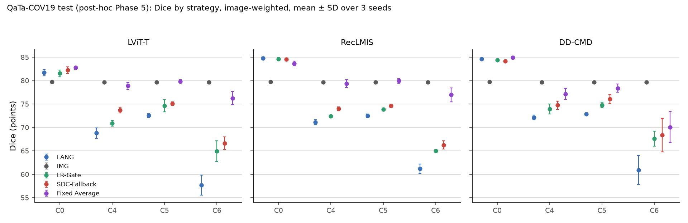
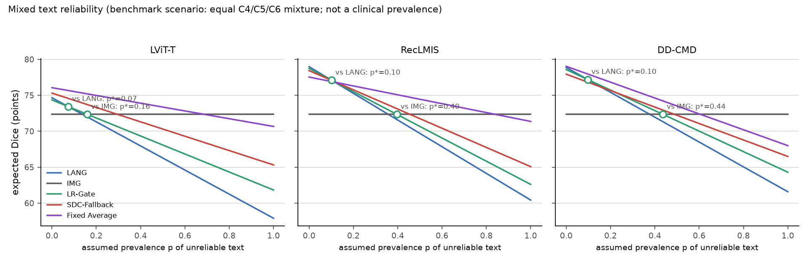

# Phase 5 — Results (post-hoc supplementary comparison)

Status: 2026-11-10. **Post-hoc supplementary comparison** on the QaTa-COV19 test split, which had already been
evaluated in Phases 2 and 3; not an independent confirmation. Plan: [PHASE5_PLAN.md](PHASE5_PLAN.md); rules and
freeze: [PHASE5_PROTOCOL_FREEZE.md](PHASE5_PROTOCOL_FREEZE.md) (commit 6573689). One test run: Slurm job 476
(manifest of 2763 files verified, 206,595 rows), outputs committed in 32a0ebc. Every number below is read by a
program from `results/phase5_*.csv`; Dice in points (× 100, 2 decimals), crossovers with 3 decimals; 95%
t-intervals over 472 (C4–C6) or 474 (C0 / C2) patient groups; no p-values. The results were recomputed
independently with separate code that does not import the repository code (maximum difference 5e-9, storage
precision).

**Check against the frozen Phase 3 results.** The LANG, IMG, D-Gate and LR-Gate rows of
`results/phase5_test_results.csv` equal `results/phase3_test_results.csv` after rounding to its 6 significant
digits (60 rows × 15 columns, 0 mismatches), as stated in the freeze document.

## Dice by strategy (image-weighted, mean of 3 seeds)

| Model | Condition | LANG | IMG | D-Gate | LR-Gate | SDC-Fallback | Fixed Average |
|---|---|---|---|---|---|---|---|
| LViT-T | C0 | 81.71 | 79.72 | 81.48 | 81.54 | 82.24 | 82.76 |
| LViT-T | C2 | 81.65 | 79.72 | 81.43 | 81.50 | 82.07 | 82.64 |
| LViT-T | C4 | 68.81 | 79.66 | 69.73 | 70.89 | 73.70 | 78.87 |
| LViT-T | C5 | 72.53 | 79.66 | 73.19 | 74.64 | 75.09 | 79.85 |
| LViT-T | C6 | 57.70 | 79.66 | 62.54 | 64.95 | 66.64 | 76.23 |
| RecLMIS | C0 | 84.77 | 79.72 | 84.48 | 84.63 | 84.53 | 83.65 |
| RecLMIS | C2 | 83.84 | 79.72 | 83.62 | 83.77 | 83.88 | 83.39 |
| RecLMIS | C4 | 71.13 | 79.66 | 71.72 | 72.39 | 73.99 | 79.37 |
| RecLMIS | C5 | 72.48 | 79.66 | 73.01 | 73.88 | 74.61 | 79.94 |
| RecLMIS | C6 | 61.20 | 79.66 | 64.79 | 65.04 | 66.26 | 76.96 |
| DD-CMD | C0 | 84.64 | 79.72 | 84.41 | 84.39 | 84.14 | 84.89 |
| DD-CMD | C2 | 84.63 | 79.72 | 84.40 | 84.38 | 84.15 | 84.87 |
| DD-CMD | C4 | 72.12 | 79.66 | 72.75 | 73.93 | 74.74 | 77.18 |
| DD-CMD | C5 | 72.85 | 79.66 | 73.46 | 74.82 | 76.08 | 78.39 |
| DD-CMD | C6 | 60.92 | 79.66 | 65.16 | 67.60 | 68.41 | 70.07 |

Fallback rates (% of images, image-weighted):

| Model | Condition | D-Gate | LR-Gate | SDC-Fallback |
|---|---|---|---|---|
| LViT-T | C0 | 0.7 | 1.5 | 12.1 |
| LViT-T | C2 | 0.7 | 1.4 | 11.7 |
| LViT-T | C4 | 3.7 | 8.7 | 17.2 |
| LViT-T | C5 | 2.6 | 9.1 | 16.8 |
| LViT-T | C6 | 10.1 | 17.7 | 26.1 |
| RecLMIS | C0 | 0.9 | 0.9 | 4.8 |
| RecLMIS | C2 | 1.0 | 0.8 | 6.0 |
| RecLMIS | C4 | 3.2 | 6.4 | 10.5 |
| RecLMIS | C5 | 2.3 | 7.2 | 11.1 |
| RecLMIS | C6 | 8.8 | 10.9 | 15.5 |
| DD-CMD | C0 | 0.8 | 1.2 | 7.7 |
| DD-CMD | C2 | 0.8 | 1.2 | 7.7 |
| DD-CMD | C4 | 2.8 | 9.1 | 18.8 |
| DD-CMD | C5 | 2.6 | 9.8 | 27.2 |
| DD-CMD | C6 | 9.6 | 19.1 | 31.0 |

## Q1–Q2. LR-Gate versus SDC-Fallback and versus Fixed Average under C4–C6

Group-weighted paired Dice difference [95% CI]:

| Model | Condition | Images | Groups | LR-Gate − SDC-Fallback | LR-Gate − Fixed Average |
|---|---|---|---|---|---|
| LViT-T | C4 | 2081 | 472 | -6.03 [-7.32, -4.73] | -9.78 [-10.65, -8.92] |
| LViT-T | C5 | 2081 | 472 | -1.24 [-1.95, -0.52] | -5.91 [-6.45, -5.37] |
| LViT-T | C6 | 2081 | 472 | -3.20 [-4.18, -2.21] | -10.82 [-11.51, -10.14] |
| RecLMIS | C4 | 2081 | 472 | -3.41 [-4.33, -2.49] | -8.33 [-9.09, -7.57] |
| RecLMIS | C5 | 2081 | 472 | -1.61 [-2.17, -1.04] | -6.66 [-7.23, -6.08] |
| RecLMIS | C6 | 2081 | 472 | -2.39 [-3.12, -1.65] | -11.28 [-12.02, -10.54] |
| DD-CMD | C4 | 2081 | 472 | -1.94 [-2.56, -1.32] | -3.43 [-3.76, -3.11] |
| DD-CMD | C5 | 2081 | 472 | -1.97 [-2.47, -1.47] | -4.05 [-4.41, -3.69] |
| DD-CMD | C6 | 2081 | 472 | -2.66 [-3.30, -2.02] | -3.59 [-4.13, -3.06] |

**All 18 differences are negative, with every 95% interval below zero (highest upper bound -0.52):
LR-Gate gives a lower Dice than both SDC-Fallback and Fixed Average under C4, C5 and C6 for all three models.**
The gap to Fixed Average is the larger one (up to about 11 points).

## Q3. Clean-text cost under C0 and C2 (strategy − LANG)

Group-weighted difference [95% CI]; "CI ≥ −0.50" marks whether the lower bound stays above the −0.005
development margin, shown only as a reference line. The intervals are descriptive; a lower bound above the line
is not read as equivalence to LANG.

| Strategy | Model | C0 | CI ≥ −0.50 | C2 | CI ≥ −0.50 |
|---|---|---|---|---|---|
| IMG | LViT-T | -2.27 [-3.24, -1.30] | no | -2.19 [-3.15, -1.23] | no |
| IMG | RecLMIS | -6.58 [-7.58, -5.58] | no | -5.33 [-6.32, -4.34] | no |
| IMG | DD-CMD | -6.51 [-7.42, -5.60] | no | -6.50 [-7.41, -5.59] | no |
| D-Gate | LViT-T | -0.18 [-0.32, -0.04] | yes | -0.17 [-0.30, -0.04] | yes |
| D-Gate | RecLMIS | -0.29 [-0.47, -0.11] | yes | -0.20 [-0.39, -0.01] | yes |
| D-Gate | DD-CMD | -0.26 [-0.43, -0.08] | yes | -0.26 [-0.43, -0.08] | yes |
| LR-Gate | LViT-T | -0.30 [-0.56, -0.04] | no | -0.28 [-0.52, -0.03] | no |
| LR-Gate | RecLMIS | -0.25 [-0.42, -0.07] | yes | -0.17 [-0.34, -0.00] | yes |
| LR-Gate | DD-CMD | -0.30 [-0.45, -0.14] | yes | -0.28 [-0.42, -0.13] | yes |
| SDC-Fallback | LViT-T | +0.66 [-0.05, +1.37] | yes | +0.51 [-0.18, +1.20] | yes |
| SDC-Fallback | RecLMIS | -0.55 [-0.92, -0.17] | no | -0.02 [-0.43, +0.40] | yes |
| SDC-Fallback | DD-CMD | -0.95 [-1.29, -0.60] | no | -0.95 [-1.30, -0.60] | no |
| Fixed Average | LViT-T | +1.41 [+0.74, +2.08] | yes | +1.35 [+0.69, +2.02] | yes |
| Fixed Average | RecLMIS | -1.42 [-2.05, -0.79] | no | -0.54 [-1.20, +0.12] | no |
| Fixed Average | DD-CMD | +0.15 [-0.13, +0.43] | yes | +0.13 [-0.15, +0.41] | yes |

How the thresholds were set: the SDC-Fallback τ (Phase 5) and the D-Gate / LR-Gate thresholds (Phase 3) were
chosen on GATE_CAL subject to C0 and C2 losses of at most 0.005 (and C4–C6 ≥ −0.005); Fixed Average has no
constraint, no calibration and no tuned parameter.

## Q4. Computation (approximation)

Model-forward time per image from job 391 (validation, 64 QaTa images, seed 1001, C0): LANG + IMG for LR-Gate,
D-Gate and Fixed Average; LANG + fallback rate × IMG for SDC-Fallback, with the test fallback rate of each
condition. Score computation ignored; approximate values.

| Model | LANG ms | IMG ms | LR-Gate / D-Gate / Fixed Average ms | SDC-Fallback C0 | C2 | C4 | C5 | C6 |
|---|---|---|---|---|---|---|---|---|
| LViT-T | 50.15 | 30.35 | 80.50 | 53.83 (12.1%) | 53.70 (11.7%) | 55.36 (17.2%) | 55.24 (16.8%) | 58.06 (26.1%) |
| RecLMIS | 21.97 | 30.35 | 52.32 | 23.44 (4.8%) | 23.78 (6.0%) | 25.16 (10.5%) | 25.35 (11.1%) | 26.67 (15.5%) |
| DD-CMD | 19.81 | 30.35 | 50.16 | 22.16 (7.7%) | 22.16 (7.7%) | 25.53 (18.8%) | 28.06 (27.2%) | 29.23 (31.0%) |

SDC-Fallback runs nnU-Net only on the images that fall back; LR-Gate, D-Gate and Fixed Average need both models
on every image.

## Q5–Q7. Mixed text reliability

Equal C4/C5/C6 benchmark mixture on the common targets (2081 images, 472 groups): E(p) = (1 − p) D(C0) +
p D_wrong, with group-weighted D. p is an assumed share of unreliable text in a benchmark scenario, not an
estimate of real report errors.

D(C0) / D_wrong (points):

| Model | LANG | IMG | LR-Gate | SDC-Fallback | Fixed Average |
|---|---|---|---|---|---|
| LViT-T | 74.66 / 57.90 | 72.34 / 72.34 | 74.34 / 61.82 | 75.30 / 65.31 | 76.06 / 70.66 |
| RecLMIS | 78.97 / 60.42 | 72.34 / 72.34 | 78.73 / 62.60 | 78.42 / 65.07 | 77.53 / 71.36 |
| DD-CMD | 78.86 / 61.58 | 72.34 / 72.34 | 78.57 / 64.30 | 77.93 / 66.49 | 79.02 / 67.99 |

Exact crossovers (p* from the plan's formula; "none" if outside [0, 1]) and the range of p where the strategy has a
higher expected Dice than both always-LANG and always-IMG:

| Strategy | Model | p* vs LANG | p* vs IMG | Better than both LANG and IMG |
|---|---|---|---|---|
| LR-Gate | LViT-T | 0.073 | 0.160 | 0.073–0.160 |
| LR-Gate | RecLMIS | 0.102 | 0.396 | 0.102–0.396 |
| LR-Gate | DD-CMD | 0.097 | 0.437 | 0.097–0.437 |
| SDC-Fallback | LViT-T | none | 0.296 | 0.000–0.296 |
| SDC-Fallback | RecLMIS | 0.106 | 0.455 | 0.106–0.455 |
| SDC-Fallback | DD-CMD | 0.159 | 0.489 | 0.159–0.489 |
| Fixed Average | LViT-T | none | 0.689 | 0.000–0.689 |
| Fixed Average | RecLMIS | 0.117 | 0.841 | 0.117–0.841 |
| Fixed Average | DD-CMD | none | 0.606 | 0.000–0.606 |

- **Q5.** LR-Gate has a higher expected Dice than always-LANG above p* = 0.073 (LViT-T),
  0.102 (RecLMIS) and 0.097 (DD-CMD).
- **Q6.** Always-IMG has a higher expected Dice than LR-Gate above p* = 0.160 (LViT-T),
  0.396 (RecLMIS) and 0.437 (DD-CMD).
- **Q7.** LR-Gate beats both fixed choices only in a band: 0.073–0.160 (LViT-T), 0.102–0.396 (RecLMIS),
  0.097–0.437 (DD-CMD). Fixed Average beats both over a wider range (0.000–0.689, 0.117–0.841, 0.000–0.606).

**Best of the five strategies by p (descriptive; not a pre-specified output).** From the D(C0) and D_wrong above,
the strategy with the highest expected Dice, with the boundaries computed exactly from the crossing lines:

- LViT-T: Fixed Average [0.000, 0.689]; IMG [0.689, 1.000]
- RecLMIS: LANG [0.000, 0.102]; LR-Gate [0.102, 0.110]; SDC-Fallback [0.110, 0.124];
  Fixed Average [0.124, 0.841]; IMG [0.841, 1.000]
- DD-CMD: Fixed Average [0.000, 0.606]; IMG [0.606, 1.000]

In this benchmark scenario, LR-Gate is the best of the five only for RecLMIS and only in a narrow band of p.

## Q8. Consistency across C4, C5 and C6

Crossovers with D_wrong replaced by one mismatch condition (equal mixture repeated for reference):

| Strategy | Model | vs LANG: equal | C4 | C5 | C6 | vs IMG: equal | C4 | C5 | C6 |
|---|---|---|---|---|---|---|---|---|---|
| LR-Gate | LViT-T | 0.073 | 0.121 | 0.094 | 0.045 | 0.160 | 0.150 | 0.257 | 0.122 |
| LR-Gate | RecLMIS | 0.102 | 0.154 | 0.146 | 0.062 | 0.396 | 0.415 | 0.509 | 0.313 |
| LR-Gate | DD-CMD | 0.097 | 0.154 | 0.128 | 0.060 | 0.437 | 0.493 | 0.551 | 0.330 |
| SDC-Fallback | LViT-T | none | none | none | none | 0.296 | 0.359 | 0.394 | 0.208 |
| SDC-Fallback | RecLMIS | 0.106 | 0.104 | 0.153 | 0.082 | 0.455 | 0.520 | 0.572 | 0.343 |
| SDC-Fallback | DD-CMD | 0.159 | 0.208 | 0.191 | 0.114 | 0.489 | 0.556 | 0.643 | 0.359 |
| Fixed Average | LViT-T | none | none | none | none | 0.689 | 0.709 | none | 0.505 |
| Fixed Average | RecLMIS | 0.117 | 0.130 | 0.151 | 0.088 | 0.841 | 0.883 | none | 0.653 |
| Fixed Average | DD-CMD | none | none | none | none | 0.606 | 0.692 | 0.866 | 0.425 |

For LR-Gate the direction is the same in all three conditions and all three models
(worse than LANG with reliable text and better with unreliable text; better than IMG with reliable text and worse
with unreliable text), so a crossover exists in every case; its location varies with the mismatch type, lowest
for C6. Under C4, C5 and C6 the image-weighted Dice is ordered LR-Gate < SDC-Fallback < Fixed Average for every
model (Dice table above); LR-Gate is below both in every paired comparison (Q1–Q2).

## Q9. What comes from where

- **Frozen Phase 2/3 study (pre-specified, test evaluated once in Phases 2–3):** the size of the text effects
  (C0 versus C1, C4–C6), LANG and IMG, D-Gate and LR-Gate on the test split, their C0 / C2 costs and their C4–C6
  gains over LANG. Phase 5 reproduces these numbers to their stored precision.
- **Post-hoc Phase 5 analyses (frozen in 6573689 before the run, but after the test split had been seen):** the
  two new baselines (SDC-Fallback with τ chosen on GATE_CAL; Fixed Average), all comparisons with them, the
  computation estimate, the mixed-reliability curves, crossovers and the best-strategy partition above.

## Note on `results/phase5_crossover_summary.csv`

The column `better_than_both_p_range` was formatted in `src/phase5/compute_test_split.py` `mixed()` with
`f"{both[0]!r} - {both[1]!r}"`. The interval ends come from differences of `np.mean(...)` values, so they are
NumPy floats, and `repr` writes them as, e.g., `np.float64(0.07337152046896658) - np.float64(0.15997087152019895)`
(an end that is exactly 0 is a Python float and appears as `0.0`). The numbers are complete and exact, but the
text is not in plain form. The file is a frozen output and is not changed; the cleaned values are those in the
Q5–Q7 table above.

## Limits

- The gate does not establish whether a report is correct; it chooses between two segmentations.
- C4–C6 are benchmark mismatch conditions, not clinically validated error-severity levels.
- Phase 5 is post-hoc on a test split already seen; it is not an independent confirmation.
- MosMedData+ was not part of Phase 5; earlier MosMed results remain exploratory transfer evidence only.
- The Phase 4 spatial pilot stopped at Stage 1 and is not part of these results.
- The mixed-reliability prevalence p is a scenario parameter, not an estimate of real report-error rates; the
  crossovers are not decision rules for practice.
- Timing is an approximation from a small validation subset.
