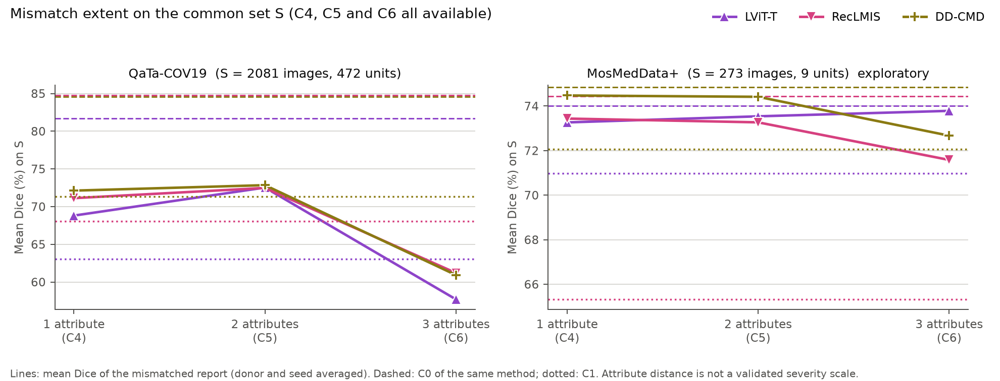
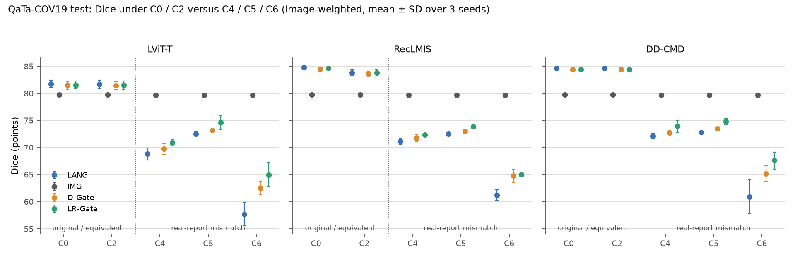
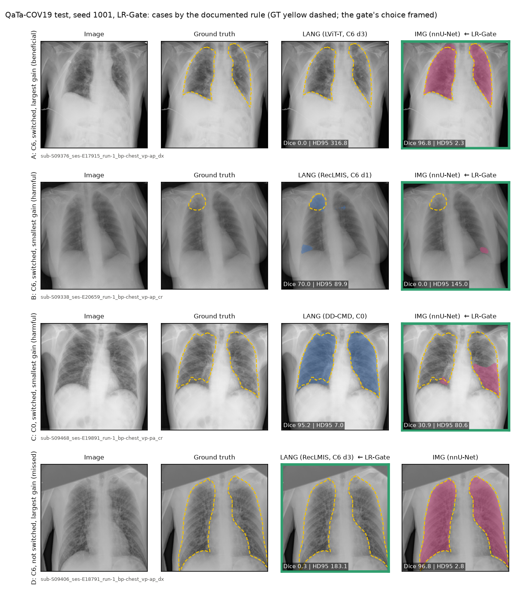

# Language-guided lesion segmentation when the report is wrong: summary of Phases 0–3

Status: 2026-11-02. Phases 0–3 are complete.

This document summarises the work so far. It adds no new analysis: every number is taken from the phase reports
listed in section 9, and each of those numbers was recomputed independently from the result files (section 7).
Dice is given in points (0–100).

## In one paragraph

Language-guided segmentation models read a short report together with the image. We asked what happens when
that report is missing or wrong.

- **Phases 0–1.** Three image-only and three language-guided models were trained under one common protocol on
  QaTa-COV19 (chest X-ray) and MosMedData+ (CT).
- **Phase 2.** The language-guided models were then tested, frozen, with controlled changes to their text. On
  QaTa-COV19, removing the report costs 12–20 Dice points. A fully mismatched report costs 23–24 points, more
  than no report. The harm comes almost entirely from the location in the report.
- **Phase 3.** A simple gate that falls back to nnU-Net when the two predictions disagree improves Dice under
  mismatched reports for all three models (9 of 9 significant). It costs 0.2–0.3 points under the correct
  report, but recovers only 11–33% of the oracle headroom. Whenever the report is wrong or missing, nnU-Net alone
  is better than the gate.
- **Protocol.** All test results come from protocols fixed before the test data were used, and were checked by an
  independent recomputation.

## 1. Research question and phases

| Phase | Question | Answer (test set) | Report |
|---|---|---|---|
| 0 | How good are image-only models under one common protocol? | QaTa: all three about 79–80; MosMed: U-Net 74.0 > nnU-Net 72.1 > TransUNet 69.4 | [PHASE0_SUMMARY.md](PHASE0_SUMMARY.md) |
| 1 | Are language-guided models better under the same protocol? | QaTa: yes (81.7–84.8 vs 79.2–79.7); MosMed: not consistently | [PHASE1_SUMMARY.md](PHASE1_SUMMARY.md) |
| 2 | Do the frozen models depend on their text, and what does a wrong report do? | Strongly on QaTa; a fully wrong report is worse than none; the location drives the harm | [PHASE2_RESULTS.md](PHASE2_RESULTS.md) |
| 3 | Can a reliability gate fall back to an image-only model when the text may be wrong? | It helps under wrong reports (9/9 significant) but recovers only 11–33% of the headroom | [PHASE3_RESULTS.md](PHASE3_RESULTS.md) |

## 2. Common setup

**Data.** LViT split and text annotations.
- QaTa-COV19: 5716 / 1429 / 2113 images (train / val / test); 474 patient units in the test set.
- MosMedData+: 2183 / 273 / 273 images; 9 CT-volume units in the test set.

**Models.**
- Image-only: U-Net, TransUNet, nnU-Net (2d).
- Language-guided: LViT-T, RecLMIS, DD-CMD.
- Each model was trained with seeds 1001–1003.

**Evaluation.**
- One common evaluator: 224 × 224, probability > 0.5, per-image Dice, mIoU, HD95, ASSD.
- Checkpoints were selected on validation only.

**Statistics.**
- Phases 0–1: paired tests on seed-averaged per-case Dice, with Holm correction.
- Phases 2–3: patient-level (QaTa) and volume-level (MosMed) units, 95% t-CIs, and Holm correction within
  pre-specified families.
- MosMedData+ is exploratory throughout, because it has few independent units.

**Test protection.**
- The analysis of each phase was fixed and pushed before its test evaluation.
- For Phases 2–3, both protocols were frozen together (commit b593d7f, 27 files with sha256). A lock program
  refused every test run until then.

## 3. Phases 0–1: baselines and reproductions

Test Dice, mean ± SD over 3 seeds.

| Method | Text | QaTa-COV19 | MosMedData+ |
|---|---|---|---|
| U-Net | no | 79.18 ± 0.22 | 74.01 ± 0.86 |
| TransUNet | no | 79.47 ± 0.41 | 69.43 ± 0.53 |
| nnU-Net | no | 79.72 ± 0.16 | 72.06 ± 0.84 |
| LViT-T | yes | 81.71 ± 0.69 | 61.26 ± 1.10 (batch-24 sensitivity run: 74.01 ± 1.11) |
| RecLMIS | yes | 84.77 ± 0.33 | 74.44 ± 1.00 |
| DD-CMD | yes | 84.64 ± 0.10 | 74.85 ± 0.53 |

- **QaTa-COV19.** RecLMIS and DD-CMD are level and best. LViT-T is significantly below them and significantly
  above the three image-only models.
- **MosMedData+.** DD-CMD, RecLMIS and U-Net are level. Language-guided models are therefore not consistently
  better than image-only ones.
- **Comparison with the papers.**
  - Phase 0: 5 of 6 image-only results are within 2 points of LViT Table II. U-Net on MosMedData+ is 9.4 points
    above the paper on average (8.6–10.3 in every seed); the cause is not confirmed.
  - Phase 1: our LViT-T is 1.95 points below its paper on QaTa, and RecLMIS 0.45 points below. DD-CMD's paper
    uses a pixel-pooled Dice, so its numbers are not directly comparable.
- **Problems found in the official code.**
  - RecLMIS silently switched off its main losses when a package was missing.
  - RecLMIS loaded the QaTa settings for MosMedData+.
  - LViT's released loader could not pair QaTa images and masks.
  - The LViT code and paper give different batch sizes and learning rates.
- **LViT-T on MosMedData+.** The pre-fixed setting (batch 2, learning rate 1e-3) gave 38–41 empty test
  predictions per seed. A post-hoc sensitivity run with batch 24 reached 74.01. This is descriptive only, and the
  main results are unchanged. Phases 2–3 use the batch-24 runs for this one model.

## 4. Phase 2: what does the text do? (counterfactual benchmark, frozen models)

The 18 frozen checkpoints were evaluated under nine text conditions.

| Condition | Text given to the model |
|---|---|
| C0 | the original report |
| C1 | empty text |
| C2 | equivalent wording (two word substitutions) |
| C3a / C3b / C3c | scope word / count clause / location clause deleted |
| C4 / C5 / C6 | a real report of another case that differs in exactly 1 / 2 / 3 of scope, count and location (3 donors per image) |

QaTa-COV19 test Dice (mean ± SD over 3 seeds; C3c–C6 on the 2081 eligible images):

| Method | C0 | C1 | C2 | C3a | C3b | C3c | C4 | C5 | C6 |
|---|---|---|---|---|---|---|---|---|---|
| LViT-T | 81.71 ± 0.69 | 63.05 ± 0.49 | 81.65 ± 0.75 | 70.75 ± 3.41 | 74.45 ± 2.48 | 70.78 ± 1.13 | 68.81 ± 1.09 | 72.53 ± 0.40 | 57.70 ± 2.15 |
| RecLMIS | 84.77 ± 0.33 | 68.03 ± 3.53 | 83.84 ± 0.52 | 84.32 ± 0.06 | 83.28 ± 1.00 | 72.66 ± 2.91 | 71.13 ± 0.51 | 72.48 ± 0.36 | 61.20 ± 1.02 |
| DD-CMD | 84.64 ± 0.10 | 71.30 ± 2.89 | 84.63 ± 0.09 | 83.57 ± 0.29 | 83.41 ± 0.29 | 62.53 ± 10.30 | 72.12 ± 0.49 | 72.85 ± 0.11 | 60.92 ± 3.11 |

Findings on QaTa-COV19. Differences are unit-weighted, with Holm correction across 11 comparisons per model.

1. **The models depend strongly on the text.** Removing it (C0 − C1) costs +12.35 to +20.13 points.
2. **A fully mismatched report is worse than no report.** C0 − C6 is +23.31 to +24.40. C1 − C6 is +3.12
   (LViT-T), +7.60 (RecLMIS) and +11.39 (DD-CMD), all significant.
3. **The harm follows the location.**
   - A location-only change costs 12.6–13.8 points; a count-only or scope-only change costs 0.1–1.1.
   - Deleting the location (C0 − C3c) costs +11.43 to +21.76.
   - The number of changed attributes does not order the harm: C5 hurts less than C4.
4. **Wording.** RecLMIS loses 1.25 [0.95, 1.55] points under equivalent wording. LViT-T (+0.08) and DD-CMD (+0.01)
   do not change significantly, although 99.0% and 99.4% of their masks change.
5. **What the models actually read.**
   - LViT-T uses only the first 10 word vectors of the report.
   - RecLMIS reads a CLIP context of 18 tokens (16 of text). In 101 of 1429 QaTa validation reports it cuts the
     last words even of the original report; in 81 of them this is only the final "lung".
   - The texts are templated: the 5716 QaTa training images have 273 distinct texts.
6. **Validation and test agree.**
   - Same sign in 31 of 33 comparisons and the same Holm decision in 30 of 33.
   - The three that differ are "partly wrong versus no text" comparisons. Their sign or size is not stable across
     the two splits.
7. **MosMedData+ (exploratory, 9 units).**
   - Mismatched reports have small effects: C0 − C6 is +0.11 to +2.95, and every CI includes 0.
   - Empty text gives a lower point estimate than any mismatched report.

*Lines: Dice under C4 / C5 / C6; dashed: C0; dotted: C1. On QaTa-COV19, C6 falls below the empty text for all three
models.*

## 5. Phase 3: falling back to an image-only model (frozen gates)

**Design.** For each image, a gate chooses between the language-guided prediction (LANG) and nnU-Net (IMG).
- D-Gate thresholds one disagreement feature.
- LR-Gate is a logistic regression on five features of the two probability maps.
- Both were fitted and calibrated on QaTa validation only, with the constraint "lose at most 0.5 points under
  C0 / C2" on the calibration part.
- On MosMedData+ the QaTa gates were applied unchanged.

QaTa-COV19 test Dice. ORACLE picks the better of LANG and IMG per image using the ground truth; it is a reference,
not a method.

| Method | Text | LANG | D-Gate | LR-Gate | IMG (nnU-Net) | ORACLE |
|---|---|---|---|---|---|---|
| LViT-T | C0 | 81.71 | 81.48 | 81.54 | 79.72 | 84.98 |
| LViT-T | C6 | 57.70 | 62.54 | 64.95 | 79.66 | 80.96 |
| RecLMIS | C0 | 84.77 | 84.48 | 84.63 | 79.72 | 86.38 |
| RecLMIS | C6 | 61.20 | 64.79 | 65.04 | 79.66 | 81.14 |
| DD-CMD | C0 | 84.64 | 84.41 | 84.39 | 79.72 | 86.17 |
| DD-CMD | C6 | 60.92 | 65.16 | 67.60 | 79.66 | 81.16 |

Findings. Differences are group-weighted over 472–474 patients, with 95% t-CIs.

1. **Primary family: LR-Gate − LANG under C4–C6.** All 9 are significant after Holm, +1.36 to +6.53 points.
2. **Secondary family: LR-Gate − D-Gate.** All 9 are significant, +0.76 to +2.68.
3. **Cost under the correct report (C0 / C2): −0.17 to −0.30 points.**
   - D-Gate keeps the −0.5 margin in 6 of 6 cells.
   - LR-Gate keeps it in 4 of 6. For LViT-T, the CI lower bounds for C0 and C2 are −0.56 and −0.52.
   - The margin had already been exceeded on GATE_FIT before the freeze. This was reported, and the gates were
     kept as specified.
4. **Limits.**
   - LR-Gate recovers only 11.1–33.0% of the oracle headroom (D-Gate 5.2–20.9%).
   - Under C1 and C4–C6, nnU-Net alone is 4.85–17.12 points above either gate.
   - Under C0 / C2, nnU-Net alone is 1.93–5.04 points below LANG.
   - The gate is therefore a compromise for the case where it is not known whether the report is correct.
5. **Missing location (C3c, withheld from fitting).** LR-Gate − LANG is +0.72, +0.66 and +3.45 (DD-CMD).
6. **MosMedData+ (exploratory).**
   - The QaTa gates almost never switch: 0–2.1% of the rows.
   - They change Dice by at most 0.63 points, although the oracle headroom is 1.90–8.92 points.
7. **Cost.** A gate runs both models: 53.6–83.3 ms per image against 19.8–50.2 ms for LANG alone (1.7–2.8 times),
   and +80 to +82 MB of GPU memory.

The case figure below shows real cases chosen by a fixed rule (QaTa test, seed 1001, LR-Gate):
- A: the largest gain from a switch;
- B: the largest loss from a switch;
- C: the largest loss from a switch under the original report;
- D: the largest gain that was missed.

## 6. Main findings

1. Under one common protocol, language-guided models are better than image-only ones on QaTa-COV19 (by 2–5
   points over nnU-Net) but not consistently on MosMedData+.
2. On QaTa-COV19 the frozen models depend strongly on their text. A fully mismatched report costs more than no
   report (23–24 versus 12–20 points).
3. The harm comes almost entirely from the location in the report. Scope and count barely matter, and the
   number of changed attributes does not order the harm.
4. A post-hoc gate between the language-guided model and nnU-Net reduces the harm significantly at a small cost
   under the correct report. It recovers only a minority of what is possible: when the report is wrong or
   missing, nnU-Net alone is better.
5. On MosMedData+ the text matters much less, and the QaTa gate does not transfer (exploratory).

## 7. How the results were protected and checked

- **Pre-specified analysis.**
  - Phases 0–1: fixed and pushed before the test evaluation.
  - Phases 2–3: both protocols frozen together before any counterfactual test run (commit b593d7f). Test runs
    were possible only through a lock program.
  - Each pre-specified analysis was run once, unchanged.
- **Independent recomputation.** Every reported test number was recomputed from the per-case result files with
  separate code.
  - Phase 2: 0 differences in 1602 checks of the main table and comparisons, and in 294 further checks.
  - Phase 3: 0 differences in 14,373,709 checks, including the gate decisions recomputed from the frozen
    parameters.
- **Recorded rather than hidden.**
  - The Phase 1 clean test results were seen before the freeze.
  - One `git fetch` failed on a compute node; the lock allows this by design.
  - Two label errors are in figure titles of the frozen Phase 2 code: "validation" in the test case figures, and
    "11 units" instead of 9 in two MosMed panels.
  - The first cost measurement (job 379) was withdrawn as a measurement artifact.

## 8. Limitations

- **Constructed text errors.** C2–C6 are benchmark constructions. C4–C6 swap real reports of other cases, and
  real report errors may look different. The texts are templated.
- **MosMedData+ is exploratory.**
  - It has 9 test units.
  - Its split is by slice, so some CT volumes have slices in both training and test.
- **Model coverage.** Three language-guided models and one image-only fallback (nnU-Net) were used, with one
  checkpoint per seed. The results describe these models, not text-guided segmentation in general.
- **Model-specific caveats.**
  - LViT-T's text encoder was re-implemented in PyTorch, because the original MXNet one does not run on our
    cluster. It could not be compared with the original.
  - On MosMedData+, Phases 2–3 use the post-hoc batch-24 LViT-T runs.
- **The LR-Gate is not interpretable feature by feature.** Its coefficients change sign across seeds, because
  three of its features are collinear.

## 9. Open questions raised by the results (for discussion, not results)

- **Why the gates fall short.** The gates decide only from the two predictions and never read the report.
  - On validation, the current gate signals separate the original reports from fully mismatched ones only
    moderately (AUROC 0.68–0.76).
  - Would a signal of whether the report fits the image do better? Two possible signals:
    - the stated location compared with the location found by nnU-Net;
    - a classifier trained on real versus swapped reports.
- **Do the findings hold for real report errors?** For example, reports with a wrong side or wrong zone, rather
  than reports swapped between cases.

## 10. Reports and files

- Phase 0: [PHASE0_SUMMARY.md](PHASE0_SUMMARY.md), [PHASE0_RESULTS.md](PHASE0_RESULTS.md)
- Phase 1: [PHASE1_SUMMARY.md](PHASE1_SUMMARY.md), [PHASE1_RESULTS.md](PHASE1_RESULTS.md),
  [PHASE1_SENSITIVITY_LVIT.md](PHASE1_SENSITIVITY_LVIT.md)
- Phase 2: [PHASE2_VALIDATION_SUMMARY.md](PHASE2_VALIDATION_SUMMARY.md), [PHASE2_RESULTS.md](PHASE2_RESULTS.md)
  (test), protocol [PHASE2_PROTOCOL.md](PHASE2_PROTOCOL.md) and freeze
  [PHASE2_PROTOCOL_FREEZE.md](PHASE2_PROTOCOL_FREEZE.md)
- Phase 3: [PHASE3_SETUP.md](PHASE3_SETUP.md) (validation development), [PHASE3_RESULTS.md](PHASE3_RESULTS.md)
  (test), freeze [PHASE3_PROTOCOL_FREEZE.md](PHASE3_PROTOCOL_FREEZE.md)
- Lessons learned: [RESEARCH_LEARNING_LOG.md](RESEARCH_LEARNING_LOG.md)
